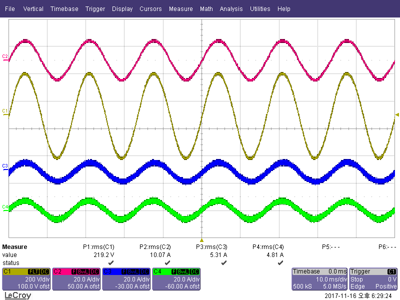
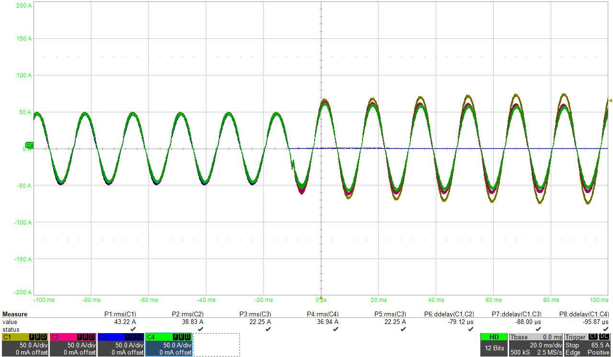

# UPS 병렬운전과 순환전류 억제

## 왜 병렬운전 제어가 따로 필요했나

UPS를 여러 대 묶으면 용량을 늘리고 운전 중 한 대를 분리·투입할 수 있다. 대신 각
인버터의 전압 지령, PWM carrier, 계측 오차가 조금만 달라도 순환전류가 생긴다. 이
문제는 출력전압만 보면 잘 보이지 않아, 모듈별 인덕터 전류와 전류 분담 오차를 먼저
봤다.

## 적용한 제어 방식

각 모듈에는 같은 전압-전류 이중루프를 두고, 모듈 사이 전류 분담을 위한 보상 경로를
추가했다. 검토한 방식은 평균전류분담(ALS)과 Circular Chain Control(3C)이었다.

| 항목 | ALS | 3C |
|---|---|---|
| 전류 분담 기준 | 각 모듈 전류의 평균값 | 인접 모듈 전류를 연결한 환형 구조 |
| 장점 | 전류 분담 기준이 직관적 | 별도 master/slave 의존성을 낮출 수 있음 |
| 설계 시 확인점 | 모듈 수, 평균값 전달 지연 | 연결 순서, 통신 지연, 한 모듈 이탈 시 동작 |

전류 분담 보상을 넣은 뒤에도 순환전류가 남았다. PWM carrier 시간 오차는 고주파
순환전류로, 전압 지령의 위상 오차는 저주파 순환전류로 나타났다. 그래서 제어기 gain과
별도로 PWM 동기와 위상 동기를 관리했다.

## 파형으로 확인한 것

*2대 병렬 정상상태. C1 출력전압 219.2 Vrms, C2 부하전류 10.07 A, C3·C4 모듈 전류
5.31 A·4.81 A. 두 모듈 합 10.12 A가 부하전류와 맞고, 분담 편차는 평균 대비 약 ±5 %다.*

*운전 중 모듈 1대 분리(C1~C4 모듈 전류, 50 A/div). −10 ms 부근에서 C3 전류가 0이 되고, 나머지 세 모듈이 부하를
나눠 받는다(분리 전 각 약 48 A peak → 분리 후 약 57~74 A peak, 합계는 거의 같다).
이 ±100 ms 화면 안에서는 C1이 가장 많이 받고 있어, 재균형이 끝나는 시점은 이 캡처
범위 밖이다.*

시험은 평형·비선형·불평형 부하, 부하 급변, 정전 전환, hot-swap/hot-plug 순서로
진행했다. 4대 병렬 조건에서는 정상상태 RMS 분담 오차와 과도 중 최대 편차를
나누어 기록했다. 통신이 끊기는 경우의 fallback과 모듈 이탈 시 전류 지령 재분배도
같은 시나리오에서 확인했다.

## 정리

병렬 문제를 볼 때 확인 순서: PWM 동기 → 전압 지령 위상 → 통신 지연 → 모듈
투입·이탈 순서 → 분담 보상 gain.

> 통신 프레임, 제어 파라미터, 원본 시험 파일은 싣지 않았다.
