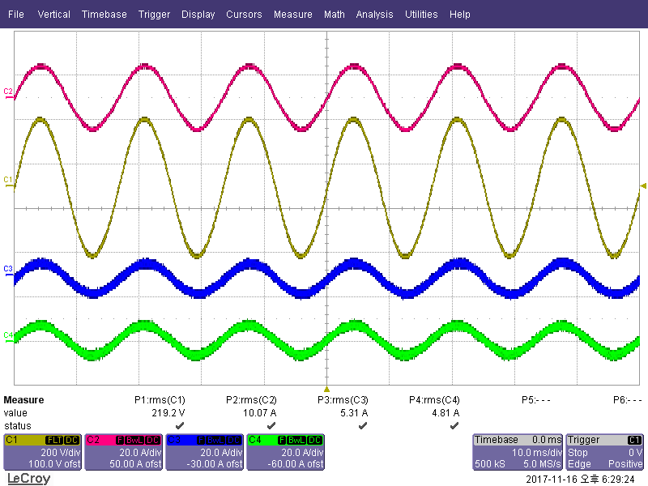

# UPS 병렬운전 제어

3레벨 UPS 인버터의 출력전압 제어와 병렬운전 전류 분담을 설계하고, 부하 투입·운전 중 모듈 분리 시험으로 확인했습니다.

| 항목 | 내용 |
|---|---|
| 기간 | ✏️ |
| 역할 | ✏️ (예: 출력전압·병렬 제어 알고리즘 설계, DSP 구현, 시험) |
| 개발 환경 | ✏️ (DSP, 개발 툴, 계측 장비) |
| 키워드 | 3레벨 인버터, 전압·전류 이중루프, 부하전류 전향 보상, ALS·3C, 순환전류 |

## 1. 문제

- 저항 부하에서는 출력전압이 잘 나와도, 정류기 부하나 한 상에만 걸린 부하에서는 같은 PI gain으로 전압 처짐과 회복이 달라졌습니다.
- 여러 대를 병렬로 묶으면 전압 지령·PWM carrier·계측 오차가 조금만 달라도 모듈 사이에 순환전류가 생겼습니다.

## 2. 접근

**출력전압 제어**
- 전압 외부루프 + 전류 내부루프 구조에서, 내부루프에 넣는 전류를 인덕터 전류와 커패시터 전류로 나눠 비교했습니다.
- 부하전류를 전향 보상으로 넣어, 전압루프가 부하 변화를 뒤늦게 쫓아가는 부분을 줄였습니다.

**병렬운전**
- 평균전류분담(ALS)과 Circular Chain Control(3C)을 비교했습니다.
- 분담 보상과 별도로 PWM carrier 동기와 전압 지령 위상 동기를 관리했습니다.

## 3. 검증

1. 선형 부하에서 전압·전류 루프 기본 안정성
2. 단상 불평형·비선형 부하에서 상별 전압 변형
3. 부하를 단계적으로 바꿀 때 전압 피크와 회복 시간
4. 병렬: 평형·비선형·불평형 부하 → 부하 급변 → 정전 전환 → hot-swap/hot-plug 순서 (4대 병렬 포함)

## 4. 결과

| 시험 | 결과 | 캡처 |
|---|---|---|
| 2대 병렬 정상상태 | 모듈 전류 5.31 A / 4.81 A, 합 10.12 A(부하전류 10.07 A), 분담 편차 약 ±5 % | 위 그림 |
| 부하 투입 | 분담 전류 약 ±10 A → ±25 A, 출력전압 진폭은 다음 주기에도 유지 | [그림](./01_시험_캡처/02_부하_투입.png) |
| 운전 중 모듈 분리 | C3 분리 후 나머지 세 모듈이 부하를 이어받음(합계 유지). 분담이 다시 고르게 되는 구간은 캡처 범위 밖 | [그림](./01_시험_캡처/03_모듈_분리.png) |

✏️ 공개 가능한 정량 결과 추가 (예: 전향 보상 전후 전압 처짐 %, 순환전류 저감률, 4대 병렬 RMS 분담 오차)

## 5. 트러블슈팅

| 문제 | 원인 | 해결 |
|---|---|---|
| 불평형·비선형 부하에서 전압 처짐이 큼 | 피드백 전류 위치와 출력 임피던스 | 커패시터 전류 피드백 + 부하전류 전향 보상 |
| 부하전류 측정 노이즈가 보상 경로로 들어가면 PWM 지령이 거칠어질 수 있음 | 측정 신호를 그대로 전향 보상에 사용 | 보상 신호의 부호·스케일과 필터 지연을 따로 맞춤 |
| 분담 보상을 넣은 뒤에도 순환전류가 남음 | PWM carrier 시간 오차(고주파), 전압 지령 위상 오차(저주파) | PWM 동기와 위상 동기를 gain과 별도로 관리 |

✏️ 추가 사례

## 6. 상세 기록

- [출력전압 제어와 부하전류 보상](./02_설계_기록/01_출력전압_제어와_부하전류_보상.md)
- [병렬운전과 순환전류 억제](./02_설계_기록/02_병렬운전과_순환전류_억제.md)

---

회로 정수, 제어 파라미터, 통신 프레임, 고객·사이트 정보는 싣지 않았습니다.
