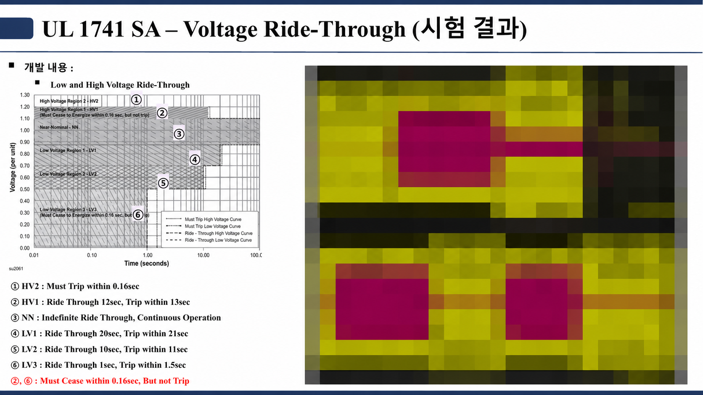

# ESS 계통연계 HILS 검증

ESS PCS의 계통연계 기능을 UL 1741 SA 항목 기준으로 HILS에서 시험했습니다. 제어 보드를 실제 I/O·PWM으로 HILS에 연결해, 실장비 시험 전에 시퀀스와 제어 알고리즘을 확인했습니다.

| 항목 | 내용 |
|---|---|
| 기간 | ✏️ |
| 역할 | ✏️ (예: 계통연계 기능 구현, HILS 시나리오 작성, 시험) |
| 개발 환경 | ✏️ (HILS 장비, 제어 보드, 툴) |
| 키워드 | UL 1741 SA, Ride-Through, Ramp Rate, Anti-Islanding, Volt-Var/Volt-Watt, HILS |

## 1. 문제

계통연계 기능은 전압 급변, 주파수 변화, 정전·재연계, 보호 동작이 겹치는 조건을 요구합니다. 실제 전력 장비에서 처음 돌리면 문제가 생겼을 때 원인을 나누기 어렵습니다.

## 2. 접근

- HILS 모델에 전력변환기와 계통 조건을 넣고, 제어 보드는 실제 I/O·PWM으로 연결했습니다.
- 모델 정밀도보다 센서 스케일, I/O 지연, 보호 입력 우선순위, 모드 전환 순서를 실제 제어기와 먼저 맞췄습니다.
- 곡선형 기능(Volt-Watt 등)은 시작점·종료점·중간값, 상승·하강 방향을 나눠 시험했습니다.
- 기능별 시험 뒤에는 보호 동작과 운전 모드가 겹치는 조합(계통 이상 중 지령 변경, 재연계 대기 중 지령 입력)을 반복했습니다.

## 3. 검증 항목

| 항목 | 시험 조건 (슬라이드 기준) | 확인한 것 |
|---|---|---|
| 충·방전 전력 제어 | 충·방전 정격 전력, R상 기준 | 충전·대기·방전 전환과 전력 방향 |
| Ramp Rate | 정상 ramp-up 50~100 %Irated/s, soft-start 10~20 %Irated/s | 지령 변화율과 출력 추종 |
| Voltage Ride-Through | HV2 0.16 s 이내 trip, HV1 12 s·LV1 20 s·LV2 10 s·LV3 1 s 유지 후 trip | 영역별 운전 유지·출력 정지·복귀 |
| Frequency Ride-Through | HF2·LF2 0.16 s 이내 trip, HF1·LF1 299 s 유지 후 300 s 이내 trip | 영역별 상태 전이와 전력 회복 |
| Anti-Islanding | S3 개방 후 2 s 이내 출력 정지 (IEEE 1547-2003 / 1547a-2014) | 단독운전 검출과 출력 정지 |

시험마다 초기 모드, 계통 조건, 지령값, 보호 설정 상태를 한 세트로 기록했고, 로직을 고치면 같은 시나리오를 다시 돌려 변경 전후를 비교했습니다.

## 4. 결과

| 항목 | 캡처 |
|---|---|
| 충·방전 전력 제어 | [그림](./01_시험_캡처/01_충방전_전력제어.png) |
| Ramp Rate | [그림](./01_시험_캡처/02_Ramp_Rate.png) |
| Voltage Ride-Through | 위 그림 |
| Frequency Ride-Through | [그림](./01_시험_캡처/04_주파수_Ride-Through.png) |
| Anti-Islanding | [그림](./01_시험_캡처/05_Anti-Islanding.png) |

✏️ 공개 가능한 정량 결과 추가 (예: 항목별 통과 여부, 단독운전 검출 시간 실측값, trip 시간 실측값)

슬라이드의 영역·시간 값은 UL 1741 SA 기준입니다. 현재 미국 인증은 IEEE 1547-2018 / 1547.1-2020 기반 UL 1741 SB로 바뀌었습니다.

## 5. 트러블슈팅

| 문제 | 원인 | 해결 |
|---|---|---|
| 저전압 구간에서 Volt-Watt 출력이 기대값과 다를 수 있음 | 정격 유효전력을 요구하면 전류 제한에 먼저 걸림 | 전류 제한 진입 조건을 따로 시험하고 결과에 원인을 표기 |
| 단일 기능 시험으로는 보호·모드 전환이 겹치는 순서를 확인할 수 없음 | 기능별 시나리오만 사용 | 계통 이상 중 지령 변경, 재연계 대기 중 지령 입력 같은 조합을 HILS에서 반복 |

✏️ 실제로 찾아낸 버그와 수정 사례 추가

## 6. 상세 기록

- [HILS 기반 계통연계 기능 검증](./02_설계_기록/01_HILS_계통연계_기능검증.md)

---

계측 파형은 모자이크 처리했습니다. 사이트 구성, 배터리 용량, 보호 설정값, 고객·제품 정보는 싣지 않았습니다.
