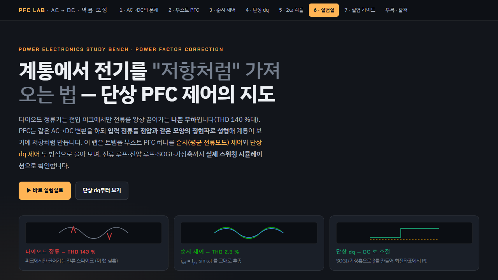
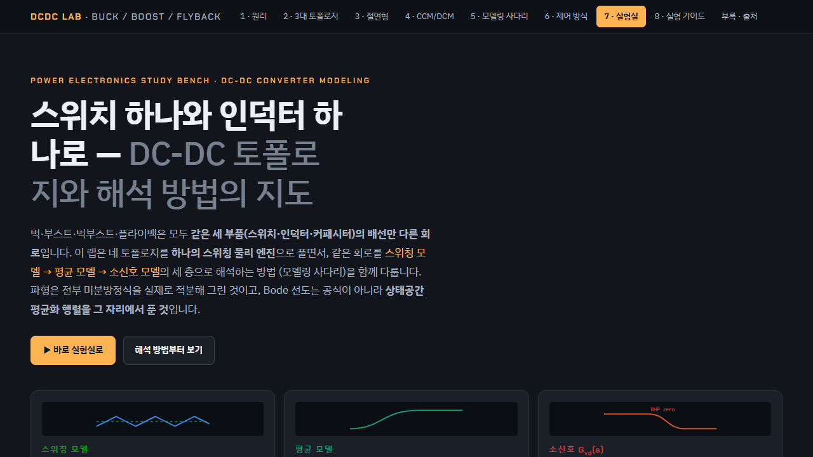
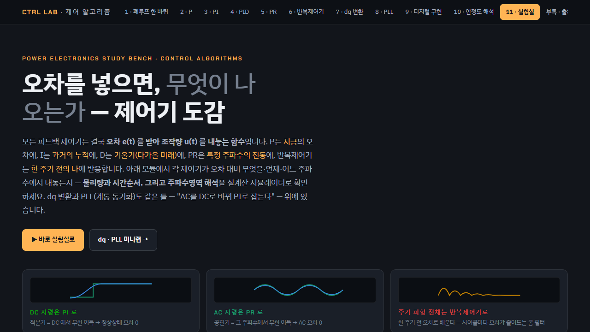

# OBC 전력단·운전모드

차량 탑재 충전기(OBC)의 AC-DC·절연 DC-DC 전력 경로를 나누고, G2V·V2G·V2L 운전에서 상태 전이와 보호 조건을 정리했습니다.

✏️ 대표 그림 (직접 그린 블록도나 직접 돌린 시뮬레이션 파형)

| 항목 | 내용 |
|---|---|
| 기간 | ✏️ |
| 역할 | ✏️ |
| 개발 환경 | ✏️ (모델링 툴, 코드 생성, 제어보드) |
| 키워드 | 양방향 OBC, PFC, 절연형 DC-DC, G2V·V2G·V2L, 상태 전이, 보호 |

## 1. 문제

✏️ 이 프로젝트에서 풀어야 했던 문제 (예: V2G 추가로 늘어난 운전 모드와 보호 조건을 어떻게 검증할지)

## 2. 접근

**전력 경로**

| 단계 | 역할 | 확인 항목 |
|---|---|---|
| AC 입력·EMI 필터 | 외부 전원 입력, 전도성 노이즈 경로 | 입력 조건, 보호, 필터 경계 |
| PFC | 입력 전류 정형, DC Link 전압 형성 | 입력 전압·주파수, 역률, DC Link 상태 |
| 절연형 DC-DC | 절연, 전압 변환, 배터리 충전 전류 제어 | 절연 경계, 전압 범위, 전류 제한 |
| 고전압 배터리 | 충전 에너지 저장, 양방향 운전 시 전력원 | 배터리 제한, 충전·방전 허용 상태 |

**운전 모드별 확인**
- 충전·방전·대기·보호 동작을 상태 전이와 인터페이스 조건으로 나눠, 입력 신호와 출력 동작의 대응을 검토했습니다.
- V2G: 계통 확인 → 동기 → 전력 공급 → 이상 정지 → 재기동 조건을 시나리오별로 확인했습니다.
- V2L: 외부 부하의 기동 전류, 전압 강하, 보호 동작과 정지 조건을 확인했습니다.
- 모델 → 생성 코드 → 제어보드 순으로 동작을 비교하고, 변경 후에는 같은 보호 시나리오로 회귀 시험했습니다.

## 3. 검증

✏️ 시험 환경과 시나리오 (예: MIL/SIL/HIL 단계, 시나리오 수)

## 4. 결과

✏️ 공개 가능한 결과 (예: 모드 전환 시간, 보호 동작 시간, 회귀 시험 결과)

**학습 화면 (참고)**

차량 OBC 시험 캡처가 아니라, 전력단을 공부하면서 쓴 시뮬레이션 화면입니다.

| PFC | 절연형 DC/DC | 제어 알고리즘 |
|---|---|---|
|  |  |  |
| 토템폴 PFC 순시 제어 vs 단상 dq 제어, 입력 전류 THD 143 % → 2.3 % | DC Link에서 배터리 전압 범위로의 절연 변환 | 상태·전류·전압 제어 루프의 관계 |

## 5. 트러블슈팅

✏️ 문제 · 원인 · 해결

---

차량 회로, 제어 파라미터, 통신 시퀀스, 측정 로그, 고객·차종 정보는 싣지 않았습니다.
