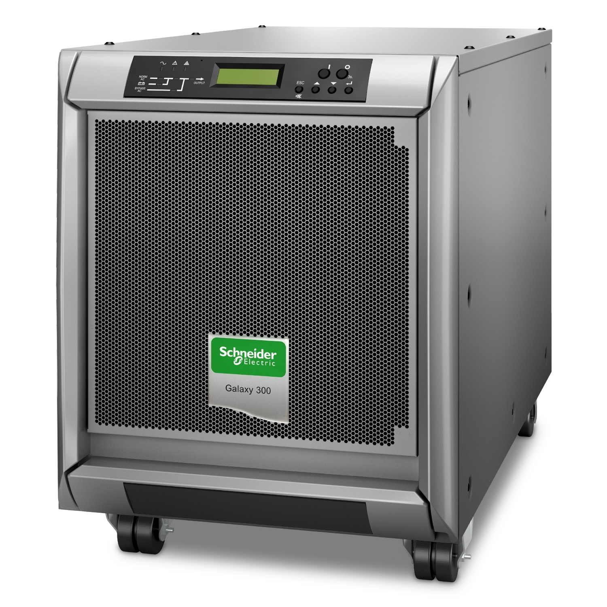
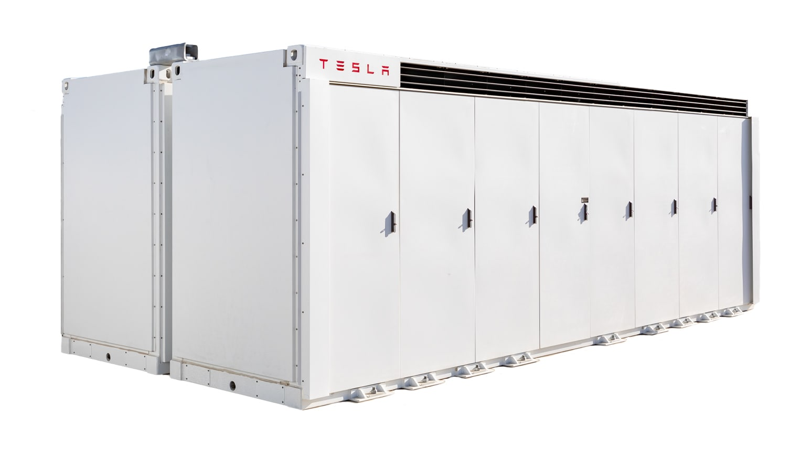
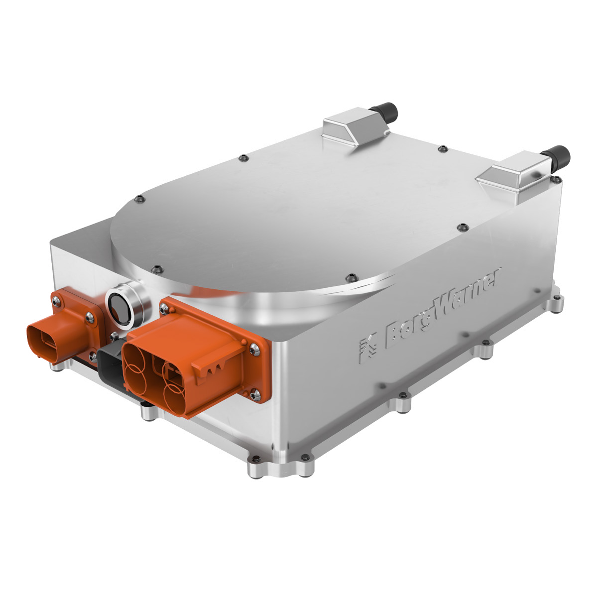
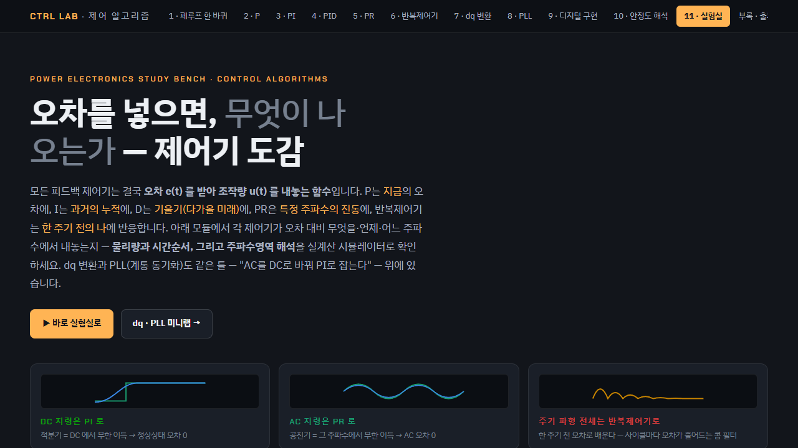

# 전력변환 포트폴리오

UPS, ESS, OBC 개발·검증 경험과 전력전자 학습 기록을 공개 가능한 범위에서 정리한 저장소입니다. 각 문서는 시스템 구성, 전력 흐름, 운전 조건, 검증 관점을 중심으로 읽을 수 있으며 고객·제품 식별 정보, 제어 파라미터, 원본 시험 데이터는 포함하지 않습니다.

<table>
  <tr>
    <td width="50%" valign="top">
      <a href="./portfolio/UPS/README.md"></a><br>
      <strong><a href="./portfolio/UPS/README.md">UPS</a></strong><br>
      정전 시 부하를 유지하기 위한 오프라인·라인 인터랙티브·온라인 UPS의 구성과 운전 방식, 절체·정류·인버터 검증 관점
    </td>
    <td width="50%" valign="top">
      <a href="./portfolio/ESS/README.md"></a><br>
      <strong><a href="./portfolio/ESS/README.md">ESS</a></strong><br>
      배터리, BMS, PCS, 계통 연계가 연결된 에너지저장시스템의 전력 흐름과 보호·운전 상태 검토
    </td>
  </tr>
  <tr>
    <td width="50%" valign="top">
      <a href="./portfolio/OBC/README.md"></a><br>
      <strong><a href="./portfolio/OBC/README.md">OBC</a></strong><br>
      차량 탑재 충전기의 AC-DC·절연 DC-DC 구조와 G2V·V2L·V2G·ESS 전력 흐름 검토
    </td>
    <td width="50%" valign="top">
      <a href="./AI_Engineering/README.md"></a><br>
      <strong><a href="./AI_Engineering/README.md">전력전자 랩</a></strong><br>
      제어 이론과 전력변환 토폴로지를 수식, 파형, 시뮬레이션 관점에서 정리한 학습 기록과 작업 환경
    </td>
  </tr>
</table>

## 페이지별 내용

| 구분 | GitHub에서 읽을 내용 | 문서 |
| --- | --- | --- |
| UPS | 전원 이상 시 전력 경로, UPS 방식별 차이, 검증 시 확인할 입력·출력·절체 조건 | [README](./portfolio/UPS/README.md) · [HTML 문서](./portfolio/UPS/index.html) |
| ESS | 배터리·BMS·PCS·계통의 역할, 충·방전 전력 흐름, 보호와 상태 전이 관점 | [README](./portfolio/ESS/README.md) · [HTML 문서](./portfolio/ESS/index.html) |
| OBC | PFC와 절연형 DC-DC 단계, V2G·V2L·ESS 연계 시 양방향 전력 흐름 | [README](./portfolio/OBC/README.md) · [HTML 문서](./portfolio/OBC/index.html) |
| 전력전자 랩 | 제어 알고리즘, DC-DC, PFC, DAB, SRDAB, LLC/CLLC 학습 화면과 공개 오픈소스 설정 출처 | [README](./AI_Engineering/README.md) |

## 읽는 기준

- 폴더를 열면 먼저 각 폴더의 `README.md`에서 구조와 범위를 확인할 수 있습니다.
- `index.html`은 다이어그램과 이미지를 포함한 페이지 원본입니다.
- 제품 이미지는 공개 제품 이해를 돕기 위한 예시이며, 업무 수행 제품 또는 고객 정보를 의미하지 않습니다.
- 포트폴리오에는 일반화한 구조와 검증 관점만 수록합니다. 내부 회로, 보정값, 시험 로그, 고객·제품 식별 정보는 제외합니다.

## 저장소 구조

```text
Portfolio_WorkSpace/
├─ portfolio/
│  ├─ UPS/                 # 무정전전원장치
│  ├─ ESS/                 # 에너지저장시스템
│  └─ OBC/                 # 차량 탑재 충전기
├─ AI_Engineering/         # 전력전자 랩, 공개 스킬·설정·명령 문서
├─ assets/                 # 제품·랩 화면·검증 사례 이미지 아카이브
└─ studies/                # 전공학습의 영역별 인덱스와 학습 기록
```

## 하위 아카이브 안내

### AI_Engineering · 전력전자 랩과 작업 환경

이 폴더는 화면 캡처를 모아 둔 위치가 아니라, 전력전자 학습 화면·공개 스킬 원본·로컬 작업 절차를 분리해 둔 작업 아카이브입니다. 폴더를 열면 아래 문서부터 읽으면 됩니다.

| 하위 페이지 | 확인할 내용 | 바로가기 |
| --- | --- | --- |
| 전력전자 랩 | 제어 알고리즘, DC-DC, PFC, DAB·SRDAB, LLC·CLLC 화면과 수식 자료의 범위 | [AI_Engineering README](./AI_Engineering/README.md) |
| 작업 명령 | 랩 증거 캡처와 공개 전 최종 점검에 사용하는 명령 문서 | [commands README](./AI_Engineering/commands/README.md) |
| 로컬 스킬 설정 | 리서치·문서 읽기·검토·시각 QA·공개 전 점검에 연결된 스킬과 훅 | [.codex README](./AI_Engineering/.codex/README.md) |
| 플러그인 연결 | 이 저장소에서 참조하는 플러그인 매니페스트와 스킬 경로 | [.codex-plugin README](./AI_Engineering/.codex-plugin/README.md) |
| 공개 저장소 출처 | 스킬·명령·에이전트 설정을 어떤 공개 저장소에서 확인했는지와 라이선스 범위 | [open-source README](./AI_Engineering/open-source/README.md) |
| 원본 라이브러리 | 포함된 `claude-skills` 원본의 구조와 원본 문서 | [원본 README](./AI_Engineering/claude-skills/README.md) |

### assets · 이미지와 검증 자료

이미지는 폴더만 보고 용도를 추측하지 않도록 세 갈래로 분리했습니다. 각 하위 README에는 이미지의 쓰임과 연결된 본문 페이지를 적었습니다.

| 하위 페이지 | 보관 내용 | 바로가기 |
| --- | --- | --- |
| 제품 이미지 | UPS·ESS·OBC 공개 제품 예시와 연결된 포트폴리오 문서 | [products README](./assets/products/README.md) |
| 전력전자 랩 | 제어·DC-DC·PFC·DAB·SRDAB·LLC의 개요·랩·수식 이미지 목록 | [labs README](./assets/labs/README.md) |
| 검증 포트폴리오 | ESS 계통연계와 UPS 검증 사례의 공개용 정리 | [portfolio README](./assets/portfolio/README.md) |

### studies · 전공학습 기록

전공학습은 참고 문헌을 기반으로 작성한 본문과, 아직 학습 내용을 채우지 않은 주제 폴더를 구분합니다. 비어 있는 폴더에는 학습 본문을 임의로 추가하지 않고, 학습 범위와 작성 전 확인할 기준만 표시합니다.

| 하위 페이지 | 확인할 내용 | 바로가기 |
| --- | --- | --- |
| 학습 전체 지도 | 열 개 영역의 현재 자료 상태, 선수 관계, 작성 원칙 | [studies README](./studies/README.md) |
| 전공학습 인덱스 | 기초 회로·제어·전력변환·전동화까지 이어지는 상세 카테고리 | [전공학습 README](./studies/전공학습/README.md) |
| 전기전자 핵심기초 | 회로이론·전자기학·전자회로·논리회로·신호와 시스템의 세부 단원 | [핵심기초 README](./studies/전공학습/01_전기전자_핵심기초/README.md) |
| 제어시스템 설계 | 노트·참고자료·프로젝트 폴더를 분리한 제어 학습 기록 | [제어시스템 README](./studies/전공학습/02_제어시스템_설계/README.md) |
