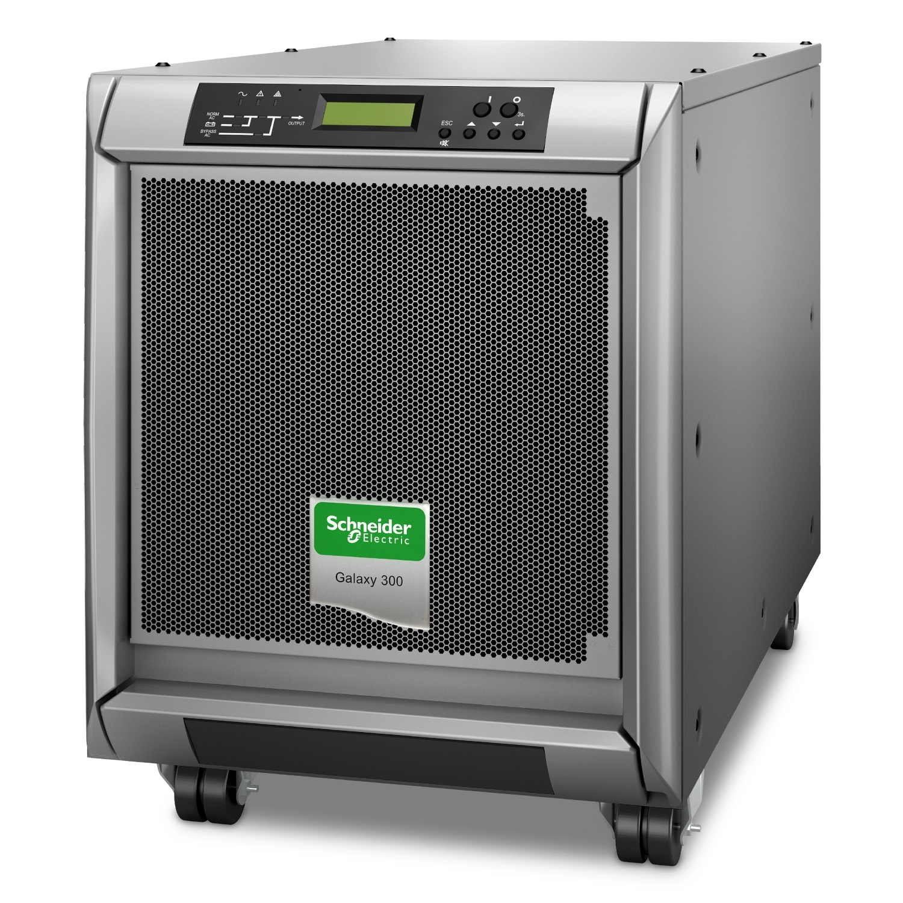
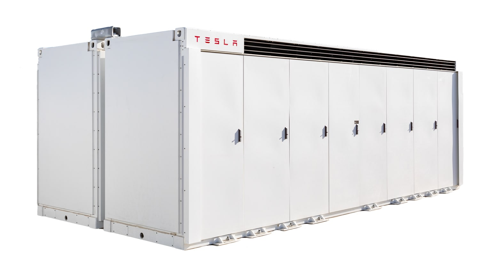
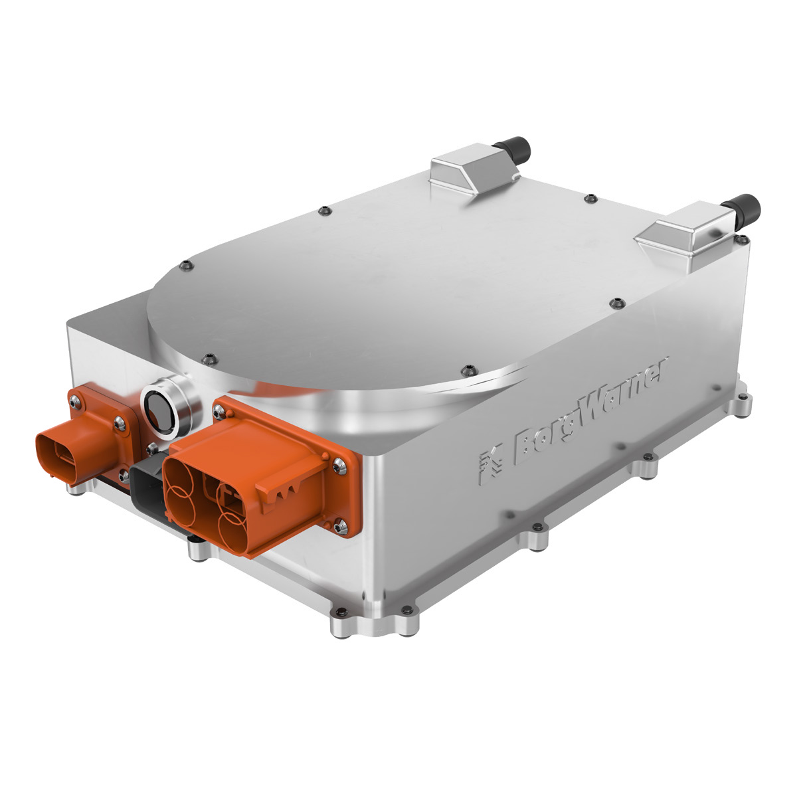

# 공개 제품 이미지

이 폴더의 이미지는 UPS·ESS·OBC 시스템을 설명하기 위한 공개 제품 예시입니다. 포트폴리오의 실제 수행 제품이나 고객 정보를 나타내지 않으며, 사양 비교의 근거로 사용하지 않습니다.

| 분야 | 이미지 | 연결된 설명 |
| --- | --- | --- |
| UPS |  | [UPS 시스템 문서](../../portfolio/UPS/README.md) |
| ESS |  | [ESS 시스템 문서](../../portfolio/ESS/README.md) |
| OBC |  | [OBC 시스템 문서](../../portfolio/OBC/README.md) |

각 이미지를 누르면 원본 크기 파일을 확인할 수 있습니다. 제품의 구조·전력 흐름·검증 관점은 이미지가 아니라 연결된 분야 README에서 읽습니다.
