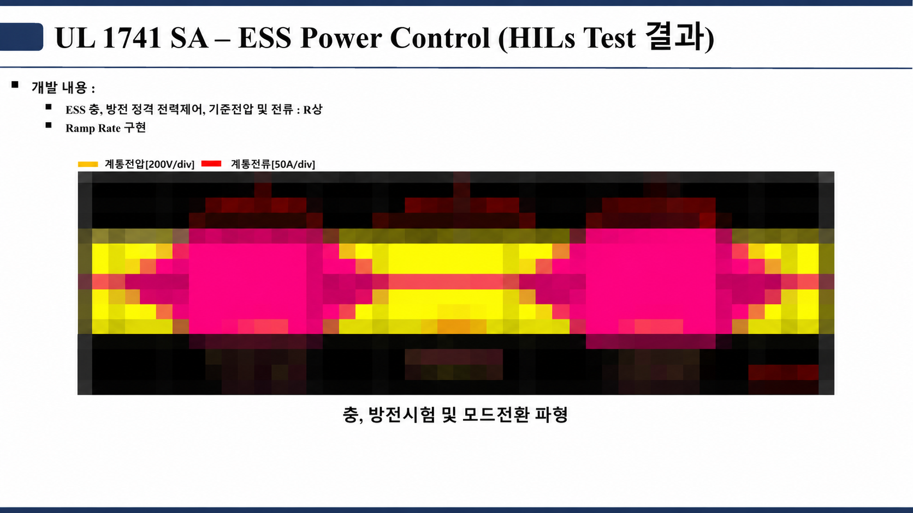
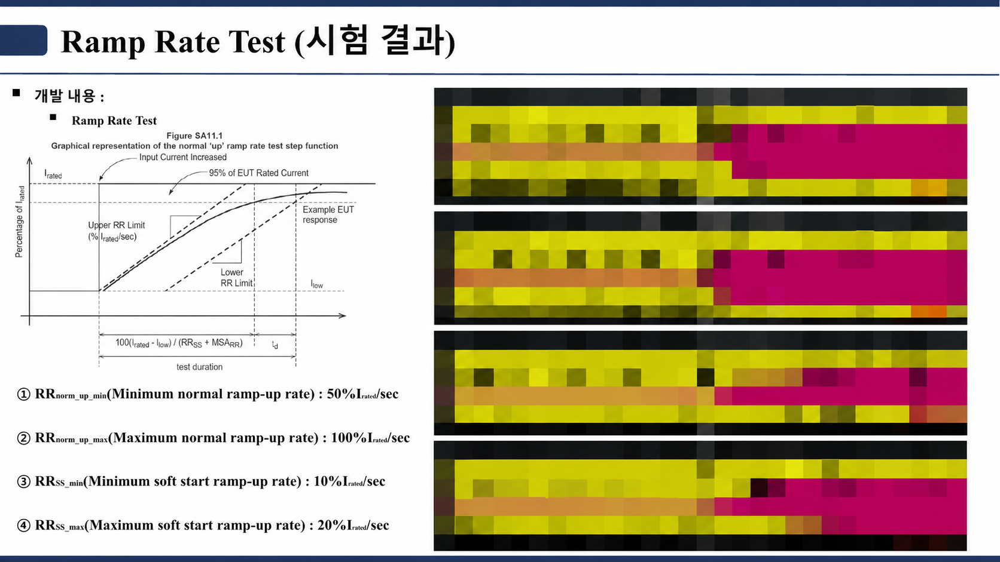
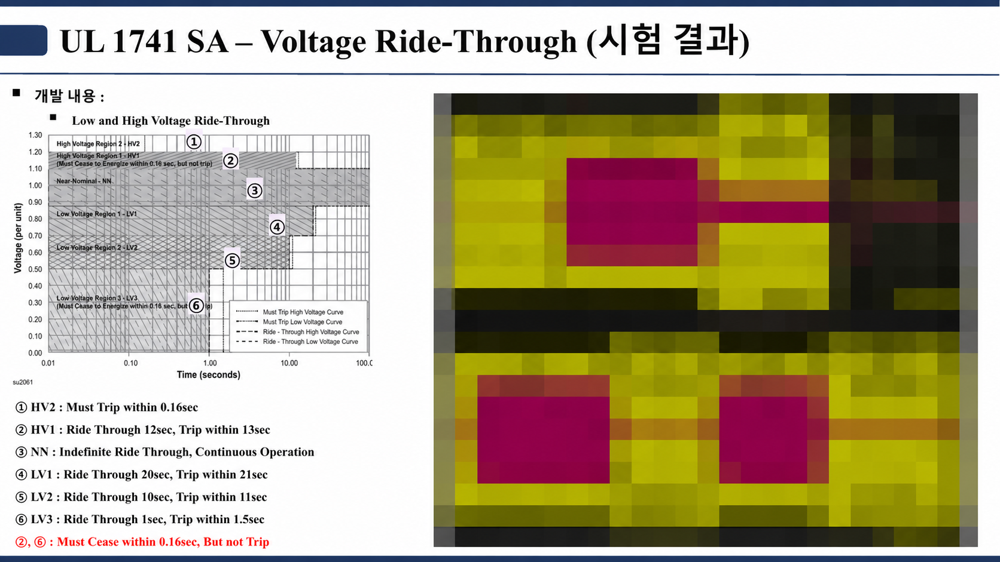
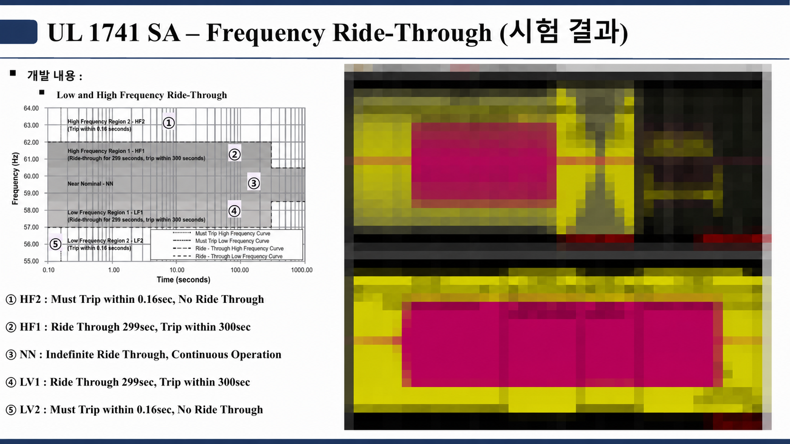
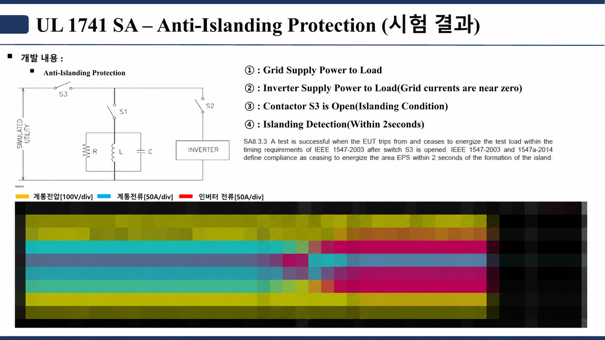

# ESS 사례 · UL 1741 SA 계통연계 기능 HILS 시험

PCS가 충전·대기·방전 지령에 따라 전력 방향을 바꾸고, 계통 전압·주파수 이상이나 계통 분리 때 정해진 상태로 넘어가는지를 HILS에서 확인했습니다. 제어 보드는 실제 I/O·PWM 신호로 HILS에 연결했습니다.

## 시험 항목

| 항목 | 슬라이드에 적힌 시험 조건 | 본 것 | 캡처 |
| --- | --- | --- | --- |
| Power Control | 충·방전 정격 전력, R상 기준 | 충전·대기·방전 전환과 전력 방향 | [자료](./assets/evidence/ul1741_ess_power_control.png) |
| Ramp Rate | 정상 ramp-up 50~100 %Irated/s, soft-start 10~20 %Irated/s | 지령 변화율과 출력 추종 | [자료](./assets/evidence/ul1741_ramp_rate.png) |
| Voltage Ride-Through | HV2 0.16 s 이내 trip, HV1 12 s·LV1 20 s·LV2 10 s·LV3 1 s 유지 후 trip, HV1·LV3는 0.16 s 이내 출력 정지(trip 아님) | 영역별 운전 유지·출력 정지·복귀 | [자료](./assets/evidence/ul1741_voltage_ride_through.png) |
| Frequency Ride-Through | HF2·LF2 0.16 s 이내 trip, HF1·LF1 299 s 유지 후 300 s 이내 trip | 영역별 상태 전이와 전력 회복 | [자료](./assets/evidence/ul1741_frequency_ride_through.png) |
| Anti-Islanding | S3 개방 후 2 s 이내 출력 정지 (IEEE 1547-2003 / 1547a-2014) | 단독운전 검출과 출력 정지 | [자료](./assets/evidence/ul1741_anti_islanding.png) |

슬라이드의 영역·시간 값은 UL 1741 SA 시점 기준입니다. 현재 미국 시장 인증은 IEEE 1547-2018 / 1547.1-2020 기반의 UL 1741 SB로 바뀌었습니다.

## 1. 충전·방전 전력 제어

충·방전 정격 전력 시험과 모드 전환 파형입니다(R상 계통전압 200 V/div, 계통전류 50 A/div). 전류가 흐르는 두 구간과 그 사이의 전환 구간이 보입니다.

## 2. Ramp Rate

정상 ramp-up 최소·최대, soft-start 최소·최대 네 조건의 출력 전류 상승 파형입니다.

## 3. Voltage / Frequency Ride-Through

왼쪽은 시험 영역도, 오른쪽은 계측 파형입니다. 영역별로 운전 유지, 출력 정지, trip, 복귀가 정해진 시간 안에 일어나는지 확인했습니다.

## 4. Anti-Islanding

① 계통이 부하에 공급 → ② 인버터가 부하에 공급(계통전류 ≈ 0) → ③ S3 개방(단독운전 조건) → ④ 2 s 이내 검출·정지 순서입니다.

제어 설계와 경계 조건 시험 방법은 [ESS HILS 기반 계통연계 기능 검증](../../studies/전공학습/02_제어시스템_설계/04_업무_설계기록/03_ESS_HILS_계통연계_기능검증.md)에 정리했습니다.

---

계측 파형은 모자이크 처리했습니다. 실제 사이트 구성, 배터리 용량, 보호 설정값, 고객·제품 정보, 원본 시험 로그는 싣지 않았습니다.
