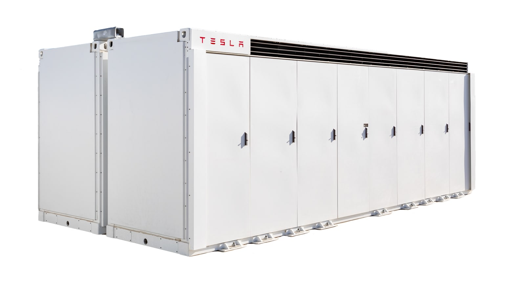
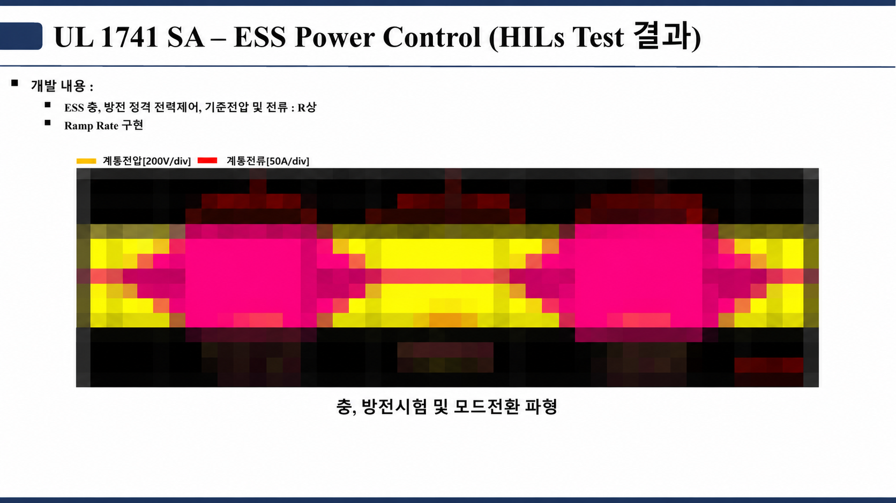

# ESS · 에너지저장시스템

이 사례는 계통과 연결된 ESS에서 충전·대기·방전 전력 제어, Ramp Rate, 전압·주파수 Ride-Through, Anti-Islanding 조건을 검토한 공개용 정리입니다.

## 공개 작업 캡처

충전·방전 전력 제어와 모드 전환을 확인한 공개용 HILS 화면입니다. Ramp Rate, Voltage/Frequency Ride-Through, Anti-Islanding 화면은 [사례 문서](./CASE_STUDY.md)에서 시험 항목별로 확인할 수 있습니다. 이 자료는 시험의 관찰 항목을 설명하기 위한 것으로, 특정 인증의 최종 성적서가 아닙니다.

## 사례 문서

- [ESS 사례 읽기](./CASE_STUDY.md)
- [공개 시험 자료](./assets/evidence/)
- [화면형 문서](./index.html)

## 시스템 경계

`배터리 랙 ↔ BMS·보호 장치 ↔ DC Bus ↔ PCS ↔ 계통 또는 부하`의 전력 경로를 기준으로 봅니다. 이 사례에서는 PCS의 전력 방향과 계통 이상 조건에서의 상태 전이를 구분해 확인합니다.

## 공개 범위

실제 사이트 구성, 배터리 용량, 보호 설정값, 고객·제품 식별 정보, 원본 시험 로그는 포함하지 않습니다. 공개 자료는 시험 목적과 해석 관점을 설명하기 위한 요약입니다.

공개 기술 참고: [U.S. DOE — BESS 구성요소와 기능](https://www.energy.gov/sites/default/files/2025-01/BESSIE_supply-chain-battery-report_111124_OPENRELEASE_SJ_1.pdf)
