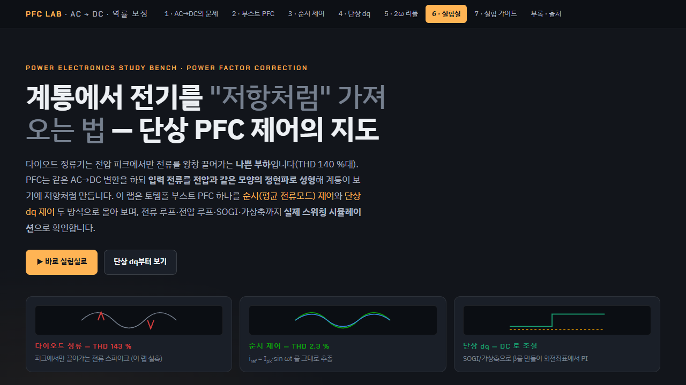
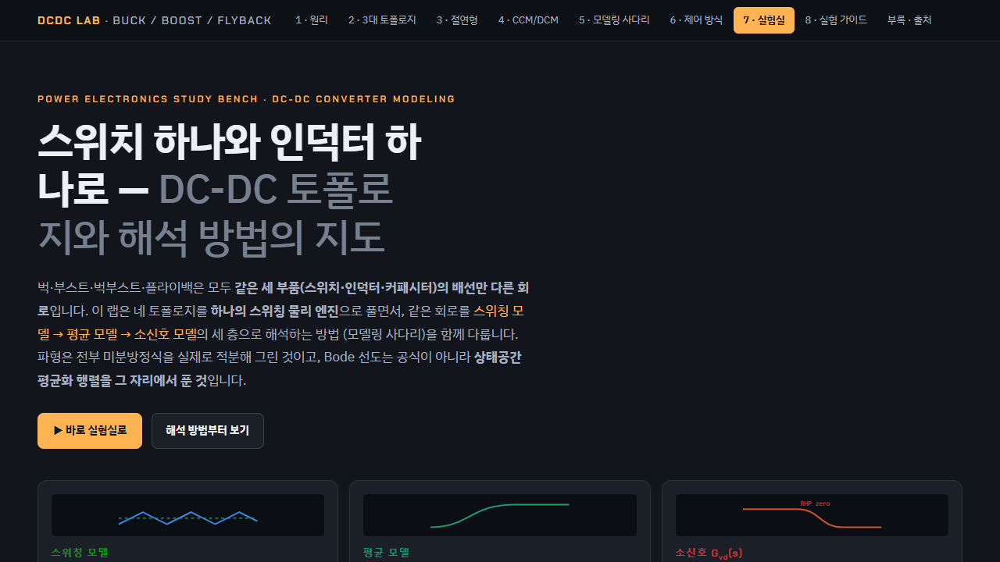
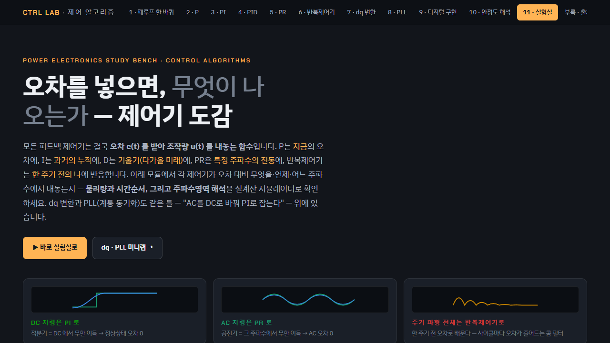

# OBC 사례 · 전력 경로와 운전 모드 검토

## 목적

OBC의 전력변환 단계를 나누고, 충전과 양방향 전력 전달에서 어떤 상태·보호 조건을 확인해야 하는지 정리합니다.

## 전력 경로

| 단계 | 역할 | 확인 관점 |
| --- | --- | --- |
| AC 입력·EMI 필터 | 외부 전원 입력과 전도성 노이즈 경로 관리 | 입력 조건, 보호, 필터 경계 |
| PFC | 입력 전류와 DC Link 전압 형성 | 입력 전압·주파수, 역률, DC Link 상태 |
| 절연형 DC-DC | 절연과 전압 변환, 배터리 충전 전류 제어 | 절연 경계, 전압 범위, 전류 제한 |
| 고전압 배터리 | 충전 에너지 저장 또는 양방향 전력원 | 배터리 제한, 충전·방전 허용 상태 |

## 운전 조건

- **G2V**: 계통 AC 전력을 차량 배터리에 저장하는 충전 경로
- **V2L**: 차량 배터리 전력을 외부 부하에 공급하는 경로
- **V2G**: 차량 배터리와 계통 사이의 양방향 전력 전달 경로

각 조건에서는 전력 방향, 배터리 제한, 외부 전원 상태, 보호 이벤트 후 안전 상태 전이를 같은 기준으로 확인합니다.

## 공개 범위

이 문서는 공개 기술 자료를 바탕으로 한 시스템 수준 사례입니다. 실제 차량 회로, 제어 파라미터, 통신 시퀀스, 측정 로그는 포함하지 않습니다.

## 연계 학습 화면

아래 화면은 OBC 전력단을 이해하기 위해 정리한 공개용 전력전자 학습 자료입니다. 실제 차량 OBC의 회로·소프트웨어·시험 캡처가 아니며, 시스템 원리와 제어 항목을 공부한 화면으로만 사용합니다.

### PFC · 입력 전류 제어

입력 전류 파형, 전류 루프, 전압 루프가 PFC 단계에서 어떤 역할을 하는지 정리한 화면입니다. 실제 차량 사양이나 제어 게인을 뜻하지 않습니다.

### 절연형 DC/DC

DC Link와 절연형 DC/DC가 배터리 전압 범위에 맞춰 전력을 변환하는 원리를 확인하기 위한 학습 화면입니다.

### 제어 알고리즘

상태·전류·전압 제어의 관계를 정리한 화면입니다. OBC의 실제 안전 요구사항과 차량 인터페이스는 별도 요구사항 문서와 시험에서 확인해야 합니다.
