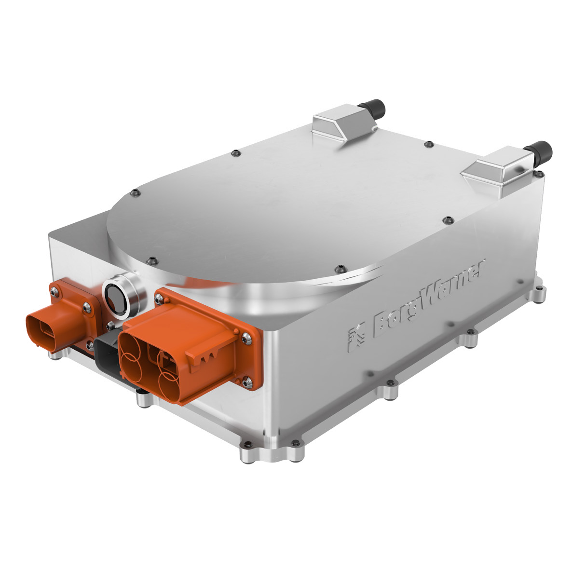
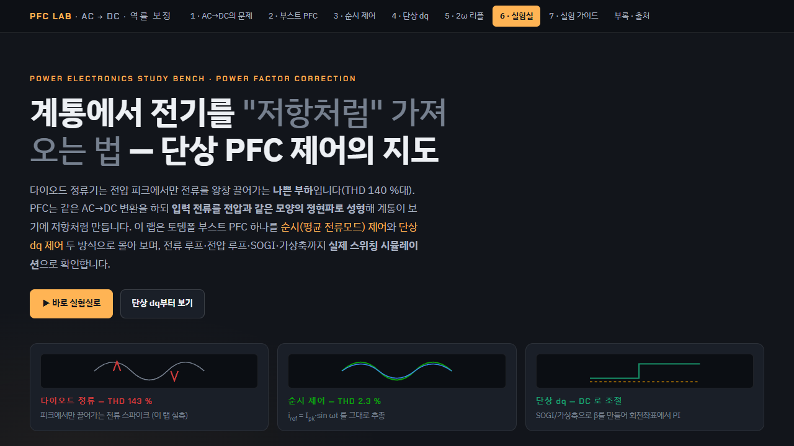

# OBC · 차량 탑재 충전기

차량 탑재 충전기의 AC-DC·절연 DC-DC 전력 경로와 G2V·V2L·V2G 운전 조건을 정리한 사례입니다.

*제품 예시 사진(BorgWarner). 실제 업무 제품과는 무관합니다.*

## 연계 학습 화면

토템폴 PFC의 순시 제어와 단상 dq 제어를 비교한 학습용 시뮬레이션 화면입니다. 차량 OBC 시험 캡처는 아닙니다.

## 시스템 경계

`AC 입력 → EMI 필터 → PFC → DC Link → 절연형 DC-DC → 고전압 배터리`를 기본 경로로 봅니다. 양방향 운전에서는 배터리, 외부 부하, 계통 사이의 전력 방향과 보호 조건을 같이 봅니다.

## 문서

- [사례 문서](./CASE_STUDY.md) · [화면형 문서](./index.html)

참고: [Texas Instruments — HEV/EV OBC·DC/DC 설계 자료](https://www.ti.com/applications/automotive/hev-ev-powertrain/hevev-obc-dc-dc-converter/overview.html?subsystemid=18546&variantid=18502)
