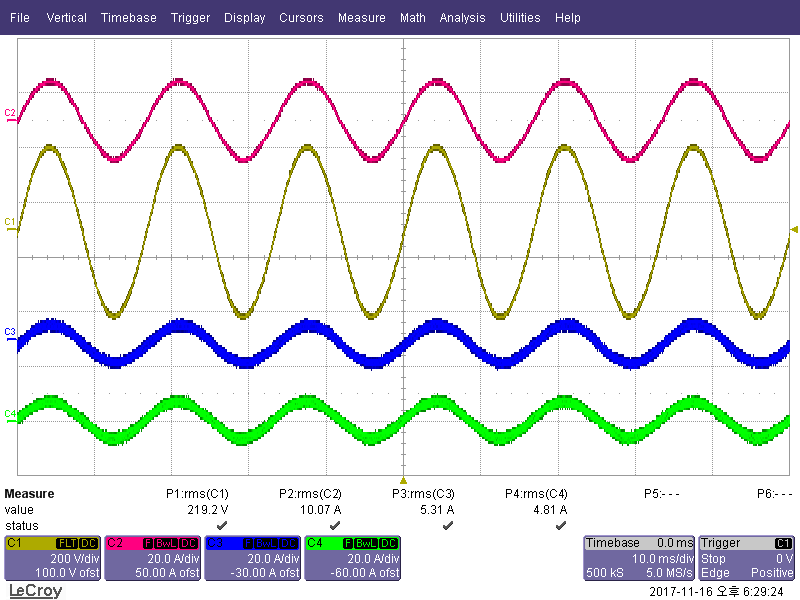
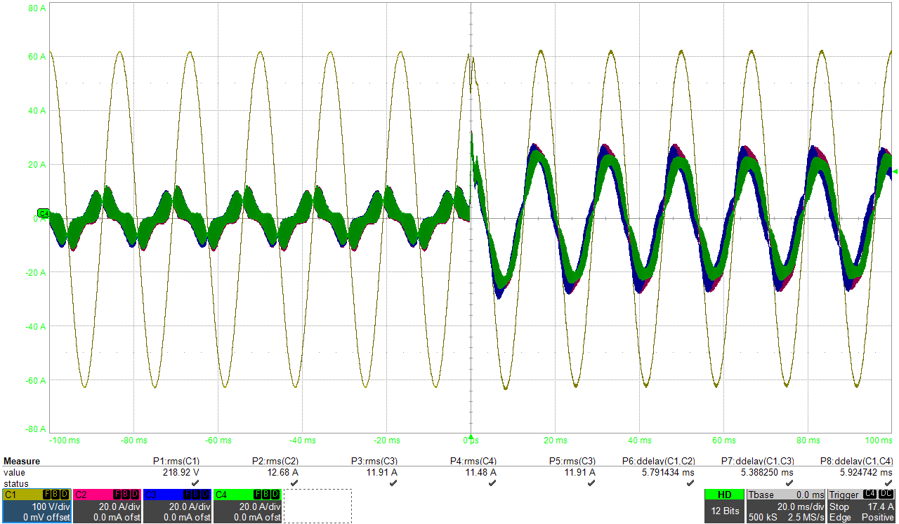
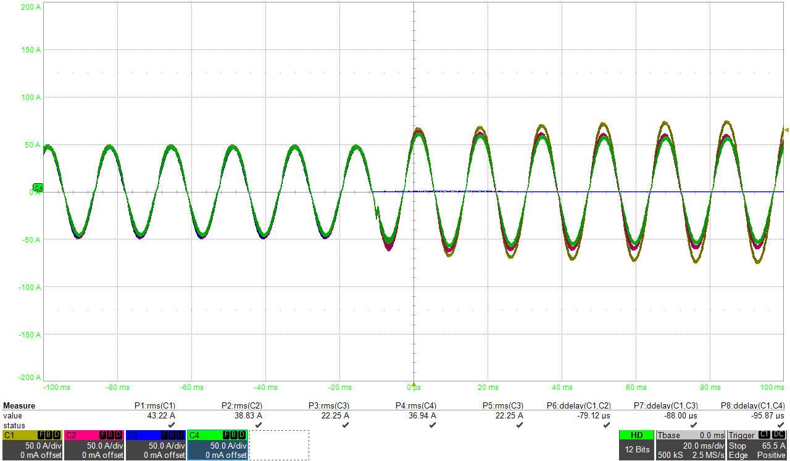

# UPS 사례 · 병렬운전과 과도상태 검증

## 목적

병렬 UPS가 정상 운전 중 부하를 나누어 공급하고, 부하가 급변하거나 모듈이 투입·분리되는 상황에서도 부하 출력이 연속적으로 유지되는지를 확인합니다.

## 확인한 상황

| 상황 | 확인 관점 | 공개 자료 |
| --- | --- | --- |
| 병렬운전 정상상태 | 각 전류 채널의 분담과 출력 파형의 안정성 | [파형](./assets/evidence/ups_parallel_waveform.png) |
| 부하 과도 | 부하 전류 변화 전후 출력 전압의 연속성과 과도 응답 | [파형](./assets/evidence/ups_load_transient.png) |
| Hot Swap | 모듈 투입·분리 시 전류 이관과 새로운 정상상태 수렴 | [파형](./assets/evidence/ups_hot_swap.png) |

## 시스템 관점

병렬운전의 핵심은 각 모듈이 단독으로 동작하는지가 아니라, 공통 부하를 향한 전압 기준과 전류 분담이 함께 유지되는지입니다. 따라서 각 이벤트에서 출력 전압, 전체 부하 전류, 모듈별 분담 전류의 시간적 관계를 비교합니다.

## 공개 자료를 읽는 방법

공개 파형은 사건 전후의 변화와 채널 간 관계를 보는 자료입니다. 세부 모듈 번호, 파라미터, 원본 계측 데이터는 포함하지 않으며 이 이미지 자체로 제품 적합성이나 인증 결과를 단정하지 않습니다.

## 공개 작업 캡처

### 1. 병렬운전 전류 분담

병렬 모듈과 부하의 전류 관계를 시간축에서 확인한 화면입니다. 채널의 실제 의미·모듈 번호·계측 설정·원본 데이터는 공개하지 않으며, 출력 연속성과 전류 분담을 함께 봐야 한다는 검증 관점만 남겼습니다.

### 2. 부하 과도

부하가 변하는 사건 전후에 출력이 어떻게 반응하는지 보는 공개용 캡처입니다. 특정 부하 사양 또는 제품 인증 성적서가 아니므로, 시간·전압·전류 수치를 일반 요구조건으로 사용하지 않습니다.

### 3. Hot Swap

모듈을 투입·분리하는 조건에서 전류 이관과 새로운 정상상태 수렴을 확인하는 화면입니다. 실제 고객 설비의 구성과 시험 조건을 식별할 수 있는 정보는 포함하지 않았습니다.
