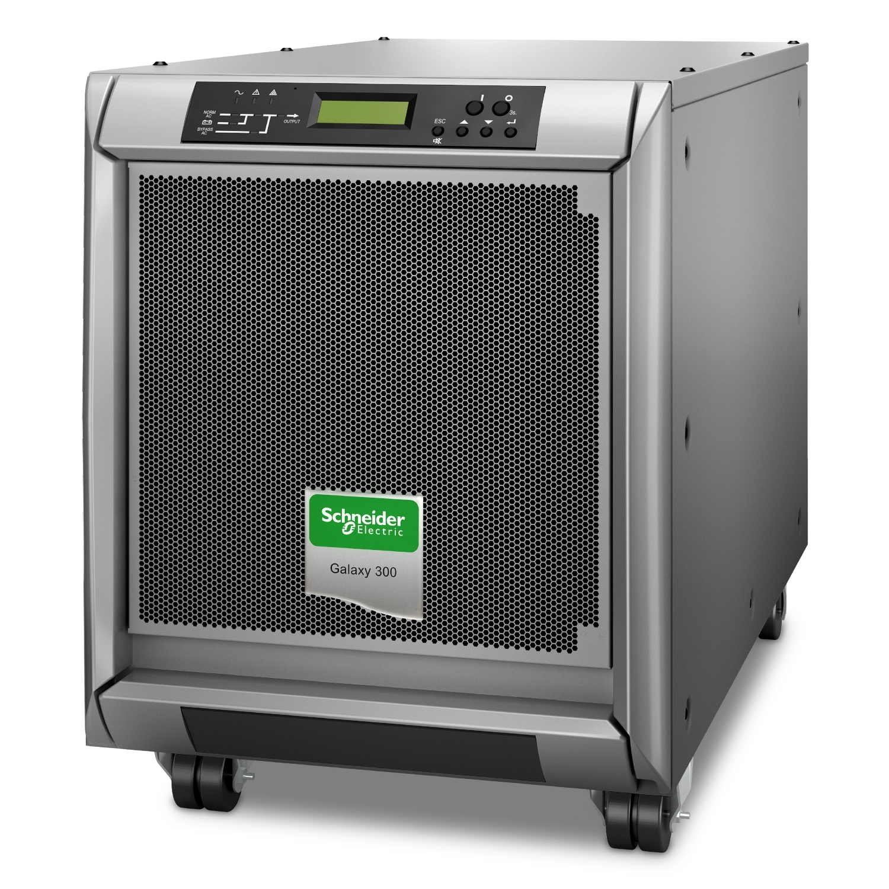
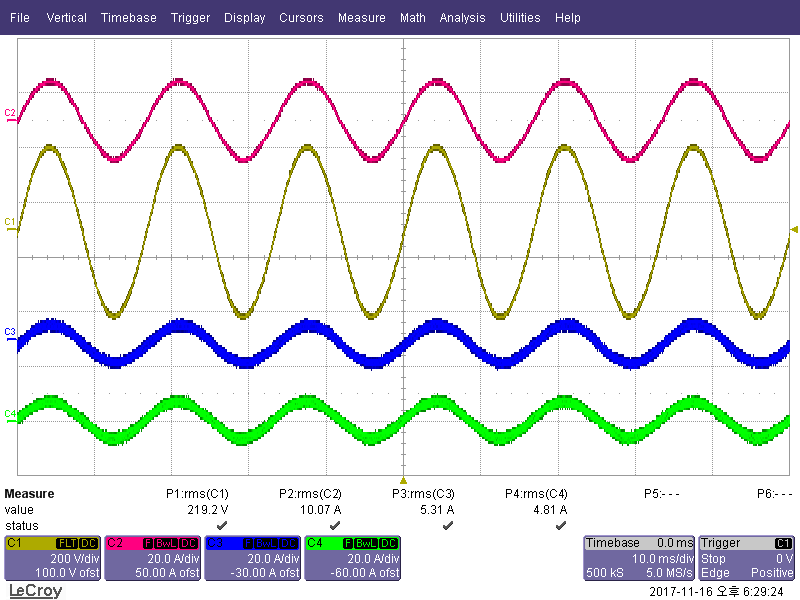

# UPS · 무정전전원장치

이 사례는 UPS 병렬운전, 부하 과도, 모듈 Hot Swap 상황에서 출력 연속성과 전류 분담을 확인하는 데 초점을 둡니다. 특정 고객 또는 제품의 설계 문서가 아니라, 공개 가능한 파형과 일반화한 검증 관점만 기록합니다.

## 공개 작업 캡처

병렬운전에서 모듈별 전류 분담과 출력의 시간 관계를 확인한 공개용 파형입니다. 부하 과도와 Hot Swap 화면은 [사례 문서](./CASE_STUDY.md)에서 함께 볼 수 있습니다. 파형은 검증 관점을 보여 주는 자료이며, 특정 제품의 인증 성적서나 원본 계측 로그가 아닙니다.

## 사례 문서

- [UPS 사례 읽기](./CASE_STUDY.md)
- [공개 파형 자료](./assets/evidence/)
- [화면형 문서](./index.html)

## 시스템 경계

`상용 AC 입력 → 정류·충전 단계 → DC Link·배터리 → 인버터 → 중요 부하`를 기본 전력 경로로 봅니다. 병렬 구성이면 각 UPS 모듈의 출력과 분담 전류, 공통 부하의 출력 연속성을 함께 확인합니다.

## 공개 범위

공개 자료에는 식별 가능한 모듈 정보, 제어 파라미터, 원본 계측 로그, 고객·사이트 정보가 없습니다. 제품 이미지는 구조 이해를 위한 공개 예시입니다.

공개 기술 참고: [Eaton — UPS 유형](https://www.eaton.com/us/en-us/products/backup-power-ups-surge-it-power-distribution/backup-power-ups/types-of-ups-systems.html)
