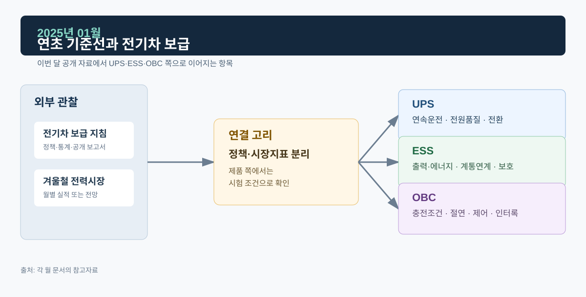

# 2025년 01월 · 연초 기준선과 전기차 보급

1월에는 환경부의 2025년 전기차 보조금 지침 개정안과 전력거래소 1월 시장실적을 읽었다. 하나는 전기차 보급 쪽 정책 신호이고, 하나는 한 달 동안의 계통 거래·가격 결과다. 올해 매달 같은 방식으로 따라갈 지표의 기준점으로 삼는다.

*그림. 전기차 보급 지침·겨울철 전력시장과 UPS·ESS·OBC*

## 자료

환경부는 1월 2일 `2025년 전기자동차 보급사업 보조금 업무처리지침` 개정안을 공고했다. 전기차 보급 지원 기준과 절차를 다루는 행정 문서다. 구매 보조금의 공고 시점과 요건은 전기차 보급 환경의 한 축이다.[^moe]

전력거래소가 사후 공표한 1월 운영실적에 따르면, 1월 말 전력시장 회원 수는 6,721개, 설비용량은 142,472 MW였다. 같은 달 거래량은 48,844 GWh, SMP는 117.15원/kWh로 집계됐고, 전년 동월 대비 거래량은 3.9%, SMP는 15.1% 낮았다. 전력거래소는 이 자료를 잠정치로 표시하며, SMP 변화에는 LNG 열량단가와 거래량 변화가 함께 작용했다고 설명한다.[^kpx]

## UPS · ESS · OBC

UPS는 SMP가 오르든 내리든 전원 연속성을 본다. 계통 이상 시 인버터 출력이 유지되는지, 배터리 전환과 복귀가 안정적인지, 병렬 모듈과 바이패스가 의도대로 동작하는지가 직접 확인할 항목이다. 그래서 월별 기록에는 가격과 별도로 최대수요, 설비·계통 사건, 중요부하 운전 요구를 적는 칸을 둔다.

ESS는 남는 전력을 시간대 사이에 옮기고, 급격한 출력·부하 변화에서 유효·무효전력 제어를 보조하며, 제도에 따라 계약된 용량을 제공한다. 기여도를 따지려면 배터리 에너지 용량, PCS 출력 용량, 운전 시간, 계통연계 규정이 있어야 해서 한 달 거래량이나 SMP로는 답이 나오지 않는다.

OBC는 입력 전압·주파수, 배터리 전압 범위, 전류 제한, 인터록, 온도와 통신 상태에서 안전하게 충전·정지·복귀해야 한다. 전기차 쪽 자료는 판매량, 충전기 수, 충전 규격, V2G·V2L 제도처럼 성격이 다른 지표가 섞여 나오므로 출처와 단위를 나눠 적는다.

## 다음 달에 볼 것

1. 2월 운영실적에서 겨울철 수요·가격·설비 변화가 어떻게 이어지는지
2. 보조금 지침 최종본과 실제 전기차 보급 통계

## 참고자료

[^moe]: [환경부, 「2025년 전기자동차 보급사업 보조금 업무처리지침」 개정안 공고, 2025-01-02](https://www.mcee.go.kr/home/mob/board/read.do?boardId=1717700&boardMasterId=39&menuId=290)
[^kpx]: [전력거래소, 2025년 1월 전력시장 운영실적(속보), 2025-02-19](https://www.kpx.or.kr/boardDownload.es?bid=0086&list_no=74358&seq=1)
