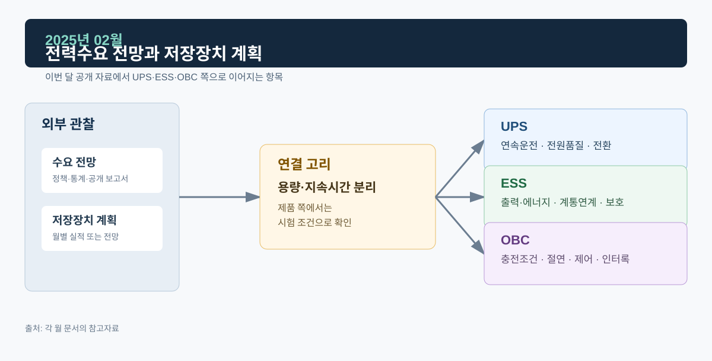

# 2025년 02월 · 전력수요 전망과 저장장치 계획

2월에는 IEA *Electricity 2025*의 세계 전력수요 전망, 2월 21일 확정된 제11차 전력수급기본계획, 전력거래소 2월 실적을 읽었다. 세 자료는 시간 범위와 산정 방법이 달라서 수치를 합치지 않고 따로 적는다. 저장장치 필요량이 양수와 기타 저장장치로 나뉘어 나온 점이 이번 달에 눈에 띄었다.

*그림. 수요 전망·저장장치 계획과 UPS·ESS·OBC*

## 자료

IEA의 *Electricity 2025*는 2024년 세계 전력소비가 4.3% 증가했고, 2025~2027년에도 전력수요가 연평균 약 4% 수준으로 증가할 것으로 전망했다. 보고서는 산업생산, 냉방, 전기화, 데이터센터 확대를 주요 배경으로 제시한다.[^iea]

국내에서는 제11차 전력수급기본계획이 2월 21일 확정됐다. 공개된 계획 자료는 재생에너지 확대 대응을 위한 저장장치 필요량을 별도로 제시하며, 양수와 기타 저장장치를 구분한다. 같은 ESS라도 에너지 지속시간, 설치 위치, 계통 역할, 사업 방식이 다를 수 있다.[^motie]

전력거래소의 2월 운영실적은 월평균 전력 69,120 MW, 전년 동월보다 낮은 평균기온을 함께 제시했다. 시장가격은 116.39원/kWh로 집계됐다.[^kpx]

## UPS

온라인 UPS는 정상 시에도 정류부–DC Link–인버터 경로로 부하를 공급하고, 계통 이상에서는 배터리가 DC Link를 지지한다. 수요가 늘면 계통 공급력과 복원력 논의가 커지지만, UPS에서 검증할 것은 여전히 부하에 공급되는 전압의 연속성, 즉 인버터 과도응답과 바이패스 절체다. 포트폴리오의 병렬운전·부하 과도·Hot Swap 파형은 이런 조건을 어떻게 관찰하는지 보여 주는 자료다.

## ESS: MW와 MWh

전력계획의 저장장치 필요량은 장기 수급과 재생에너지 수용을 다루고, PCS 검증은 순간 전력 지령, 전압·주파수 보호, 단독운전 검출, 복귀 시퀀스를 다룬다. 양수와 배터리 ESS는 둘 다 저장 기능을 하지만 응답 시간·지속시간·입지·제도가 다르다. 배터리 ESS에서도 MW는 순간 출력, MWh는 에너지 지속시간이라 둘 중 하나만으로는 시스템 역할을 판단할 수 없다.

## OBC

IEA가 말하는 전기화에는 전기차뿐 아니라 건물·산업의 전기 사용 증가가 들어 있어서, 이 전망을 OBC 시장 규모로 환산할 근거는 부족하다. OBC에서 직접 볼 것은 충전 포트부터 PFC, 절연형 DC/DC, 고전압 배터리까지의 전력 경로와 상태별 보호 조건이다. V2G·V2L은 전력 흐름이 반대가 되는 것 외에도 계통·외부 부하 상태, 인터록, 배터리 허용 범위, 정지·재기동 조건이 맞아야 한다.

## 정리

| 구분 | 공개 자료에서 확인한 사실 | 설계·검증에서 따로 확인할 것 |
| --- | --- | --- |
| UPS | 수요 증가와 전력 공급 복원력의 중요성이 커지는 환경 | 전환·과도·병렬분담·바이패스 동작 |
| ESS | 장기 계획에서 저장장치를 별도 자원으로 다룸 | MW/MWh, 지령 추종, 보호·복귀, 계통연계 조건 |
| OBC | 전기화가 장기 전력수요 증가 요인 중 하나로 제시됨 | PFC/DC-DC, 배터리 제한, 모드 전환·보호 |

## 다음 달에 볼 것

- 전력수요 증가가 냉방·산업·데이터센터·전동화 중 어느 원인과 연결되는지, 출처별로
- 11차 계획의 저장장치 필요량이 어떤 시간대·출력·계통 서비스를 전제로 하는지

## 참고자료

[^iea]: [IEA, *Electricity 2025*, 2025-02-14](https://www.iea.org/reports/electricity-2025)
[^motie]: [산업통상자원부, 제11차 전력수급기본계획 확정, 2025-02-21](https://www.motie.go.kr/search/search.do?category=c1&currentPage=1&date=%24param.date&detailSearch=&end-date=&fdContent=%24param.fdContent&fdFile=%24param.fdFile&fdNotice=%24param.fdNotice&fdTitle=%24param.fdTitle&fdTot=%24param.fdTot&kwd=%EC%A0%84%EB%A0%A5%EC%88%98%EA%B8%89&ppkFlag=weekly&preCondi=%24param.preCondi&reSrchFlag=&rowPerPage=10&searchOptionAnd=&searchOptionOr=&searchRange=fdTot&site=main&sort=r&srchFd=%24param.srchFd&start-date=)
[^kpx]: [전력거래소, 전력계통 운영실적(2025년 2월)](https://kpx.or.kr/boardDownload.es?bid=0159&list_no=75075&seq=1) · [전력시장 운영실적(2025년 2월)](https://kpx.or.kr/boardDownload.es?bid=0086&list_no=74854&seq=1)
