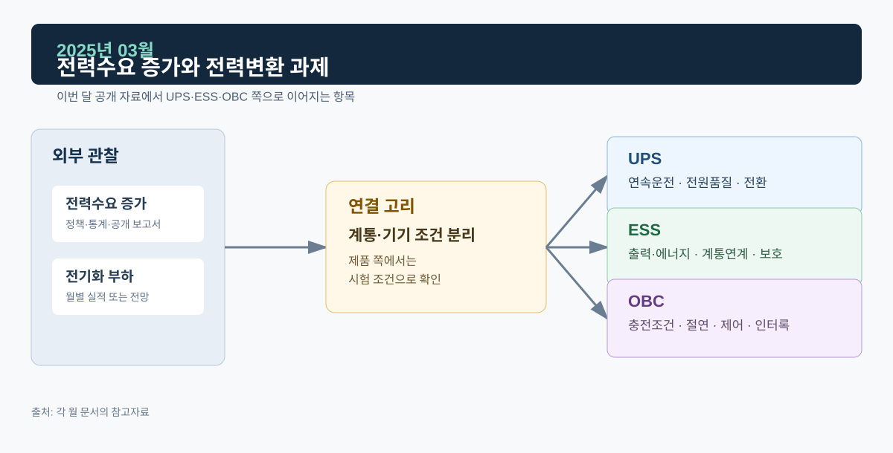

# 2025년 03월 · 전력수요 증가와 전력변환 과제

3월에는 IEA *Global Energy Review 2025*로 2024년 전력수요가 왜 늘었는지 확인했다. 같은 수요 증가라도 UPS는 중요부하의 단기 전원 연속성, ESS는 시간·공간적으로 달라지는 공급과 부하의 조정, OBC는 차량 내부 전력변환과 차량–외부 전력계 사이의 경계 조건을 다룬다.

*그림. 전력수요 증가·전기화 부하와 UPS·ESS·OBC*

## 자료

IEA의 *Global Energy Review 2025*는 2024년 세계 전력수요가 4.3% 증가해 약 1,080 TWh 늘었다고 정리했다. 전력수요 증가는 냉방, 산업, 수송 전기화, 데이터센터 확대와 연결됐으며, 건물 부문의 전력소비 증가는 600 TWh를 넘었다.[^iea]

같은 보고서는 2024년 전력수요 증가의 상당 부분이 저배출 전원 증가로 충당됐다고 설명한다. 전원 용량이 늘어도 계통의 유연성·연결 용량·보호 협조는 따로 확보해야 하고, 전력변환 장치에서는 전압·주파수·고장 상태에서의 동작과 복귀 조건이 중요하다.

전력거래소는 3월 전력시장 운영실적을 4월에 공표했다. 설비·회원·거래·가격 변화를 보는 원자료다.[^kpx]

## UPS

데이터센터·통신·산업 제어처럼 순간 정전이 허용되지 않는 부하가 늘면 전원 연속성의 비중이 커진다. UPS 시험은 정전·복전, 급격한 부하 변화, 배터리 운전, 정적 바이패스, 병렬 모듈 투입·분리 같은 사건을 중심으로 짠다. 정상 상태의 출력전압과 주파수, 과도 시 전압 회복, 모듈별 전류 분담, Hot Swap 후 수렴을 각각 확인한다.

## ESS: 언제, 어디서, 어떤 규칙으로

재생에너지와 전기화가 동시에 늘면 공급과 부하가 시간대별로 달라지고, 계통은 더 빠른 조정 자원을 필요로 할 수 있다. 배터리 ESS는 충전·대기·방전, 유효전력 지령, 출력 변화율, 전압·주파수 이상, 단독운전 검출 이후의 상태전이를 관리해야 한다. PCS가 배터리 DC와 계통 AC를 연결해도 어떤 시장·계통 서비스에 참여하는지는 운전 규정·계통접속·보호 설정·계약 조건에 따라 프로젝트마다 다르다.

## OBC

OBC는 계통 교류를 배터리 충전에 맞는 직류로 바꾸고, 양방향 구조에서는 V2G·V2L의 역방향 전력 흐름까지 다룬다. 전동화가 전력수요를 늘리는 원인 중 하나라 해도 OBC 검증은 입력전압·주파수 범위, DC Link, 절연, 배터리 전압·전류 한계, 온도, 인터록, 통신, 이상 정지와 재기동으로 내려가야 한다.

## 다음 달에 볼 것

1. 데이터센터처럼 위치가 집중된 부하가 계통과 UPS에 주는 과제를 다룬 자료
2. 전기차 충전 수요 통계의 출처

## 참고자료

[^iea]: [IEA, *Global Energy Review 2025*, 2025-03-24](https://www.iea.org/reports/global-energy-review-2025) · [전력수요 상세](https://www.iea.org/reports/global-energy-review-2025/electricity)
[^kpx]: [전력거래소, 2025년 3월 전력시장 운영실적(속보), 2025-04-22](https://www.kpx.or.kr/board.es?act=view&bid=0086&list_no=74939&mid=a10102000000&tag=)
