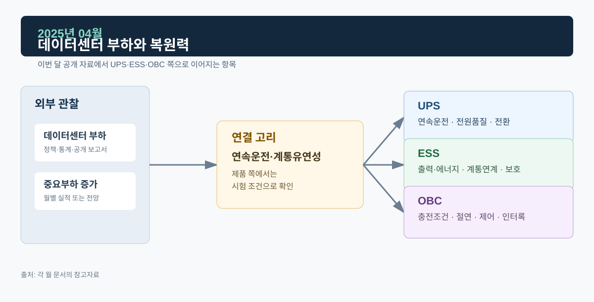

# 2025년 04월 · 데이터센터 부하와 전력계통 복원력

4월에는 IEA *Energy and AI*의 데이터센터 전력소비 전망과 전력거래소 4월 계통 실적을 읽었다. 데이터센터는 규모가 큰 중요부하라서 UPS, ESS, 계통이 각각 어디까지 맡는지 정리해 둔다.

*그림. 데이터센터 부하·중요부하 증가와 UPS·ESS·OBC*

## 자료

IEA의 *Energy and AI*는 2024년 전 세계 데이터센터 전력소비를 약 415 TWh(세계 전력소비의 약 1.5 %)로 보고, 기준 시나리오에서 2030년에는 약 945 TWh로 두 배 넘게 늘 것으로 전망했다. 보고서는 대규모 데이터센터의 전력수요가 지역적으로 집중될 수 있으며, 전력망·발전원·저장장치·수요 관리의 조합이 필요하다고 설명한다.[^iea]

전력거래소의 2025년 4월 계통 운영실적에는 최대수요 71,667 MW(4월 14일 17시), 월평균 전력 57,186 MW가 기록됐다. 같은 자료는 기온과 추계수요를 함께 제공한다.[^kpx]

국제 전망은 중장기적으로 큰 전력소비가 한곳에 몰릴 수 있다는 방향을, 4월 실적은 한 달 동안 계통이 실제로 겪은 수요 조건을 보여 준다. 한 표에 넣을 때는 단위·공간 범위·시점이 다르다고 주석을 단다.

## UPS: 백업 전원

데이터센터나 제어 설비의 UPS는 계통 이상 때 부하에 무정전 전원을 공급하고, 배터리나 다른 백업 전원이 이어받을 시간을 만든다. 온라인 UPS에서는 정류부–DC Link–인버터 경로가 부하를 공급하고 배터리는 DC Link를 지지한다. 따져 볼 것은 어떤 백업 체계와 절체 조건 아래에서 출력 연속성을 유지하는지다.

포트폴리오의 UPS 사례에 있는 병렬운전, 부하 과도, Hot Swap 파형은 각각 모듈 사이의 전류 분담, 출력전압의 과도응답, 모듈 투입·분리 뒤 수렴을 보는 장면이다. 중요부하가 클수록 전압 허용범위, 부하 특성, 바이패스 정책, 발전기 기동과의 시간 협조를 요구사항으로 먼저 고정해야 한다.

## ESS: 계통 유연성

ESS는 과잉 전력의 시간 이동, 출력 변화 완화, 주파수·전압 지원 같은 계통 유연성 역할을 할 수 있다. 데이터센터 수요가 특정 지역에 몰리면 배전·송전 제약과 피크 관리가 같이 논의되는데, 이때 필요한 것은 위치, 용량, 지속시간, 계통연계 규정, 보호협조, 충전 가능한 시간대, 화재·안전 설계의 조합이다.

용어도 나눠 쓴다. `충전·대기·방전`은 에너지 상태, `Ramp Rate`는 지령 변화율, `Ride-Through`는 이상 전압·주파수 조건에서의 운전·정지·복귀 규칙이다.

## OBC: 양방향 충전의 조건

전기차는 분산된 이동형 부하이고, 양방향 충전은 기술·시장·계통 규정이 갖춰졌을 때 계통과 상호작용할 수 있다. 데이터센터 같은 고정 대용량 부하와는 위치·시간·제어권한이 다르다. OBC 사례에서는 G2V·V2G·V2L의 전력 흐름을 나누고, 모드별로 배터리 제한, 외부 전원 상태, 인터록, 보호 이후 안전 상태를 확인한다. 먼저 검증할 것은 어떤 조건에서 양방향 운전이 허용되는지다.

## 다음 달에 볼 것

- 전기차 판매·배터리 화학계·충전 인프라 지표
- 국내 ESS 사업 진행과 설치 결과를 보여 주는 원문

## 참고자료

[^iea]: [IEA, *Energy and AI*, 2025-04-10](https://www.iea.org/reports/energy-and-ai) · [Energy supply for AI](https://www.iea.org/reports/energy-and-ai/energy-supply-for-ai)
[^kpx]: [전력거래소, 전력계통 운영실적(2025년 4월)](https://www.kpx.or.kr/boardDownload.es?bid=0159&list_no=75484&seq=1)
