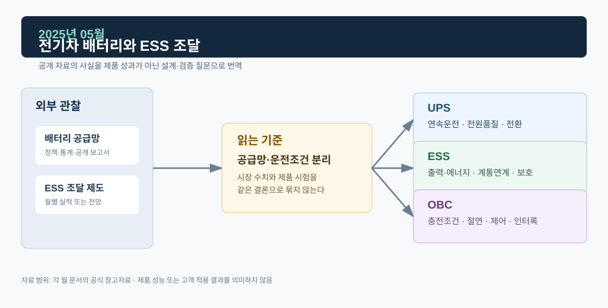

# 2025년 05월 · 전기차·배터리와 ESS 조달 신호

5월에는 IEA의 전기차·핵심광물 보고서와 전력거래소의 제1차 ESS 중앙계약시장 입찰 공고를 읽었다. 셀 화학계는 전기차와 ESS가 겹칠 수 있어도, 전기차 배터리는 주행·충전 요구로, ESS 배터리는 정지형 계통의 출력·지속시간·안전·계약 조건으로 요구사항이 정해진다.

*그림. 배터리 공급망·ESS 조달 제도와 UPS·ESS·OBC*

## 자료

IEA의 *Global EV Outlook 2025*는 2024년 세계 전기차 판매가 1,700만 대를 넘고 전체 승용차 판매의 20% 이상을 차지했다고 정리했다. 2025년에는 전기차 판매가 2,000만 대를 넘고 전체 판매의 4분의 1에 이를 것으로 전망했다.[^ev]

같은 달 발간된 IEA의 *Global Critical Minerals Outlook 2025*는 LFP 배터리가 세계 전기차 시장의 거의 절반을 공급하는 수준으로 확대됐다고 설명한다. 보고서는 LFP 확대가 니켈·코발트 중심의 공급망 외에 리튬·인산·흑연 등의 공급망을 함께 보게 만든다고 지적한다.[^minerals]

국내에서는 전력거래소가 5월 22일 제1차 ESS 중앙계약시장 경쟁입찰을 공고했다. 공고는 제11차 전력수급기본계획에 명기된 2026년 ESS 필요량을 대상으로 하며, 시장 참여자는 전력시장운영규칙과 입찰 조건을 따라야 한다고 안내했다. ESS가 제도·계약·운영 요건과 묶여 조달된다는 점이 드러난다.[^kpx]

## ESS: 셀 선택과 계통 서비스

배터리 화학계는 에너지 밀도, 비용, 안전, 공급망과 관련된 중요한 변수다. 시스템 수준에서는 배터리 랙·BMS·DC/DC·PCS·변압기·보호계전·EMS가 서로 다른 시간축에서 동작하고, 계통연계 조건은 전압·주파수·단독운전 검출·출력 변화율로 관리된다. 셀 공급망 변화와 계통용 ESS의 조달·운영 조건은 따로 조사한다.

공고문에서 확인되는 것은 경쟁입찰의 대상·시점·참여 규칙까지다. 낙찰가, 배터리 공급사, 설치 용량, 계통접속 일정, 화재 안전 설계는 이후 자료가 나오면 적는다.

## OBC: 판매 대수와 충전기 사양

전기차마다 내장형 충전기 용량, 급속 충전 의존도, 배터리 전압, 충전 규격, 지역별 보급정책이 다르기 때문에 판매 대수에 OBC 용량을 곱해 시장 규모를 만들 수는 없다. OBC 문서에서는 입력 AC, EMI 필터, PFC, DC Link, 절연형 DC/DC, 고전압 배터리 사이의 전력 경로와 보호·통신 조건을 먼저 보고, 양방향 운전은 V2G·V2L이 실제로 허용되는 환경과 함께 검토한다.

LFP 비중이 늘어도 OBC 제어의 입력은 차량 배터리의 전압 범위와 BMS가 허용하는 전압·전류·온도 조건이다. 화학계 이름만으로 충전 알고리즘이나 보호 한계를 정할 수 없다.

## UPS: 배터리를 쓰는 다른 장치

UPS도 배터리를 쓰지만 역할은 계통 정전·순간 전압 이상에서 중요부하의 전원을 유지하는 것이고, 계통용 ESS는 에너지 이동과 유연성 제공을 목표로 할 수 있다. 운전시간·안전설계·보호·사업 모델이 다르다. UPS에서는 배터리 지속시간, 충전기, DC Link, 인버터, 바이패스와 발전기 기동의 시간 협조를 각각 검증한다.

## 다음 달에 볼 것

1. ESS 중앙계약시장 설명회 이후 선정·계약 진행 상황
2. 전기차 판매·등록·충전기·충전량·양방향 충전 제도 통계

## 참고자료

[^ev]: [IEA, *Global EV Outlook 2025*, 2025-05-14](https://www.iea.org/reports/global-ev-outlook-2025) · [전기차 시장 동향](https://www.iea.org/reports/global-ev-outlook-2025/trends-in-electric-car-markets-2)
[^minerals]: [IEA, *Global Critical Minerals Outlook 2025*, 2025-05-21](https://www.iea.org/reports/global-critical-minerals-outlook-2025) · [LFP 공급망](https://www.iea.org/reports/global-critical-minerals-outlook-2025/beyond-nmc-batteries-supply-chain-issues-for-emerging-battery-technologies)
[^kpx]: [전력거래소, 2025년 제1차 ESS 중앙계약시장 경쟁입찰 공고, 2025-05-22](https://www.kpx.or.kr/boardDownload.es?bid=0042&list_no=75170&seq=3)
