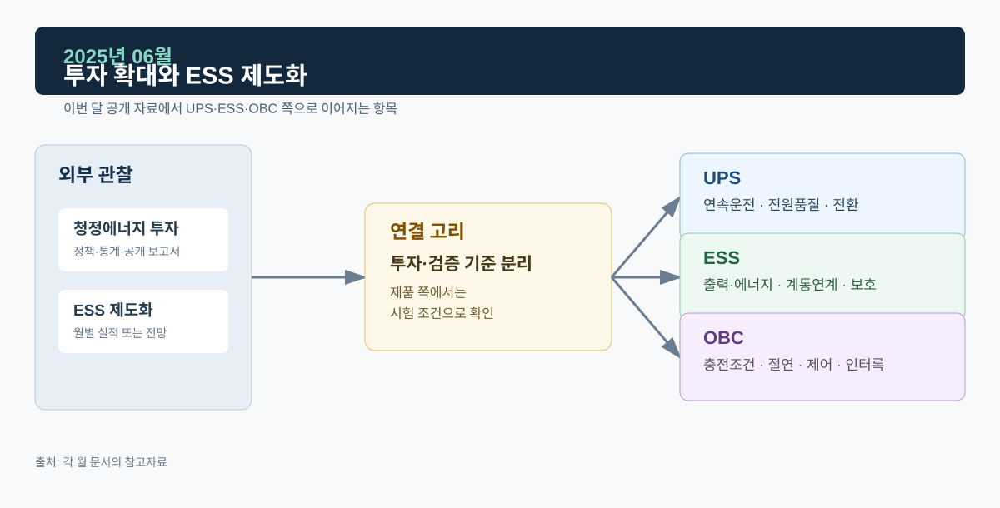
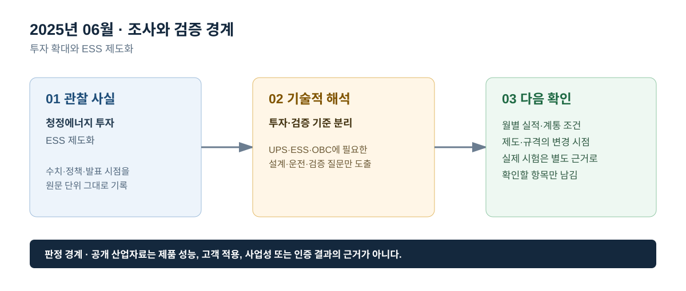

# 2025년 06월 · 투자 확대와 ESS 제도화

## 이번 달에 잡은 질문

에너지 투자가 늘어난다는 사실은 전력변환 장치가 모두 같은 방식으로 성장한다는 뜻이 아니다. 6월에는 투자 총액, ESS 제도, 전력시장 실적의 역할을 구분한다. 투자 전망은 자본이 어느 분야로 향하는지 보여 주고, 중앙계약시장 자료는 국내 ESS 조달 절차를 보여 주며, 월간 시장실적은 그 달의 거래·설비 변화를 보여 준다. 이 세 자료는 서로의 빈칸을 메울 수는 있어도 대체할 수는 없다.

## 그림으로 보는 이번 달

*그림 1. 공개 산업 신호를 UPS·ESS·OBC의 설계·검증 질문으로 연결한 도식이다. 제품 성능 또는 고객 적용 결과를 의미하지 않는다.*

*그림 2. 관찰 사실, 기술적 해석, 다음 확인 항목을 구분해 기록하는 기준이다.*

## 관찰 사실

IEA의 *World Energy Investment 2025*는 2025년 세계 에너지 투자 규모가 3.3조 달러에 이를 것으로 전망했다. 이 가운데 재생에너지·원자력·전력망·저장장치·저배출 연료·효율·전기화에 향하는 투자는 약 2.2조 달러로, 화석연료 공급 투자 약 1.1조 달러의 두 배 수준으로 제시됐다. 이는 세계 전체의 투자 전망이며, 개별 기업의 매출·수주·설비 준공을 보장하는 수치는 아니다.[^iea]

전력거래소는 6월 5일 제1차 ESS 중앙계약시장 사업자 설명회를 열어 주요 내용과 개선사항을 안내했다. 설명회 자료와 입찰 공고가 존재한다는 사실은 참여 절차가 공개됐다는 뜻이지만, 선정·계약·상업운전 완료와 같은 후속 상태는 각각 별도 원문으로 확인해야 한다.[^kpxess]

전력거래소의 6월 운영실적에 따르면, 6월 말 전력시장 회원 수는 7,096개사, 설비용량은 143,241 MW였다. 6월 거래량은 43,228 GWh로 전년 동월보다 0.4% 증가했고, 시장·정산 수치는 잠정치임이 명시돼 있다.[^kpxmarket] 이 수치는 장마·냉방·연료비 등 당시 조건이 섞인 결과이며, ESS가 제공한 특정 계통 서비스의 실적은 아니다.

## ESS: 제도 공고에서 제어 검증으로 내려가기

중앙계약시장 같은 제도는 ESS가 전력계통의 자원으로 운영되기 위해 장비 성능 이외의 조건도 필요하다는 점을 보여 준다. 실제 시스템에서는 배터리 에너지 상태, BMS 제한, PCS의 유효·무효전력 제어, 보호계전, 계통 운영자의 지령, 통신, 유지보수, 안전 관리가 연결된다. 제어 검증은 단순히 ‘지령을 따라간다’는 한 문장으로 끝나지 않고, 충전·대기·방전 상태, 출력 변화율, 전압·주파수 이상, 단독운전 검출, 정지·복귀가 어떤 순서로 일어나는지 확인하는 과정이다.

투자 전망이 커도 시험 기준이 느슨해지는 것은 아니다. 오히려 다수의 설비가 계통에 연결될수록 동일한 조건에서 재현 가능한 시험 시나리오, 변경 이력, 보호 협조, 이상 후 복귀 판정이 중요해진다. 포트폴리오의 ESS 자료는 계통연계 Power Control과 Ride-Through 화면을 공개용으로 남기되, 제품 식별 정보·원본 로그·개별 파라미터는 제외한다. 산업동향 문서도 같은 원칙으로, **공개된 제도와 추세는 적되 내부 시험 결과로 확대 해석하지 않는다.**

## UPS: 투자 규모보다 부하 요구와 교체 시간

전력망·저장장치 투자가 증가해도 중요부하의 UPS 요구는 사라지지 않는다. UPS 설계·운영에서는 부하 중요도, 허용 정전 시간, 필요한 백업 지속시간, 배터리 상태, 발전기 기동, 바이패스 전환, 병렬 모듈의 정비 가능성이 독립 변수다. 전력망 전체의 투자는 장기 신뢰도에 기여할 수 있지만, 설비 내부의 순간 전압 강하나 모듈 교체 과정에서 부하 출력이 유지되는지를 대신 보증하지 않는다.

따라서 투자 보고서를 UPS의 ‘수요 증명’으로 단정하지 않는다. 월간 조사에서는 전력망의 회복력 투자라는 배경과 UPS의 국소적 연속성 검증을 연결하되, 실제 적용 사례는 공개 가능한 파형·시험 조건이 있을 때만 제시한다. 이런 구분이 있어야 시장 동향 문서와 개인 포트폴리오의 증빙 문서가 서로 역할을 침범하지 않는다.

## OBC: 전기화 투자와 차량 조건 사이

투자 보고서의 ‘전기화’에는 전기차, 건물, 산업, 네트워크가 함께 포함된다. 따라서 OBC에는 전기차 시장·충전 인프라·차량 플랫폼·배터리 특성·양방향 충전 제도가 더 직접적인 자료다. OBC의 검증에서는 AC 입력부터 EMI 필터, PFC, DC Link, 절연형 DC/DC, 배터리까지의 경로가 안정적으로 이어지는지, 운전·보호 상태가 서로 모순되지 않는지를 확인한다. 투자 통계는 그 배경을 설명할 뿐, 특정 OBC의 출력·효율·안전 요구값을 제공하지 않는다.

## 다음 달 확인 항목

- ESS의 사업 진행 상태를 `공고 → 설명회 → 선정 → 계약 → 준공 → 운전`으로 구분해 원문을 확인한다.
- 전력시장 월간 통계의 잠정치·최종치 구분과 단위를 기록한다.
- 투자 규모를 인용할 때에는 지역·기간·포함 기술 범위를 함께 써서 한국의 특정 시장 규모처럼 오해되지 않게 한다.

## 참고자료

[^iea]: [IEA, *World Energy Investment 2025*, 2025-06](https://www.iea.org/reports/world-energy-investment-2025)
[^kpxess]: [전력거래소, 2025년 제1차 ESS 중앙계약시장 사업자 설명회, 2025-05-27](https://kpx.or.kr/board.es?act=view&bid=0042&list_no=75208&mid=a11201000000)
[^kpxmarket]: [전력거래소, 2025년 6월 전력시장 운영실적(속보)](https://new.kpx.or.kr/boardDownload.es?bid=0086&list_no=75578&seq=1)
