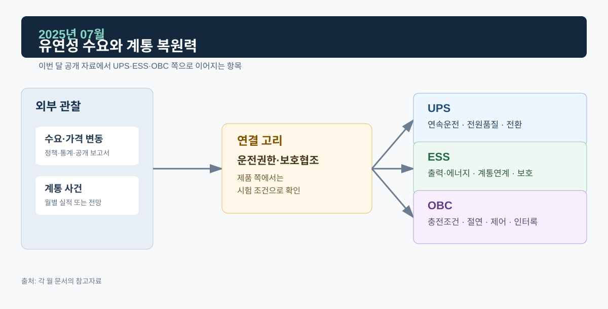

# 2025년 07월 · 유연성 수요와 계통 복원력

7월에는 IEA *Electricity Mid-Year Update 2025*와 전력거래소 7월 실적을 읽었다. 유럽 일부 시장의 음의 가격 증가와 칠레·이베리아반도 대정전이 이번 달 자료의 중심이다.

*그림. 수요·가격 변동, 계통 사건과 UPS·ESS·OBC*

## 자료

IEA의 *Electricity Mid-Year Update 2025*는 세계 전력수요가 2025년 3.3%, 2026년 3.7% 증가할 것으로 전망했다. 같은 보고서는 2025년 상반기 일부 시장에서 도매 전력가격이 상승한 반면, 독일·네덜란드·스페인 등에서는 음의 가격이 발생한 시간 비중이 커졌다고 설명한다. 평균 가격만 봐서는 계통 유연성의 가치가 드러나지 않는 사례다.[^iea]

보고서는 2월 칠레와 4월 이베리아반도에서 발생한 대규모 정전을 언급하며, 전력계통이 복잡해질수록 견고한 전력망, 다양한 유연성 자원, 기술적 안정성, 운영·규정의 정합성이 중요하다고 지적한다.[^iea]

전력거래소의 7월 운영실적은 거래량 52,108 GWh, 전년 동월 대비 3.4% 증가를 기록했다. 7월 말 회원 수는 7,153개사, 설비용량은 143,937 MW였다. SMP는 120.39원/kWh로 전년 동월보다 9.1% 낮았다. 월간 잠정치이고, 가격 변화는 LNG 열량단가·가격결정 비율 등과 함께 읽어야 한다.[^kpx]

## ESS: 음의 가격과 저장장치

음의 가격이 늘었다는 해외 사례는 변동성 전원과 수요·공급의 시간 불일치가 커질 수 있음을 보여 준다. 다만 시장제도·재생에너지 비중·송전망·요금 구조가 나라마다 달라서 해외 음의 가격 비중을 한국 ESS 수익으로 옮겨 계산할 수는 없다. ESS가 기술적으로 제공하는 기능은 에너지 이동, 빠른 출력 조정, 계통 지원이고, 실제 활용은 계통 규정·계약·운영 지령에 달려 있다.

제어 쪽에서는 충전·대기·방전 전환과 지령 변화율을 먼저 본다. Ramp Rate 검증은 전력 지령이 바뀔 때 PCS 출력이 어떤 기울기로 따라가는지, Ride-Through 검증은 전압·주파수 이상에서 운전을 유지·제한·정지·복귀하는 경계를 보는 항목이다.

## UPS: 계통 복원력과 부하 연속성의 시간축

대규모 정전은 송전·발전·운영이 얽힌 문제일 수 있고, UPS의 시간축은 이보다 짧고 국소적이다. UPS는 계통 이상을 감지해 배터리·인버터 경로로 부하 출력을 유지하거나, 정해진 조건에서 바이패스로 전환한다. 병렬 UPS라면 모듈별 전류 분담, 동기 상태, 모듈 투입·분리 후 출력 회복까지 확인한다. UPS는 계통 복구나 백업 발전기 기동 전까지 중요부하가 버틸 시간을 만드는 장치다.

수요가 높은 계절에 던질 질문은 이런 것들이다. 부하가 동시에 기동할 때 전압 강하가 허용 범위 안에 있는가, 배터리 상태와 온도가 백업 시간에 영향을 주는가, 바이패스와 발전기 전환이 어떤 순서로 일어나는가.

## OBC: 충전 부하가 유연성이 되려면

전기차 충전은 시간대에 따라 계통 부하가 되고, 양방향 충전은 조건이 갖춰지면 유연성 자원이 될 수 있다. 차량의 연결 여부, 사용자의 이동 목적, 배터리 SOC·온도·수명, 충전 규격, 요금·보상 체계, 배전망 용량, 통신·제어 권한이 모두 맞아야 한다. V2G 기능을 설명할 때는 전력 방향을 반대로 제어하는 원리와 실제 계통 참여에 필요한 제도·접속 요건을 나눠 적는다.

## 다음 달에 볼 것

1. 8월 운영실적의 거래량·가격·설비 변화와 하계 최대수요
2. 칠레·이베리아반도 정전의 원인 조사 결과가 확정됐는지

## 참고자료

[^iea]: [IEA, *Electricity Mid-Year Update 2025*, 2025-07-30](https://www.iea.org/reports/electricity-mid-year-update-2025) · [Executive summary](https://www.iea.org/reports/electricity-mid-year-update-2025/executive-summary)
[^kpx]: [전력거래소, 2025년 7월 전력시장 운영실적(속보)](https://www.kpx.or.kr/boardDownload.es?bid=0086&list_no=75784&seq=1)
