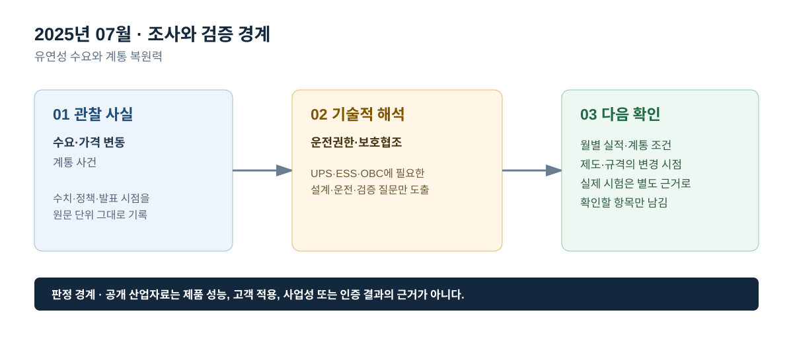

# 2025년 07월 · 유연성 수요와 계통 복원력

## 이번 달에 잡은 질문

7월에는 ‘전력수요가 많다’는 문장을 더 세분화한다. 계통은 공급량뿐 아니라 시간대별 수요, 날씨, 연료비, 재생에너지 출력, 송전 제약, 예비력, 보호·운영 규칙의 영향을 동시에 받는다. UPS는 이런 계통 조건이 흔들릴 때 중요부하를 보호하는 장치이고, ESS는 특정 조건에서 유연성 자원이 될 수 있으며, OBC는 충전 부하·양방향 자원이 되는 조건을 가진다. 세 제품을 동일한 ‘복원력 장치’라고 부르면 역할이 흐려진다.

## 그림으로 보는 이번 달

*그림 1. 공개 산업 신호를 UPS·ESS·OBC의 설계·검증 질문으로 연결한 도식이다. 제품 성능 또는 고객 적용 결과를 의미하지 않는다.*

*그림 2. 관찰 사실, 기술적 해석, 다음 확인 항목을 구분해 기록하는 기준이다.*

## 관찰 사실

IEA의 *Electricity Mid-Year Update 2025*는 세계 전력수요가 2025년 3.3%, 2026년 3.7% 증가할 것으로 전망했다. 같은 보고서는 2025년 상반기 일부 시장에서 도매 전력가격이 상승한 반면, 독일·네덜란드·스페인 등에서는 음의 가격이 발생한 시간 비중이 커졌다고 설명한다. 이는 전력의 ‘평균 가격’만으로 계통 유연성의 가치를 판단하기 어렵다는 공개 신호다.[^iea]

보고서는 2월 칠레와 4월 이베리아반도에서 발생한 대규모 정전을 언급하며, 전력계통이 복잡해질수록 견고한 전력망, 다양한 유연성 자원, 기술적 안정성, 운영·규정의 정합성이 중요하다고 지적한다. 이 사건은 한국의 계통 실적이나 특정 제품 결함의 근거가 아니며, 전력 복원력의 일반적인 점검 항목을 생각하게 하는 사례로만 사용한다.[^iea]

전력거래소의 7월 운영실적은 거래량 52,108 GWh, 전년 동월 대비 3.4% 증가를 기록했다. 7월 말 회원 수는 7,153개사, 설비용량은 143,937 MW였다. SMP는 120.39원/kWh로 전년 동월보다 9.1% 낮았다. 이 수치는 월간 잠정치이며, 가격 변화의 원인은 LNG 열량단가·가격결정 비율 등과 함께 읽어야 한다.[^kpx]

## ESS: 음의 가격·출력제어·저장장치를 같은 말로 쓰지 않는다

음의 가격이 늘어났다는 국제 사례는 변동성 전원과 수요·공급의 시간 불일치가 커질 수 있음을 보여 준다. 하지만 각 국가의 시장제도·재생에너지 비중·송전망·요금 구조가 다르므로, 해외의 음의 가격 비중을 한국의 ESS 사업수익으로 환산해서는 안 된다. ESS가 기술적으로 제공할 수 있는 기능은 에너지 이동, 빠른 출력 조정, 계통 지원 등이며, 실제 활용 여부는 계통 규정·계약·운영 지령과 연결된다.

제어 관점에서는 충전·대기·방전 전환과 지령 변화율이 우선이다. 예를 들어 Ramp Rate 검증은 전력 지령이 바뀔 때 PCS 출력이 어떤 기울기로 따라가는지 보는 항목이고, Ride-Through 검증은 전압·주파수 이상에서 운전을 유지·제한·정지·복귀하는 경계를 보는 항목이다. 이 동작은 시장가격 자료만으로 판정할 수 없다. 7월의 산업동향은 계통 유연성의 필요 배경을 적고, 포트폴리오에서는 그 배경과 분리된 HILS 시험 관점을 보여 주는 방식이 적절하다.

## UPS: 계통 복원력과 부하 연속성의 시간축

대규모 정전은 송전·발전·운영의 복합 문제일 수 있으며, UPS의 시간축은 이보다 짧고 국소적이다. UPS는 계통 이상을 감지하고 배터리·인버터 경로로 부하 출력을 유지하거나, 사전에 정의된 조건에서 바이패스로 전환한다. 병렬 UPS라면 모듈별 전류 분담, 동기 상태, 모듈 투입·분리 후 출력 회복까지 확인해야 한다. 즉 UPS는 계통을 복구하는 장치가 아니라 계통 복구 또는 백업 발전기 기동 전까지 중요부하가 견딜 시간을 만드는 장치로 읽어야 한다.

7월처럼 수요가 높아지는 계절에는 ‘전력수요가 많아서 UPS가 필요하다’보다 구체적인 질문이 유효하다. 부하가 동시에 기동할 때 전압 강하가 허용 범위 안에 있는가, 배터리 상태와 온도 조건이 백업 시간에 영향을 주는가, 바이패스와 발전기 전환이 어떤 순서로 일어나는가를 분리한다. 월간 시장통계는 이 시험의 배경이며 시험 성적서는 아니다.

## OBC: 충전 부하를 계통 유연성으로 보려면 필요한 조건

전기차 충전은 시간대에 따라 계통 부하가 될 수 있고, 양방향 충전은 조건이 갖춰졌을 때 유연성 자원이 될 가능성이 있다. 다만 차량의 연결 여부, 사용자의 이동 목적, 배터리 SOC·온도·수명, 충전 규격, 요금·보상 체계, 배전망 용량, 통신·제어 권한이 모두 충족돼야 한다. OBC의 V2G 기능을 설명할 때에는 전력 방향을 반대로 제어한다는 시스템 원리와, 실제 계통 참여가 가능한 제도·접속 요건을 구분한다.

## 다음 달 확인 항목

1. 하계 피크 달의 거래량·가격·설비 변화와 최대수요를 단위별로 확인한다.
2. 해외 정전 사례는 원인과 조사결과가 확정된 자료인지 확인하고, 다른 국가의 설계 기준으로 바로 전용하지 않는다.
3. ESS·OBC의 유연성은 기술 가능성, 접속 허용, 운영 계약의 세 층으로 나누어 기록한다.

## 참고자료

[^iea]: [IEA, *Electricity Mid-Year Update 2025*, 2025-07-30](https://www.iea.org/reports/electricity-mid-year-update-2025) · [Executive summary](https://www.iea.org/reports/electricity-mid-year-update-2025/executive-summary)
[^kpx]: [전력거래소, 2025년 7월 전력시장 운영실적(속보)](https://www.kpx.or.kr/boardDownload.es?bid=0086&list_no=75784&seq=1)
