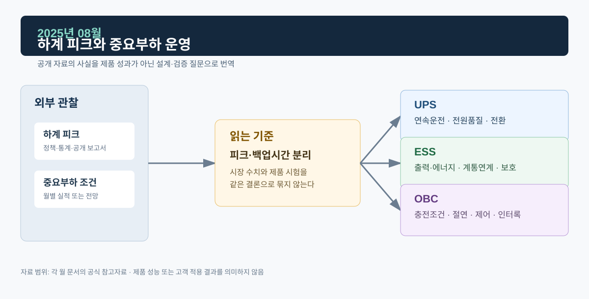

# 2025년 08월 · 하계 피크와 중요부하 운영

8월에는 전력거래소 8월 실적과 IEA 7월 전력 업데이트를 하계 피크의 배경으로 읽었다. 기온, 냉방 부하, 산업 가동, 재생에너지 출력 시간대, 연료비, 설비 정비, 송전 제약이 각자 다른 경로로 계통에 영향을 준다.

*그림. 하계 피크·중요부하 조건과 UPS·ESS·OBC*

## 자료

전력거래소의 2025년 8월 전력시장 운영실적에 따르면, 8월 거래량은 52,393 GWh로 전년 동월보다 2.8% 감소했다. SMP는 117.40원/kWh로 전년 동월보다 19.5% 낮았고, 전력거래소는 거래량 감소와 LNG 열량단가 하락을 배경으로 제시했다. 8월 말 회원 수는 7,281개사, 설비용량은 143,996 MW로 집계됐다. 잠정치이며, 다른 계절과 비교할 때는 기온·조업일수·연료비·제도 변화를 같이 본다.[^kpx]

IEA의 7월 전력 업데이트는 2025년 상반기 전력수요가 산업·냉방·데이터센터·전기화의 영향으로 강하게 증가했으며, 일부 지역에서는 폭염이 수요를 더했다고 설명했다.[^iea]

## UPS: 하계 부하 조건

중요부하가 있는 설비에서 하계 피크는 냉각·환기·통신·제어 같은 보조부하도 같이 변하는 시기일 수 있다. UPS는 정전·순간 전압 이상·부하 과도 때 출력 연속성을 유지해야 하고, 필요한 배터리 에너지는 부하 전력, 목표 지속시간, 방전율, 온도, 배터리 노화, 인버터 효율과 설계 여유로 정해진다.

확인은 사건 단위로 한다. 정전 신호 후 인버터가 부하를 계속 공급하는지, 급격한 부하 변화에서 출력전압이 어떻게 회복하는지, 병렬 모듈의 전류가 과도 뒤 다시 분담되는지, Hot Swap이나 바이패스 전환에서 부하가 끊기지 않는지를 각각 본다.

## ESS: 지속시간과 제약

ESS는 피크 시간대에 방전하거나 재생에너지 출력이 높은 시간대에 충전할 수 있지만, SOC 범위, 충·방전 전력, 배터리 온도, PCS 정격, 변압기·배전선로 용량, 계통 지령, 계약상 운전 의무가 서로 맞아야 한다. 같은 MW의 PCS라도 MWh가 다르면 피크를 지원할 수 있는 시간이 달라진다.

기술 검증은 지령 추종과 보호 협조가 중심이다. 출력 지령의 변화율, DC Bus와 배터리 상태, 계통 전압·주파수 이상에서의 상태전이, 계통 분리 검출과 복귀 조건을 확인한다.

## OBC: 충전 시간 이동

전기차 충전 부하는 하계 피크와 겹칠 수 있지만 모든 차량의 충전 시간을 마음대로 옮길 수는 없다. 차량이 연결돼 있는 시간, 사용자의 출발 시각, SOC, 충전 인프라의 제어 기능, 요금·보상, 배전선로 여유가 영향을 주고, V2G는 계통 접속·안전·통신 조건이 더 붙는다. OBC는 차량 내부 전력변환과 안전한 모드 전환을 맡고, 계통 수요관리 참여는 상위 시스템과 제도가 허용할 때 성립한다.

## 다음 달에 볼 것

- 9월 운영실적의 거래량·SMP·정산단가와 평균기온·최대수요
- 하계 이후 ESS·분산자원의 계통 연결 관련 자료

## 참고자료

[^kpx]: [전력거래소, 2025년 8월 전력시장 운영실적(속보), 2025-09-25](https://www.kpx.or.kr/boardDownload.es?bid=0086&list_no=75995&seq=1)
[^iea]: [IEA, *Electricity Mid-Year Update 2025*, 2025-07-30](https://www.iea.org/reports/electricity-mid-year-update-2025)
