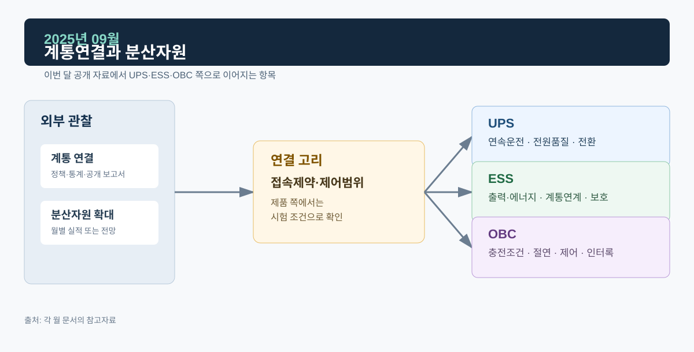

# 2025년 09월 · 계통연결과 분산자원

9월에는 전력거래소 9월 실적과 IEA의 중국 분산에너지자원(DER) 통합 보고서를 읽었다. 태양광, 배터리 ESS, 전기차, 유연 부하는 모두 분산자원으로 묶이지만 접속 지점·제어권한·계량·통신·보호 조건이 다르다. 설비가 늘어난 것과 그 설비가 계통에서 어떻게 운영되는지를 나눠서 본다.

*그림. 계통 연결·분산자원 확대와 UPS·ESS·OBC*

## 자료

전력거래소의 2025년 9월 전력시장 운영실적에 따르면, 9월 거래량은 46,660 GWh로 전년 동월과 거의 같았다. 9월 말 회원 수는 7,400개사, 설비용량은 144,814 MW였으며, 신재생 설비 증가와 LNG 설비 변화가 함께 기록됐다. SMP는 112.91원/kWh로 전년 동월보다 18.7% 낮았다.[^kpx]

IEA는 2025년 중국의 분산에너지자원(DER) 통합을 다룬 자료에서, 지붕형 태양광·배터리 저장장치·전기차·유연부하가 빠르게 늘 때 배전망의 수용용량, 시장 참여, 운영·규제 체계가 함께 바뀌어야 한다고 설명한다. 장비가 설치되는 것과 계통 자원으로 안전하게 운전되는 것 사이에 별도의 연결 과정이 있다는 점을 보여 준다.[^iea]

## ESS: 접속에서 시작하는 운전

ESS를 계통에 연결할 때는 배터리와 PCS 정격 외에 계통 접속점의 전압·단락용량·보호협조·변압기·케이블·통신, 계통 운영자가 요구하는 출력제한과 유효·무효전력 제어, 이상 시 분리와 재접속 조건이 정해진다. 같은 MW/MWh 설비라도 접속 위치와 계통 규정이 다르면 제공 가능한 서비스가 달라질 수 있다. 9월 설비용량 증가는 계통에 자원이 더 있다는 정도로 읽고, 실제 유연성 제공량은 운영 데이터로 확인한다.

포트폴리오의 ESS 사례는 Power Control, Ramp Rate, Voltage/Frequency Ride-Through, Anti-Islanding을 따로 다룬다. Anti-Islanding은 계통이 분리된 상황에서 PCS가 의도하지 않은 독립 전원으로 남지 않게 하는 보호다. 시험시간·설정값은 프로젝트와 규정에 따라 달라질 수 있다.

## OBC: 연결돼 있을 때만 계통과 만난다

전기차가 계통 자원으로 쓰이려면 충전 케이블이 연결돼 있고, 충전이 허용되는 시간이며, 배터리 SOC·온도·수명 조건이 맞고, 사용자가 출발 전에 필요한 에너지를 확보했고, 충전기와 차량이 양방향 기능을 지원하고, 상위 시스템에 안전한 통신·제어권한이 있어야 한다. OBC의 V2G·V2L 기능은 이 외부 조건과 차량 내부의 PFC·DC/DC·보호 제어가 동시에 맞을 때 운전 모드가 된다.

차량 배터리는 정지형 ESS와 에너지 상태·운전 목적이 다르고 보증·안전·사용자 편의·충전 규격까지 걸려 있다. ‘이동형 ESS’라고 부르기에는 조건이 많다.

## UPS: 중요부하 쪽 경계

분산자원·ESS·수요반응이 늘어도 개별 중요부하의 전원 품질 요구는 그대로다. UPS는 부하 가까이에서 전압 연속성을 제공한다. 입력 측에 더 다양한 전원·ESS·배전 조건이 생겨도 출력 측 시험은 부하 과도·병렬분담·정전·복전·바이패스·모듈 교체 같은 사건 중심으로 남는다.

## 다음 달에 볼 것

1. 10월 운영실적의 설비용량 증감(신재생·LNG)
2. 국내 계통접속 완료·상업운전 상태가 따로 공개되는 통계가 있는지

## 참고자료

[^kpx]: [전력거래소, 2025년 9월 전력시장 운영실적(속보)](https://www.kpx.or.kr/boardDownload.es?bid=0086&list_no=76083&seq=1)
[^iea]: [IEA, *Integrating Distributed Energy Resources in China*, 2025](https://www.iea.org/reports/integrating-distributed-energy-resources-in-china/executive-summary)
