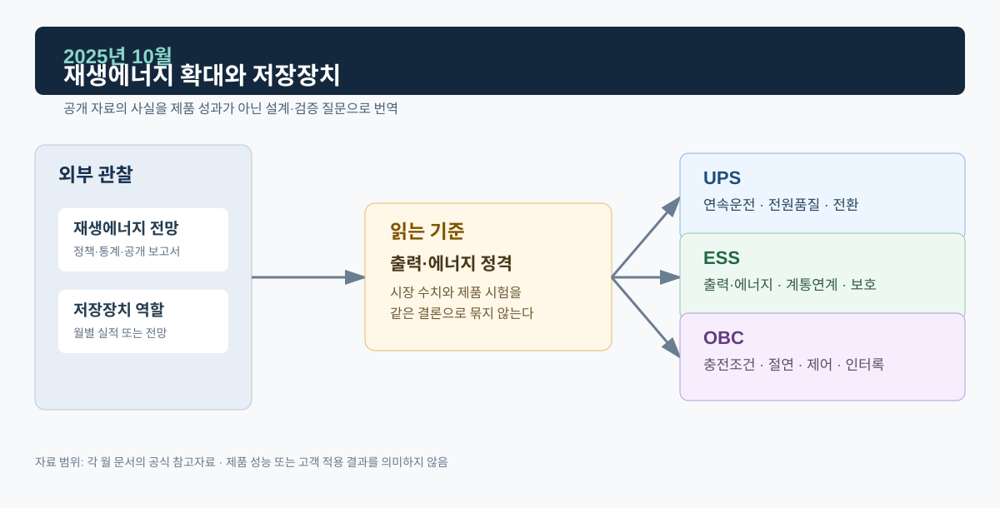
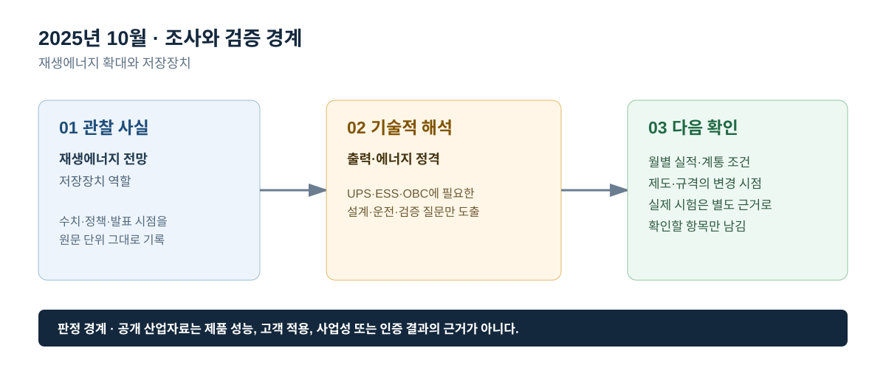

# 2025년 10월 · 재생에너지 확대와 저장장치

## 이번 달에 잡은 질문

재생에너지 설비가 늘면 ESS가 필요하다는 말은 방향을 설명하지만, 설계 조건을 충분히 주지는 않는다. 10월에는 재생에너지의 장기 확대 전망과 실제 월간 전력시장 실적을 분리해 읽고, ESS가 제공할 수 있는 시간 이동·출력 조정·계통 지원을 하나의 기능으로 뭉치지 않는다. UPS와 OBC도 재생에너지 확대의 간접적 배경을 갖지만, 제품 요구사항은 각자 다른 입력·출력·보호 경계에서 정의된다.

## 그림으로 보는 이번 달

*그림 1. 공개 산업 신호를 UPS·ESS·OBC의 설계·검증 질문으로 연결한 도식이다. 제품 성능 또는 고객 적용 결과를 의미하지 않는다.*

*그림 2. 관찰 사실, 기술적 해석, 다음 확인 항목을 구분해 기록하는 기준이다.*

## 관찰 사실

IEA의 *Renewables 2025*는 2025~2030년 세계 재생에너지 전력설비가 약 4,600 GW 증가할 것으로 전망했으며, 증가분의 약 80%가 태양광이 될 것으로 제시했다. 또한 변동성 재생에너지 비중이 높아질수록 출력제어, 음의 가격, 전력망·저장장치·수요유연성의 필요성이 커진다고 설명한다. 이는 세계 전망이며, 특정 국가의 태양광 접속용량이나 특정 ESS의 설치 계획을 뜻하지 않는다.[^iea]

전력거래소의 10월 운영실적에는 거래량 41,738 GWh, 10월 말 설비용량 145,469 MW, SMP 101.53원/kWh가 기록됐다. 설비용량 증감에는 신재생과 LNG 변화가 함께 포함돼 있다. 월간 설비용량이 늘었다는 사실만으로 재생에너지 출력제어량, ESS 충방전량, 계통 혼잡 여부를 판정할 수는 없다.[^kpx]

## ESS: 재생에너지와 ‘같이 설치’되는 것과 ‘유연성을 제공’하는 것은 다르다

ESS는 태양광·풍력 발전량이 높을 때 충전하고 수요가 높은 시간에 방전하는 방식으로 시간 이동을 할 수 있다. 그러나 실제 운전은 발전량 예측, 배터리 SOC, PCS 정격, 충전·방전 제한, 계통 접속점, 시장·계약 규칙, 열관리, 안전 제약의 영향을 받는다. 태양광과 같은 부지에 ESS가 설치됐다고 해도 모든 시간대에 충전·방전이 가능하다는 뜻은 아니다. 또한 2시간 시스템과 4시간 시스템은 같은 MW라 하더라도 제공 가능한 에너지와 운전전략이 다르다.

전력변환 검증에는 다시 다른 질문이 필요하다. PCS가 충방전 지령을 안정적으로 추종하는지, 전력 방향이 바뀔 때 DC Bus와 배터리 제한이 맞는지, 출력 변화율이 요구 조건을 지키는지, 전압·주파수 이상에서 정지 또는 운전유지 후 안전하게 복귀하는지를 확인한다. `재생에너지 확대`는 이 시험들이 필요한 배경을 설명하지만, 그 자체가 시험의 합격 판정은 아니다. 그래서 이 월의 산업동향에는 장기 전망과 단위·조건의 구분을 남긴다.

## UPS: 전원 믹스 변화와 부하 측 품질 요구

재생에너지 비중 증가로 계통 운영이 복잡해질 수 있어도, UPS가 보는 직접 입력은 현장의 AC 품질과 이상 조건이다. UPS는 정류부·인버터·배터리·바이패스가 부하 전력의 연속성을 확보하도록 동작한다. 입력 전원의 조성은 배경이지만, UPS 출력의 전압·주파수·과도 응답과 병렬 모듈의 전류분담을 대체하는 지표는 아니다. 중요부하는 언제나 현장 부하·발전기·바이패스·보호협조를 기준으로 요구사항을 정의해야 한다.

즉, 재생에너지 확대가 곧 UPS의 입력 품질 저하나 특정 제품의 수요 증가를 의미한다고 단정하지 않는다. 대신 전력계통이 다양한 전원과 수요를 통합하는 과정에서 전원 품질·복원력에 대한 설계 검토가 계속 중요하다는 수준에서 연결한다. 공개 포트폴리오의 UPS 파형은 그런 검토에서 확인할 구체적인 사건을 보여 주는 자료로 남긴다.

## OBC: 스마트 충전과 양방향 운전의 전제

태양광·풍력 출력의 시간적 변동이 커질수록 전기차 충전을 시간대와 계통 상태에 맞추는 스마트 충전이 논의될 수 있다. 하지만 OBC와 차량이 실제로 어느 정도의 충전 시점 이동 또는 역송 전력을 제공할 수 있는지는 차량 연결 상태, 배터리 조건, 충전기 규격, 사용자 동의, 요금·보상, 배전망 제약과 상위 제어를 함께 확인해야 한다. 따라서 재생에너지 확대 전망을 V2G가 이미 상용화됐다는 근거로 쓰지 않는다.

OBC의 기술 기록에서는 G2V·V2G·V2L의 전력 방향과 보호 조건을 구분하고, 실제 시장 참여·접속 규정은 별도 자료로 확인한다. 시스템 경계가 분명해야, 차량 내부 제어 검증과 전력계통 정책을 과장 없이 연결할 수 있다.

## 다음 달 확인 항목

- 재생에너지 확대 전망에서는 설비용량(GW)·발전량(TWh)·변동성 비중·저장장치 지속시간을 구분한다.
- ESS의 성능은 충방전 전력, 사용 가능 에너지, 응답시간, 보호·복귀로 분해해 확인한다.
- OBC의 스마트·양방향 충전은 기술 지원 여부와 실제 계통 참여 여부를 분리한다.

## 참고자료

[^iea]: [IEA, *Renewables 2025*](https://www.iea.org/reports/renewables-2025) · [Executive summary](https://www.iea.org/reports/renewables-2025/executive-summary)
[^kpx]: [전력거래소, 2025년 10월 전력시장 운영실적(속보)](https://kpx.or.kr/boardDownload.es?bid=0086&list_no=76335&seq=1)
