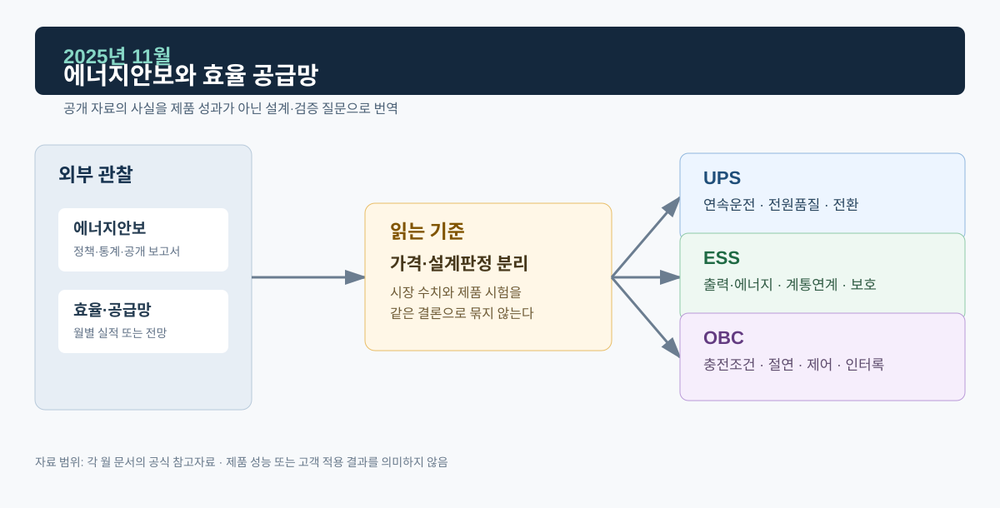

# 2025년 11월 · 에너지안보·효율·공급망

11월에는 IEA *World Energy Outlook 2025*, *Energy Efficiency 2025*와 11월 시장 실적을 읽었다. 에너지안보에는 연료 확보 외에 전력망, 중요부하 연속성, 배터리·전력전자 부품 공급망, 사이버·운영 위험, 기후로 인한 물리적 위험이 들어간다. 효율은 장비 발열·냉각·운전비·계통 피크와 이어지는 설계 변수로 본다.

*그림. 에너지안보·효율·공급망과 UPS·ESS·OBC*

## 자료

IEA의 *World Energy Outlook 2025*는 지정학적 긴장과 전략광물 수출 제한, 사이버·운영·기상 위험이 에너지안보의 핵심 요소가 되고 있다고 설명한다. 보고서는 전기화·재생에너지·원자력 확대와 함께 전략광물 공급망의 취약성을 장기적으로 살펴본다. 시나리오는 정책·기술·시장 선택에 따른 경로를 탐색하는 분석 틀로 제시된다.[^weo]

IEA의 *Energy Efficiency 2025*는 세계 에너지 효율 개선 속도가 2025년 1.8% 수준으로 개선될 것으로 보지만, 2030년 국제 목표에는 아직 부족하다고 평가했다. 보고서는 냉방 수요·산업의 에너지 집약도·기기 성능기준·투자·인력 등의 요소를 함께 다룬다.[^eff]

전력거래소의 11월 운영실적에 따르면 거래량은 42,095 GWh로 전년 동월보다 1.3% 감소했고, 11월 말 회원 수는 7,510개사, 설비용량은 145,563 MW였다(잠정치).[^kpx]

## UPS: 효율과 가용성

UPS 효율을 높이면 손실, 발열, 냉각 부담, 운전비가 달라진다. 중요부하 연속성은 그와 별도로 확인한다. 온라인 UPS라면 정류부·DC Link·인버터·배터리·바이패스의 경로별 고장·정비·절체 조건을 보고, 병렬운전 구성에서는 전류분담과 모듈 투입·분리 후 수렴, 부하 과도에서의 출력 품질까지 본다.

에너지안보와 연결하면 장비 공급망·예비품·배터리 교체·펌웨어 변경·정비 절차도 가용성 문제다. 변경 전후의 시험 시나리오와 회귀 확인이 필요한 이유가 여기에 있다.

## ESS: 공급망과 안전

배터리 ESS는 셀·모듈·랙의 공급망, BMS·PCS·변압기·보호·소방 설비의 구성, 설치·운영 절차와 엮여 있다. 전략광물이나 셀 공급망의 불확실성은 장기 비용과 조달 리드타임에 영향을 줄 수 있다. 안전성은 배터리 상태감시, 열관리, 보호협조, 비상정지, 설치 기준, 운영·유지보수처럼 시스템 수준에서 확인한다.

효율과 유연성도 나눠 본다. PCS 손실이 낮은 것과 필요한 시간에 충분한 에너지를 내는 것은 다른 문제다. 충방전 효율, 보조전력, 사용 가능한 SOC 범위, 열관리, 사이클 조건을 같이 봐야 한다.

## OBC: 보호 조건 안에서의 효율

OBC 효율은 PFC·DC/DC·자성부품·스위칭·열설계·제어전략과 관련되고, 절연·EMI·보호·내구 요구 안에서 평가한다. 차량 충전 환경에서는 입력전압·주파수, 배터리 전압·전류, 온도, 인터록, 통신, 고장 진단이 함께 작동한다. 부품 대체·단종·변경이 생기면 회로·제어·EMC·보호 영향 분석과 회귀시험이 필요하다. 요구사항–상태 설계–모델/코드–시험–변경 후 재확인이 끊기지 않고 이어져야 한다.

## 다음 달에 볼 것

1. 효율 비교 자료에서 입력·출력 조건, 부하율, 온도, 보조전력, 측정 기준이 어떻게 제시되는지
2. 12월 운영실적과 연간 누계

## 참고자료

[^weo]: [IEA, *World Energy Outlook 2025*, 2025-11-12](https://www.iea.org/reports/world-energy-outlook-2025) · [Executive summary](https://www.iea.org/reports/world-energy-outlook-2025/executive-summary)
[^eff]: [IEA, *Energy Efficiency 2025*, 2025-11-20](https://www.iea.org/reports/energy-efficiency-2025) · [Executive summary](https://www.iea.org/reports/energy-efficiency-2025/executive-summary)
[^kpx]: [전력거래소, 2025년 11월 전력시장 운영실적(속보)](https://kpx.or.kr/boardDownload.es?bid=0086&list_no=76561&seq=1)
