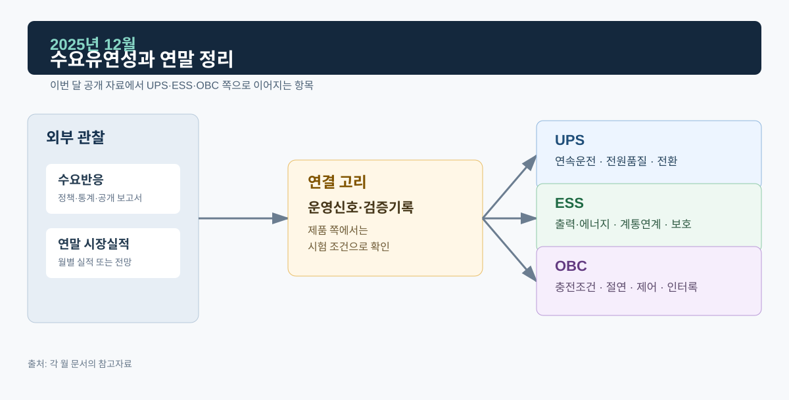
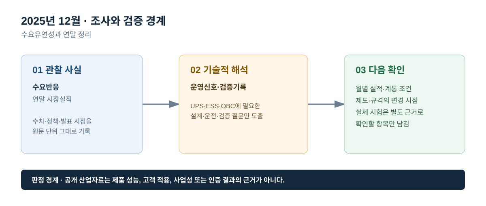

# 2025년 12월 · 수요유연성과 연말 정리

## 이번 달에 잡은 질문

연말에는 한 해의 시장 수치를 단순 합계로 끝내기보다, 다음 해에 어떤 지표를 반복 확인할지 정리한다. 전력수요가 증가하는 시스템에서는 발전·전력망·저장장치뿐 아니라 수요가 언제 얼마나 변할 수 있는지도 중요해진다. 다만 수요유연성은 모든 부하를 강제로 줄인다는 뜻이 아니라, 사용자가 허용한 범위에서 시간 또는 전력량을 조정하는 제도·제어·보상의 조합이다.

## 그림으로 보는 이번 달

*그림 1. 공개 산업 신호를 UPS·ESS·OBC의 설계·검증 질문으로 연결한 도식이다. 제품 성능 또는 고객 적용 결과를 의미하지 않는다.*

*그림 2. 관찰 사실, 기술적 해석, 다음 확인 항목을 구분해 기록하는 기준이다.*

## 관찰 사실

IEA의 *The Value of Demand Flexibility*는 전력수요가 증가하는 환경에서 수요유연성이 기존 발전·망 자산의 활용도를 높이고, 피크 스트레스·손실·출력제어를 줄이며, 청정에너지 통합을 돕는 수단이 될 수 있다고 설명한다. 이 자료는 수요유연성의 가치를 정책·운영 차원에서 다루며, 특정 UPS·ESS·OBC의 기능을 인증하거나 상용 운전을 확인하는 자료는 아니다.[^iea]

전력거래소의 12월 운영실적에 따르면, 12월 거래량은 48,493 GWh로 전년 동월보다 0.6% 감소했다. 12월 말 회원 수는 7,561개사, 설비용량은 146,156 MW였고, 설비 증감 내역에는 신재생과 ESS 12 MW가 포함됐다. SMP는 90.44원/kWh로 전년 동월보다 22.4% 낮았다. 전력거래소는 평균기온 상승에 따른 난방수요 감소와 연료비 변화를 함께 설명하며, 수치는 잠정치임을 밝힌다.[^kpx]

이 실적은 겨울철의 거래·가격 조건을 보여 주지만, 월별 SMP만으로 수요유연성 또는 ESS의 가치를 계산할 수는 없다. 실제 가치는 시간대별 가격, 계약, 계통 제약, 자원의 응답가능 시간, 소비자·사업자의 참여 조건, 배터리 사용 가능 에너지, 운영 규칙에 따라 달라진다. 연말 정리에서 중요한 것은 숫자를 과도하게 해석하지 않고, 다음 해의 질문을 더 정확하게 만드는 것이다.

## ESS: 저장장치와 수요유연성은 보완 관계다

ESS는 전력을 저장했다가 다른 시간에 공급하는 자원이고, 수요유연성은 부하의 사용 시점 또는 사용량을 조절하는 자원이다. 두 자원은 모두 피크 완화와 변동성 대응에 기여할 수 있지만, 설비 구성과 제어 대상이 다르다. ESS는 배터리 SOC·온도·PCS 정격·충방전 제한·계통 접속 상태를, 수요유연성은 부하 공정·사용자 동의·자동제어·통신·보상·복귀 조건을 고려한다. 따라서 한쪽이 있으면 다른 쪽이 불필요하다고 일반화할 수 없다.

ESS 검증에서는 충전·대기·방전 상태와 지령 추종, Ramp Rate, 전압·주파수 이상 시 Ride-Through, Anti-Islanding, 이상 후 복귀를 반복해서 확인한다. 수요유연성 논의가 확대돼도 이 전력변환·보호 검증의 기본은 바뀌지 않는다. 반대로 ESS의 존재가 모든 수요반응을 대체하지도 않는다. 연말에는 이러한 역할의 경계를 명확히 기록하는 것이 다음 해의 제도·시장 자료를 잘못 읽지 않는 방법이다.

## OBC: 스마트 충전은 수요유연성의 한 후보일 뿐이다

전기차 충전은 사용자가 허용하고 충전 인프라·요금·통신이 갖춰진 경우 시간 이동이 가능한 부하가 될 수 있다. 하지만 차량의 이동 목적과 배터리 SOC가 우선이므로, 모든 충전 부하를 동일하게 조절할 수 없다. V2G는 더 엄격하다. 차량·충전기·배전망이 양방향 전력전달을 지원하고, 계통 접속·보호·계량·정산 조건이 충족돼야 한다. OBC 내부에서는 여전히 PFC, 절연형 DC/DC, 배터리 제한, 인터록, 안전 정지와 재기동을 검증해야 한다.

따라서 이 문서에서는 ‘전기차가 수요유연성을 제공한다’고 단정하지 않는다. 올바른 표현은 기술·제도·사용자 조건이 충족되는 환경에서 스마트 충전 또는 양방향 충전이 수요유연성에 기여할 수 있다는 것이다. 실제 참여 규모와 효과는 별도 계통·시장·실증 자료가 필요하다.

## UPS: 조절하지 않는 부하의 연속성

중요부하는 수요를 줄이거나 이동하기 어려운 경우가 많다. 이때 UPS의 역할은 수요유연성을 제공하는 것이 아니라, 입력 전원 이상 중에도 해당 부하가 허용하는 전원 품질을 유지하는 것이다. UPS는 배터리·인버터·바이패스·병렬 모듈을 통해 짧은 시간축의 연속성을 다루고, 발전기나 상위 전력망 복구와 시간적으로 협조한다. 이 기능은 ESS의 장시간 에너지 이동이나 전기차 충전의 시간 이동과 구분해야 한다.

연말에는 UPS 사례에서 보이는 부하 과도, 전류 분담, Hot Swap의 의미를 다시 확인한다. 각 파형은 모듈·부하·출력의 관계를 보는 자료이지, 한 해 전체의 전력시장 안정성을 의미하지 않는다. 산업 동향과 제품 검증을 분리한 이 기록 방식이 다음 해에도 공개 범위를 지키면서 기술적 연결을 만들 수 있다.

## 2026년으로 이어갈 확인 항목

1. 월별 전력시장 실적은 공표일·잠정/확정 여부·수치 단위를 함께 기록한다.
2. ESS는 설치·접속·계약·운전·안전·보호 데이터를 다른 출처로 분리한다.
3. OBC의 G2V·V2L·V2G는 차량 내부 전력변환과 외부 제도·접속 조건을 분리해 정리한다.
4. UPS는 시장 동향보다 실제 중요부하 조건과 전환·과도·병렬운전 시험을 중심으로 계속 기록한다.

## 참고자료

[^iea]: [IEA, *The Value of Demand Flexibility*, 2025-12-23](https://www.iea.org/reports/the-value-of-demand-flexibility) · [Executive summary](https://www.iea.org/reports/the-value-of-demand-flexibility/executive-summary)
[^kpx]: [전력거래소, 2025년 12월 전력시장 운영실적(속보), 2026-01-20](https://kpx.or.kr/boardDownload.es?bid=0086&list_no=76663&seq=1)
