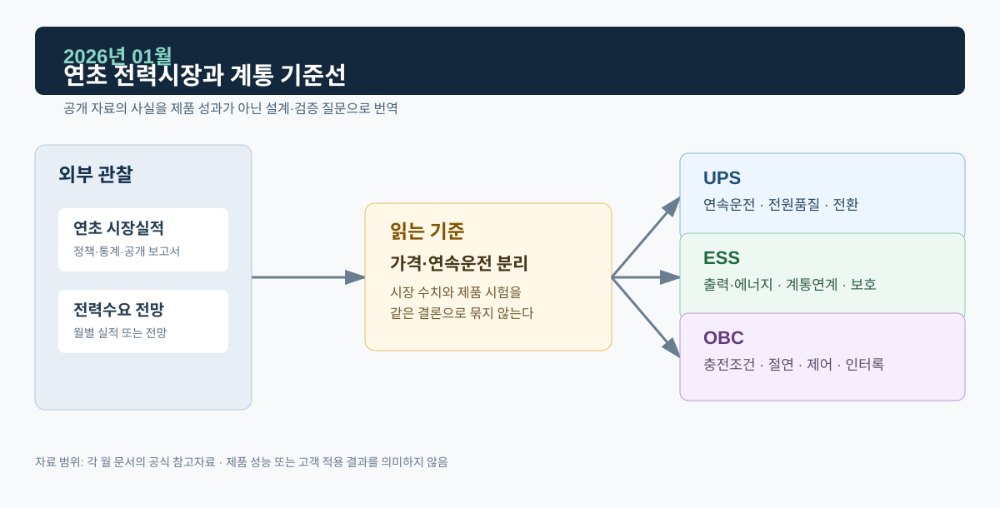

# 2026년 01월 · 연초 전력시장과 계통 기준선

1월에는 전력거래소 1월 운영실적 속보와 2026년 2월에 나온 IEA *Electricity 2026*을 연초 기준선으로 읽었다. 앞의 것은 그 달의 실적이고, 뒤의 것은 이후에 발표된 전망이다. 1월 속보에서는 시장가격과 거래금액이 서로 다른 방향으로 움직였다.

*그림. 연초 시장실적·전력수요 전망과 UPS·ESS·OBC*

## 자료

전력거래소의 `2026년 1월 전력시장 운영실적(속보)`는 최종정산 일부가 반영되지 않은 잠정치다. 이 자료에서 시장가격은 전년 동월보다 낮아졌지만 RPS 의무이행비용 증가가 함께 반영돼 거래금액은 전년 동월 대비 6.3% 증가한 것으로 설명됐다.[^kpx]

IEA의 *Electricity 2026*은 2026년 2월에 발간된 연간 전망으로, 2026~2030년의 수요·공급·배출 전망과 함께 전력망 및 유연성의 과제를 별도 장으로 다룬다. 세계 전력시장 자료라서 전력망 연결과 수요 유연성을 따로 살펴볼 배경으로 쓴다.[^iea]

## UPS · ESS · OBC

UPS에서는 정전·순간 전압 이상·부하 과도에서 출력이 유지되는지가 핵심이다. 연초에 볼 항목은 입력 이상 시 인버터가 부하를 계속 공급하는지, 배터리 전환과 복귀가 안정적인지, 병렬 모듈과 바이패스가 의도대로 협조하는지다.

ESS의 기여나 경제성을 계산하려면 PCS 정격, 배터리 에너지, SOC 운전 범위, 계통 접속 용량, 지령 이행 의무가 필요하다. 이번 달 가격 변화는 시간대별 유연성 필요를 다시 확인할 신호 정도로 읽는다.

OBC는 입력 전압·주파수, 배터리 전압 범위, 전류 제한, 절연·인터록·통신 상태에서 안전하게 충전·정지·복귀해야 한다. 전력수요나 시장가격은 차량 충전 환경의 배경이고, 판정은 PFC·절연형 DC/DC·보호제어 시험으로 한다.

## 다음 달에 볼 것

1. 1월 잠정 실적이 최종정산과 이후 월 실적에서 어떻게 달라지는지
2. 계통연결 대기, 수요반응, 배터리 저장장치에 관한 공개 지표

## 참고자료

[^kpx]: [전력거래소, 2026년 1월 전력시장 운영실적(속보)](https://www.kpx.or.kr/boardDownload.es?bid=0086&list_no=76838&seq=1)
[^iea]: [IEA, *Electricity 2026*, 2026-02-06](https://www.iea.org/reports/electricity-2026)
