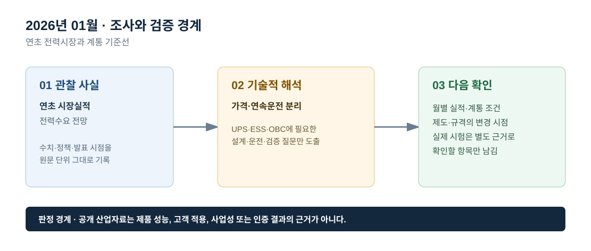

# 2026년 01월 · 연초 전력시장과 계통 기준선

## 이번 달에 잡은 질문

연초 기록은 시장 전망을 바로 제품 수요로 바꾸는 문서가 아니다. 1월에는 전력시장 잠정 실적과 연간 전력 전망이 서로 다른 시점에 공표되므로, ‘해당 월에 발생한 실적’과 ‘이후에 발표된 전망’을 나눠서 보아야 한다. 이 기록은 2026년 1월의 국내 시장자료를 기준점으로 두고, UPS·ESS·OBC에서 확인할 전원품질·계통연계·충전환경의 질문을 남긴다.

## 그림으로 보는 이번 달

*그림 1. 공개 산업 신호를 UPS·ESS·OBC의 설계·검증 질문으로 연결한 도식이다. 제품 성능 또는 고객 적용 결과를 의미하지 않는다.*

*그림 2. 관찰 사실, 기술적 해석, 다음 확인 항목을 구분해 기록하는 기준이다.*

## 관찰 사실

전력거래소의 `2026년 1월 전력시장 운영실적(속보)`는 최종정산 일부가 반영되지 않은 잠정치임을 명시한다. 이 자료에서 시장가격은 전년 동월보다 낮아졌지만 RPS 의무이행비용 증가가 함께 반영돼 거래금액은 전년 동월 대비 6.3% 증가한 것으로 설명됐다. 따라서 시장가격과 거래금액을 같은 의미로 읽을 수 없으며, 월간 수치는 최종정산 값과 달라질 수 있다.[^kpx]

IEA의 *Electricity 2026*은 2026년 2월에 발간된 연간 전망으로, 2026~2030년의 수요·공급·배출 전망과 함께 전력망 및 유연성의 과제를 별도 장으로 다룬다. 보고서의 대상은 세계 전력시장이므로 국내 1월 실적을 설명하는 자료가 아니라, 연초 기준선에서 전력망 연결과 수요 유연성을 별도로 살펴봐야 한다는 배경 자료로 쓴다.[^iea]

## UPS · ESS · OBC로 나누어 본 해석

**UPS는 시장가격이 아니라 중요부하의 전원 연속성을 확인한다.** 월간 정산이나 RPS 비용 변화는 UPS가 정전·순간 전압 이상·부하 과도에서 출력을 유지하는지 알려주지 않는다. 연초에 확인할 항목은 입력 이상 시 인버터가 부하를 계속 공급하는지, 배터리 전환과 복귀가 안정적인지, 병렬 모듈과 바이패스가 의도대로 협조하는지다. 시장 지표는 중요부하가 놓인 계통 환경의 배경으로만 기록한다.

**ESS는 가격 신호와 운전 제약을 분리한다.** 월간 거래금액이 변해도 PCS 정격, 배터리 에너지, SOC 운전 범위, 계통 접속 용량, 지령 이행 의무가 없으면 ESS의 기여나 경제성을 계산할 수 없다. 이 문서에서는 가격 변화를 ‘시간대별 유연성의 필요를 다시 확인할 신호’ 정도로만 읽고, MW·MWh·운전시간·보호 설정은 별도의 설계 및 시험 근거로 확인한다.

**OBC는 보급 또는 전력시장 지표와 충전 성능을 직접 연결하지 않는다.** OBC는 입력 전압·주파수, 배터리 전압 범위, 전류 제한, 절연·인터록·통신 상태에서 안전하게 충전·정지·복귀해야 한다. 전력수요나 시장가격은 차량 충전 환경의 배경이지만, PFC·절연형 DC/DC·보호제어의 판정을 대신하지 않는다.

## 다음 달 확인 항목

1. 1월 잠정 실적이 최종정산 및 이후 월 실적과 어떻게 달라지는지 확인한다.
2. 계통연결 대기, 수요반응, 배터리 저장장치의 공개 지표를 한 단위로 섞지 않는다.
3. UPS·ESS·OBC의 실제 시험 항목은 공개 사례 문서의 파형·HILS·학습 화면과 구분해 기록한다.

## 참고자료

[^kpx]: [전력거래소, 2026년 1월 전력시장 운영실적(속보)](https://www.kpx.or.kr/boardDownload.es?bid=0086&list_no=76838&seq=1)
[^iea]: [IEA, *Electricity 2026*, 2026-02-06](https://www.iea.org/reports/electricity-2026)

> 기록 원칙: 공개된 시장 실적과 전망을 제품 성능, 고객 적용, 인증 또는 사업 결과로 확대 해석하지 않는다.
