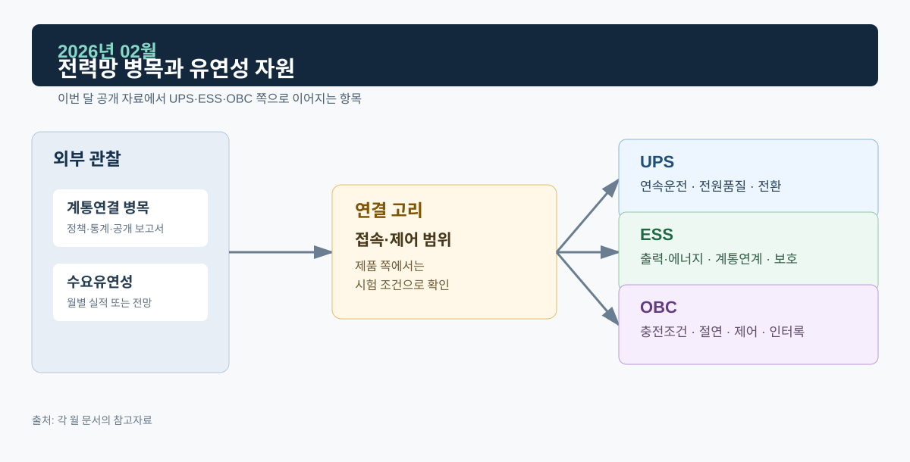
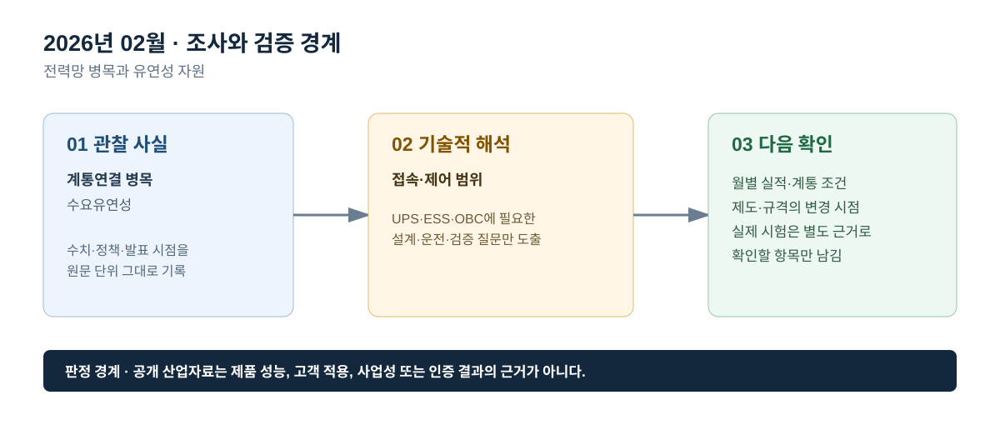

# 2026년 02월 · 전력망 병목과 유연성 자원

## 이번 달에 잡은 질문

재생에너지·저장장치·새로운 전력수요가 늘어도 실제 계통에 연결되는 과정은 별도의 제약을 받는다. 2월에는 전력망의 접속 여유, 혼잡 관리, 수요 유연성, 배터리 저장장치가 어떤 역할을 맡는지를 중심으로 본다. 여기서 ‘연결 병목’은 특정 국가나 사업장의 현황을 단정하는 말이 아니라, 공개 보고서가 제시한 전력망 일반 과제다.

## 그림으로 보는 이번 달

*그림 1. 공개 산업 신호를 UPS·ESS·OBC의 설계·검증 질문으로 연결한 도식이다. 제품 성능 또는 고객 적용 결과를 의미하지 않는다.*

*그림 2. 관찰 사실, 기술적 해석, 다음 확인 항목을 구분해 기록하는 기준이다.*

## 관찰 사실

IEA *Electricity 2026*의 전력망 장은 여러 지역에서 계통 용량 부족과 접속 대기열이 공급·수요·저장장치 연결을 늦추는 병목으로 나타난다고 설명한다. 보고서는 비확정 접속, 혼잡 관리, 단일 접속점에서 여러 발전원과 BESS를 함께 운영하는 방식, 수요 측 참여와 대규모 배터리 저장장치를 보완 수단으로 다룬다.[^grid]

국내 2월 전력시장 운영실적(속보)에서는 거래량이 42,152 GWh로 전년 동월보다 6.7% 감소했고, 거래금액은 56,207억원으로 11.0% 감소했다. 전력거래소는 시장가격 하락과 거래량 감소를 함께 배경으로 제시한다. 이 자료는 국내 한 달의 정산 결과이며, IEA의 계통 연결 분석과 같은 범위의 자료는 아니다.[^kpx]

## UPS · ESS · OBC로 나누어 본 해석

**UPS는 계통 접속 병목을 설비 신뢰도 주장으로 바꾸지 않는다.** 중요부하가 늘어나는 환경에서 UPS의 역할은 입력 전원 이상 시 부하 연속성을 유지하는 것이다. 그러나 접속 대기나 송전 제약의 존재만으로 백업시간이나 설비 구성의 정답이 결정되지는 않는다. 실제 설계에는 부하 전력, 요구 지속시간, 배터리 상태, 병렬 구성, 바이패스 전략, 현장 전원계통을 별도로 확인해야 한다.

**ESS는 접속 용량과 제어 권한을 함께 본다.** 배터리 저장장치는 유연성에 기여할 수 있지만, 접속점의 열적 한계와 보호협조, PCS의 유효·무효전력 제어 범위, SOC, 계약된 지령이 서로 맞아야 한다. ‘BESS가 연결 병목을 완화한다’는 공개 보고서의 설명을 개별 프로젝트의 허가·수익·운전 성과로 읽지 않는다.

**OBC는 충전 부하의 위치와 시간을 고려한다.** 차량 대수가 늘어도 충전 부하는 주차 위치, 접속 배전선로, 충전 시간, 충전기 제어 기능, 사용자 요구 SOC에 따라 다르게 나타난다. OBC의 차량 내부 전력변환 성능은 이러한 상위 계통 조건과 별도로 PFC·절연·보호·인터록 시험으로 확인한다.

## 다음 달 확인 항목

1. 계통 접속과 운영 제약을 설명하는 공개 제도·통계가 있는지 확인한다.
2. ESS 자료에서는 PCS 출력, 배터리 에너지, 접속 용량, 운전 지령을 한 개의 ‘용량’으로 표현하지 않는다.
3. OBC·충전 인프라·V2G를 같은 범주로 단정하지 않고 적용 계층을 구분한다.

## 참고자료

[^grid]: [IEA, *Electricity 2026 — Grids*](https://www.iea.org/reports/electricity-2026/grids)
[^kpx]: [전력거래소, 2026년 2월 전력시장 운영실적(속보)](https://www.kpx.or.kr/boardDownload.es?bid=0086&list_no=77013&seq=1)

> 기록 원칙: 계통 연결의 공개 이슈는 설계 질문을 만들기 위한 배경이며, 특정 설비의 접속 가능 여부나 성능 판정 근거가 아니다.
