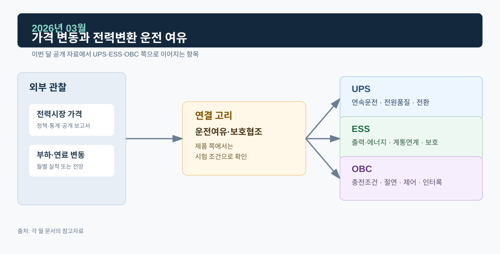

# 2026년 03월 · 가격 변동과 전력변환 운전 여유

3월 운영실적 속보에서는 거래량이 줄었는데 거래금액은 늘었다. 이 자료와 IEA *Electricity 2026*의 유연성 장을 읽고, 전력변환 설비의 운전 여유를 정격과 보호 조건으로 정리했다.

*그림. 전력시장 가격·부하와 연료 변동, UPS·ESS·OBC*

## 자료

전력거래소의 2026년 3월 운영실적(속보)에서 거래량은 43,522 GWh로 전년 동월보다 2.6% 감소했고, 거래금액은 58,329억원으로 7.3% 증가했다. 누계 거래량은 전년 같은 기간보다 1.4% 감소했지만 누계 거래금액은 0.7% 증가한 것으로 제시된다. 속보는 잠정치다.[^kpx]

IEA는 *Electricity 2026*에서 변동형 재생에너지와 배터리, 전기차·히트펌프·데이터센터와 같은 시간·지역 집중형 부하가 늘어나는 환경에서 계통 유연성이 중요하다고 정리한다.[^flex]

## UPS · ESS · OBC

UPS 전력품질은 입력 이상 시 전환, 부하 급변 시 회복, 바이패스와 병렬 운전의 상태전이를 파형이나 시험 절차로 확인한다. 출력전압 과도 응답, 배터리 방전 지속시간, 모듈 전류분담도 시험 기록에서 읽는다.

ESS의 운전 여유는 SOC와 정격으로 표현한다. 배터리에 에너지가 남아 있고 PCS·변압기·계통 접속이 해당 출력 변화를 허용해야 유연성을 낼 수 있다. MW와 MWh, 지령 변화율, SOC 범위, 보호 동작은 각각 따로 적는다.

OBC 쪽에서 충전 시간 이동이나 V2G 참여는 차량 연결 시간, 사용자 출발 시각, 충전기와 상위 시스템의 제어권한, 통신·안전 조건이 있을 때 논의할 수 있다. OBC 자체는 입력 조건과 배터리 상태에서 전류·전압을 제어하고 인터록에 따라 안전하게 정지·복귀하는지 확인한다.

## 다음 달에 볼 것

1. 운영실적의 거래량·거래금액·가격·비용 항목별 산식
2. 4월 속보에서도 거래량과 거래금액의 방향이 엇갈리는지

## 참고자료

[^kpx]: [전력거래소, 2026년 3월 전력시장 운영실적(속보)](https://www.kpx.or.kr/boardDownload.es?bid=0086&list_no=77209&seq=1)
[^flex]: [IEA, *Electricity 2026 — Flexibility*](https://www.iea.org/reports/electricity-2026/flexibility)
