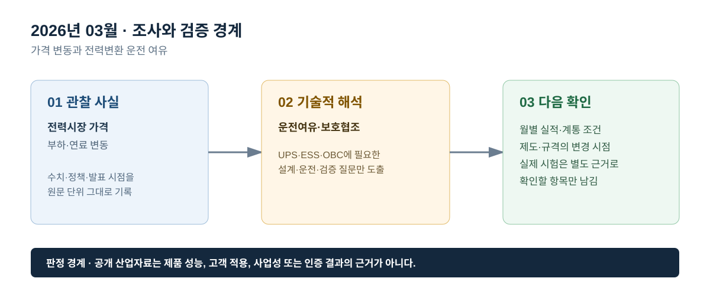

# 2026년 03월 · 가격 변동과 전력변환 운전 여유

## 이번 달에 잡은 질문

시장 거래량과 거래금액의 방향이 다르게 움직일 때, 전력변환 설비의 기술 판단은 무엇을 기준으로 해야 하는가. 3월에는 공개된 월간 시장 실적을 읽되, 가격·비용·거래량의 변화가 UPS·ESS·OBC의 성능 시험을 곧바로 의미하지 않는다는 경계를 확인한다. 제품의 운전 여유는 시장 그래프가 아니라 전기적 정격과 보호 조건으로 판단한다.

## 그림으로 보는 이번 달

*그림 1. 공개 산업 신호를 UPS·ESS·OBC의 설계·검증 질문으로 연결한 도식이다. 제품 성능 또는 고객 적용 결과를 의미하지 않는다.*

*그림 2. 관찰 사실, 기술적 해석, 다음 확인 항목을 구분해 기록하는 기준이다.*

## 관찰 사실

전력거래소의 2026년 3월 운영실적(속보)에서 거래량은 43,522 GWh로 전년 동월보다 2.6% 감소했고, 거래금액은 58,329억원으로 7.3% 증가했다. 누계 거래량은 전년 같은 기간보다 1.4% 감소했지만 누계 거래금액은 0.7% 증가한 것으로 제시된다. 월간 거래량과 거래금액이 서로 다른 방향으로 움직일 수 있다는 점을 확인할 수 있으며, 속보는 잠정치다.[^kpx]

IEA는 *Electricity 2026*에서 변동형 재생에너지와 배터리, 전기차·히트펌프·데이터센터와 같은 시간·지역 집중형 부하가 늘어나는 환경에서 계통 유연성이 중요하다고 정리한다. 이 설명은 개별 설비의 운전 한계가 아니라, 수요·공급 패턴이 변할 때 계통 운영에 필요한 수단을 다룬 것이다.[^flex]

## UPS · ESS · OBC로 나누어 본 해석

**UPS는 ‘가격 변동’ 대신 입력 이상과 부하 응답을 본다.** 시장가격이 올랐거나 거래금액이 늘었다는 사실은 UPS 출력전압의 과도 응답, 배터리 방전 지속시간, 모듈 전류분담을 말해주지 않는다. 전력품질을 확인하려면 입력 이상 시 전환, 부하 급변 시 회복, 바이패스와 병렬 운전의 상태전이를 파형 또는 시험 절차로 따로 확인해야 한다.

**ESS는 운전 여유를 SOC와 정격으로 표현한다.** 유연성은 배터리에 에너지가 남아 있고 PCS·변압기·계통 접속이 해당 출력 변화를 허용할 때 제공될 수 있다. 월간 시장 변화는 지령 추종, Ramp Rate, 전압·주파수 이상 시 상태전이, 계통 분리 검출과 복귀 조건을 대체하지 않는다. 따라서 MW와 MWh, 지령 변화율, SOC 범위, 보호 동작을 같은 문장에서 분리해 기록한다.

**OBC는 계통 비용과 차량 충전 제어를 분리한다.** 충전 시간의 이동이나 V2G 참여는 차량 연결 시간, 사용자 출발 시각, 충전기와 상위 시스템의 제어권한, 통신·안전 조건이 있을 때에만 논의할 수 있다. OBC 자체는 입력 조건과 배터리 상태에서 전류·전압을 제어하고 인터록에 따라 안전하게 정지·복귀하는지 확인하는 장치다.

## 다음 달 확인 항목

1. 월간 실적의 거래량·거래금액·가격·비용 항목을 단위와 산식까지 구분한다.
2. ESS의 시장 참여 가능성과 전기적 시험 결과를 서로 인용하지 않는다.
3. UPS와 OBC는 실제 부하·차량 조건이 공개되지 않은 경우 정량 성능을 추정하지 않는다.

## 참고자료

[^kpx]: [전력거래소, 2026년 3월 전력시장 운영실적(속보)](https://www.kpx.or.kr/boardDownload.es?bid=0086&list_no=77209&seq=1)
[^flex]: [IEA, *Electricity 2026 — Flexibility*](https://www.iea.org/reports/electricity-2026/flexibility)

> 기록 원칙: 월간 시장자료는 운전 환경을 읽는 참고자료이고, 전력변환기의 정격·보호·제어 성능 판정 자료가 아니다.
