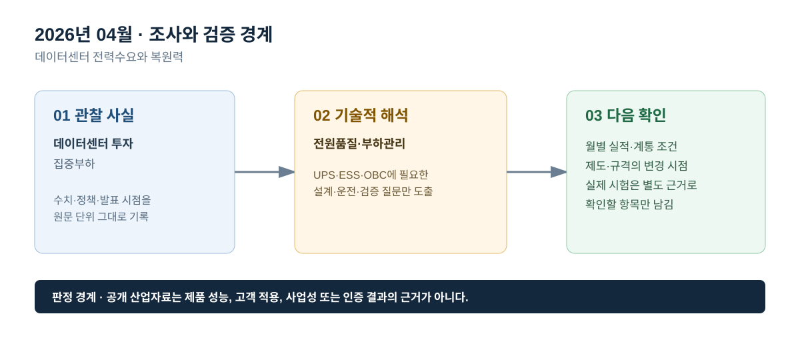

# 2026년 04월 · 데이터센터 전력수요와 복원력

## 이번 달에 잡은 질문

데이터센터 투자와 전력수요가 늘어난다는 공개 소식은 UPS의 필요성을 쉽게 떠올리게 한다. 하지만 중요부하의 확대라는 산업 신호와 특정 현장의 UPS 사양·백업시간·계약 물량은 다른 층위다. 4월에는 집중형 대규모 부하가 전력망과 복원력에 던지는 질문을 정리하고, 공개 자료가 말하지 않는 현장 조건은 비워 둔다.

## 그림으로 보는 이번 달

*그림 1. 공개 산업 신호를 UPS·ESS·OBC의 설계·검증 질문으로 연결한 도식이다. 제품 성능 또는 고객 적용 결과를 의미하지 않는다.*

*그림 2. 관찰 사실, 기술적 해석, 다음 확인 항목을 구분해 기록하는 기준이다.*

## 관찰 사실

IEA는 2026년 4월 발표한 데이터센터 전력수요 관련 분석에서 2025년 대형 기술기업 5곳의 자본지출이 4,000억 달러를 넘었고, 2026년에는 추가로 75% 늘어날 것으로 전망했다. 이 발표는 데이터센터 전력수요·접속·에너지 조달이 빠르게 중요한 주제가 되고 있음을 다루며, 개별 데이터센터의 설비 구성이나 UPS 제품 성능을 공개한 자료는 아니다.[^iea]

같은 자료는 데이터센터와 같은 대형 부하가 전력 확보와 계통 접속의 시간·위치 문제를 함께 만든다고 설명한다. 따라서 ‘데이터센터 증가’라는 한 문장만으로 전력수요, 전원품질, 냉각부하, 비상전원, 배전계통의 문제를 모두 설명할 수 없다. 공개 자료에서는 전력수요 배경과 계통 제약을 구분해 읽는다.

## UPS · ESS · OBC로 나누어 본 해석

**UPS는 중요부하 복원력의 시험 항목으로 연결한다.** 데이터센터가 대표적인 중요부하라는 사실은 UPS의 역할을 설명하는 배경이지만, 실제 백업시간은 IT 부하·냉각·통신·제어 보조부하, 배터리 상태, 설계 여유에 따라 달라진다. 확인은 정전 후 부하 연속성, 입력 이상 시 전환, 부하 과도 시 출력 회복, 병렬·바이패스 상태전이처럼 사건 중심의 시험으로 해야 한다.

**ESS는 대규모 부하의 계통 영향을 단독으로 해결한다고 쓰지 않는다.** ESS는 일정 조건에서 시간대 사이 전력을 이동하거나 유효·무효전력 제어를 지원할 수 있다. 다만 실제 효과는 접속 위치, 계통 지령, PCS·배터리 정격, SOC, 보호협조, 계약 구조에 따라 달라진다. 데이터센터 전력수요가 크다는 사실만으로 ESS 용량이나 운영 성과를 계산하지 않는다.

**OBC는 별도의 전동화 부하로 남긴다.** 데이터센터 부하와 차량 충전 부하는 모두 전력수요 변화와 관련 있지만, 시간대·접속 위치·사용자 제약·제어 방식이 다르다. OBC의 충전 제어와 안전 검증을 데이터센터 전원품질 사례로 대체하지 않고, 차량 입력·배터리·인터록 조건에서 별도로 검증한다.

## 다음 달 확인 항목

1. 중요부하의 전력수요와 전원품질 요구를 동일한 지표로 표현하지 않는다.
2. UPS 문서에는 실제 현장 부하·백업시간이 공개되지 않은 경우 시험 항목만 기록한다.
3. ESS와 대규모 부하의 연계는 접속·보호·운영권한의 공개 근거가 있을 때만 구체화한다.

## 참고자료

[^iea]: [IEA, 「Data centre electricity use surged in 2025」, 2026-04-16](https://www.iea.org/news/data-centre-electricity-use-surged-in-2025-even-with-tightening-bottlenecks-driving-a-scramble-for-solutions)

> 기록 원칙: 데이터센터 관련 공개 전망은 중요부하 환경을 이해하기 위한 자료이며, 특정 고객·설비의 요구사항이나 납품 실적을 뜻하지 않는다.
