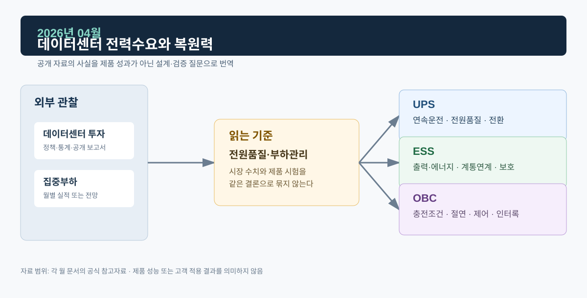

# 2026년 04월 · 데이터센터 전력수요와 복원력

4월에는 IEA의 데이터센터 전력수요 분석을 읽었다. 대형 기술기업의 자본지출과 데이터센터 전력수요가 빠르게 늘면서, 집중형 대규모 부하가 전력 확보·계통 접속·복원력에 어떤 질문을 던지는지 정리했다.

*그림. 데이터센터 투자·집중부하와 UPS·ESS·OBC*

## 자료

IEA는 2026년 4월 발표한 데이터센터 전력수요 관련 분석에서 2025년 대형 기술기업 5곳의 자본지출이 4,000억 달러를 넘었고, 2026년에는 추가로 75% 늘어날 것으로 전망했다. 발표는 데이터센터 전력수요·접속·에너지 조달이 빠르게 중요한 주제가 되고 있음을 다루며, 데이터센터 같은 대형 부하가 전력 확보와 계통 접속의 시간·위치 문제를 함께 만든다고 설명한다.[^iea]

## UPS · ESS · OBC

UPS 쪽에서 데이터센터는 대표적인 중요부하다. 실제 백업시간은 IT 부하·냉각·통신·제어 보조부하, 배터리 상태, 설계 여유에 따라 달라진다. 확인은 정전 후 부하 연속성, 입력 이상 시 전환, 부하 과도 시 출력 회복, 병렬·바이패스 상태전이 같은 사건 단위 시험으로 한다.

ESS는 일정 조건에서 시간대 사이 전력을 옮기거나 유효·무효전력 제어를 지원할 수 있다. 효과는 접속 위치, 계통 지령, PCS·배터리 정격, SOC, 보호협조, 계약 구조에 따라 달라진다.

데이터센터 부하와 차량 충전 부하는 둘 다 전력수요 변화와 관련 있지만 시간대·접속 위치·사용자 제약·제어 방식이 다르다. OBC의 충전 제어와 안전은 차량 입력·배터리·인터록 조건에서 따로 검증한다.

## 다음 달에 볼 것

1. 데이터센터 접속·전원 확보에 관한 국내 공개 자료
2. ESS를 대규모 부하와 연계한 사례 중 접속·보호·운영권한이 공개된 것

## 참고자료

[^iea]: [IEA, 「Data centre electricity use surged in 2025」, 2026-04-16](https://www.iea.org/news/data-centre-electricity-use-surged-in-2025-even-with-tightening-bottlenecks-driving-a-scramble-for-solutions)
