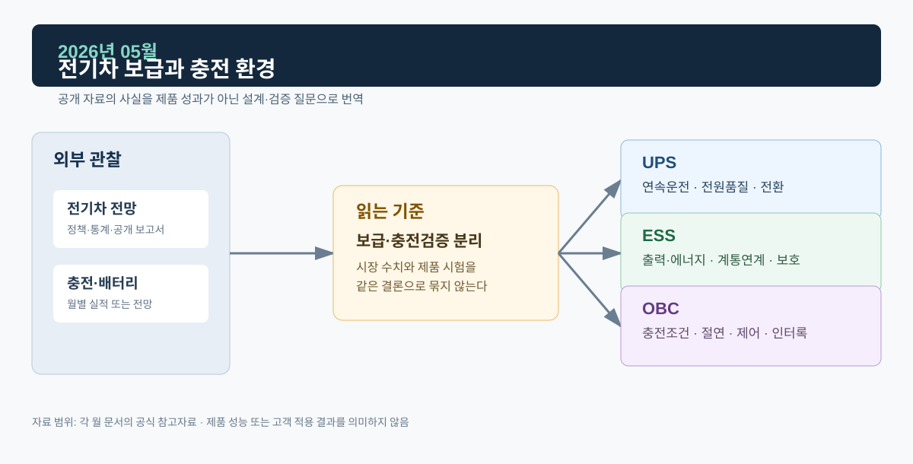
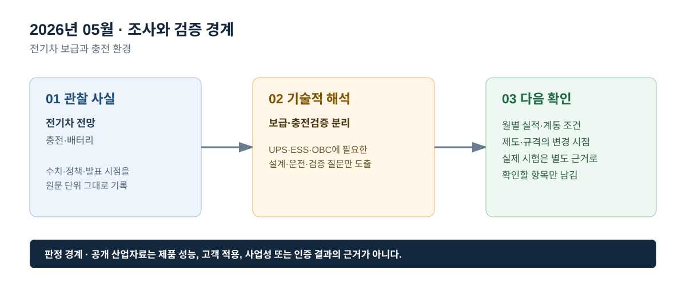

# 2026년 05월 · 전기차 보급과 충전 환경

## 이번 달에 잡은 질문

전기차 판매 전망은 OBC를 설명하는 배경일 수 있지만, 차량 내부 충전기의 사양·제어·보호를 보장하지는 않는다. 5월에는 전기차 보급, 배터리, 충전 인프라, 차량 전력변환을 하나의 숫자로 합치지 않고 각 지표가 가리키는 범위를 나눠 본다. ESS와 UPS에는 충전 부하가 계통에 미치는 시간·위치 조건을 읽는 보조 신호로만 연결한다.

## 그림으로 보는 이번 달

*그림 1. 공개 산업 신호를 UPS·ESS·OBC의 설계·검증 질문으로 연결한 도식이다. 제품 성능 또는 고객 적용 결과를 의미하지 않는다.*

*그림 2. 관찰 사실, 기술적 해석, 다음 확인 항목을 구분해 기록하는 기준이다.*

## 관찰 사실

IEA의 *Global EV Outlook 2026*은 세계 전기차 판매가 2026년에 2,300만 대, 전체 자동차 판매의 28%에 이를 것으로 전망한다. 보고서는 2026년 1분기 세계 전기차 판매가 약 390만 대였고 전년 동기보다 8% 낮았다고 설명하면서도, 지역별 증가율은 서로 달랐다고 제시한다. 따라서 세계 합계와 개별 시장의 흐름을 같은 방향으로 단정할 수 없다.[^ev]

같은 보고서는 전기차 가격, 충전 인프라, 배터리 수요, 정책 변화를 함께 다룬다. 이 자료의 전망치는 2026년 5월 시점의 전망이며, 실제 판매·차량 사양·충전기 설치 실적과 구분해야 한다. 차량 보급 전망 하나만으로 OBC의 출력, 효율, 절연 설계, 양산 물량을 추정하지 않는다.

## UPS · ESS · OBC로 나누어 본 해석

**OBC는 보급 지표와 전력변환 검증을 분리한다.** OBC는 AC 입력 조건에서 PFC를 통해 전류 파형과 DC Link를 관리하고, 절연형 DC/DC 단계에서 배터리 전압·전류를 제어한다. 이 과정에서 과전압·과전류·과온·인터록·통신 이상에 대한 정지·복귀 조건을 확인해야 한다. 전기차 판매 전망은 사용 환경의 신호일 뿐, 이 시험을 대신하지 않는다.

**ESS는 충전 부하의 시간 이동 가능성을 조건부로 본다.** 차량 충전이 전력수요에 영향을 줄 수 있지만 차량이 연결된 시간, 목표 SOC, 출발시각, 충전 인프라의 제어 기능, 요금·보상, 배전선로 여유가 함께 있어야 부하 이동을 논의할 수 있다. V2G는 양방향 전력변환·계통연계·통신·안전 조건을 더 요구하므로 일반 충전과 구분한다.

**UPS는 충전 인프라의 보조 전원과 차량 충전을 혼동하지 않는다.** 충전소의 통신·결제·제어 설비에 대한 전원 연속성은 중요할 수 있으나, 차량 OBC가 AC 전력을 배터리에 전달하는 기능과 같은 장치는 아니다. UPS 적용 여부와 필요한 백업시간은 실제 부하 분류와 운영 요구가 있어야 판단할 수 있다.

## 다음 달 확인 항목

1. 전기차 판매 전망, 충전기 설치 대수, 배터리 수요, 차량 사양의 단위와 시점을 구분한다.
2. OBC에서는 G2V·V2L·V2G를 운전 모드와 외부 계통 조건까지 포함해 구분한다.
3. 충전 부하의 계통 기여는 사용자 동의와 상위 제어 권한이 있는지 별도로 확인한다.

## 참고자료

[^ev]: [IEA, *Global EV Outlook 2026*, 2026-05-20](https://www.iea.org/reports/global-ev-outlook-2026)

> 기록 원칙: 판매·보급 전망은 공개 시장환경 자료이며, 특정 차량·OBC·충전 인프라의 성능 또는 생산 실적을 의미하지 않는다.
