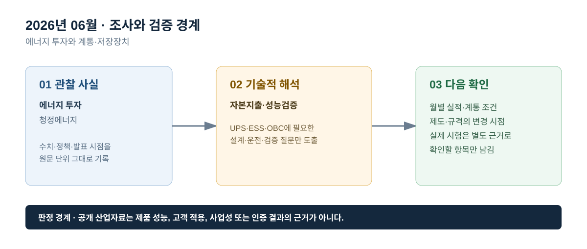

# 2026년 06월 · 에너지 투자와 계통·저장장치

## 이번 달에 잡은 질문

투자액이 늘어난다는 발표를 보면 전력망·저장장치·전동화가 모두 빠르게 확대될 것처럼 읽기 쉽다. 그러나 투자 통계는 자본지출 흐름을 정리한 것이며, 특정 PCS·배터리·UPS·OBC의 발주나 성능을 직접 말하는 데이터는 아니다. 6월에는 투자 규모가 뜻하는 범위와 실제 전력변환 설비의 검증 범위를 분리한다.

## 그림으로 보는 이번 달

*그림 1. 공개 산업 신호를 UPS·ESS·OBC의 설계·검증 질문으로 연결한 도식이다. 제품 성능 또는 고객 적용 결과를 의미하지 않는다.*

*그림 2. 관찰 사실, 기술적 해석, 다음 확인 항목을 구분해 기록하는 기준이다.*

## 관찰 사실

IEA의 *World Energy Investment 2026*은 2026년 세계 에너지 부문 투자액이 3조4,000억 달러로 2025년보다 5% 늘 것으로 전망하며, 청정에너지 투자는 2조2,000억 달러로 화석연료 투자의 약 두 배라고 제시한다. 이 수치는 전력망·재생에너지·저장장치·효율·전동화 등 넓은 투자 흐름을 다루므로, 개별 기술이나 국가의 설비 용량과는 구분해서 읽어야 한다.[^wei]

IEA의 방법론은 투자액을 자산에 대한 진행 중인 자본지출로 정의하고, 최종투자결정부터 가동까지 지출이 시간에 걸쳐 발생할 수 있음을 설명한다. 따라서 투자 발표 시점과 실제 설비 가동 시점, 그리고 설비가 규정된 성능을 달성한 시점은 서로 다를 수 있다.[^method]

## UPS · ESS · OBC로 나누어 본 해석

**ESS는 투자액보다 계통연계와 운전 성능을 먼저 확인한다.** 저장장치가 전력망 투자와 함께 언급되더라도, 실제 계통 기여는 접속 위치·용량, PCS 정격, 배터리 에너지, SOC, 변압기·보호 설정, 지령 추종과 복귀 조건이 정의됐을 때에만 평가할 수 있다. 투자 규모는 환경을 읽는 자료이고, Ramp Rate·Ride-Through·계통분리 검출과 같은 시험 판정은 별도다.

**UPS는 설비 투자 증가를 현장 요구조건으로 단정하지 않는다.** 산업·상업 설비 투자가 늘어도 모든 부하가 같은 정전 허용도를 갖는 것은 아니다. UPS 필요성은 부하 중요도, 전원구성, 정전 리스크, 요구 지속시간, 유지보수 전략으로 결정된다. 투자 지표만으로 특정 UPS 구성이나 병렬 모듈 수를 제안하지 않는다.

**OBC는 전동화 투자와 차량 제어 범위를 분리한다.** 전동화 투자는 충전 환경·배터리 공급망의 배경이지만, OBC의 전기적 설계는 차량 입력과 배터리 조건, 절연, 보호, 열, 통신을 기준으로 검증한다. 시장 투자 자료는 이 경계조건을 대신할 수 없다.

## 다음 달 확인 항목

1. 투자액, 최종투자결정, 공사 착수, 상업운전, 성능 검증의 시점을 구분한다.
2. ESS를 설명할 때 배터리 에너지와 PCS 출력, 계통 접속용량을 한 숫자로 축약하지 않는다.
3. 공개 투자자료에서 고객·회사·프로젝트 내부 정보로 추정될 수 있는 내용은 쓰지 않는다.

## 참고자료

[^wei]: [IEA, *World Energy Investment 2026*, 2026-05-28](https://www.iea.org/reports/world-energy-investment-2026)
[^method]: [IEA, *World Energy Investment 2026 — How we track investment in energy*](https://www.iea.org/reports/world-energy-investment-2026/how-we-track-investment-in-energy)

> 기록 원칙: 투자 통계는 산업의 자본 흐름을 설명하며, 개별 장치의 사업성·성능·납품 실적을 증명하지 않는다.
