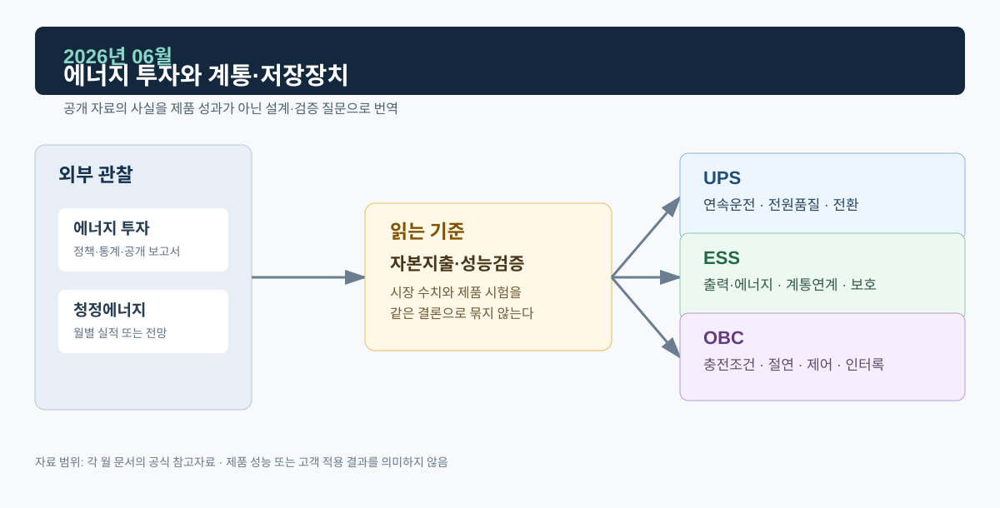

# 2026년 06월 · 에너지 투자와 계통·저장장치

6월에는 IEA *World Energy Investment 2026*과 투자 집계 방법론 페이지를 읽었다. 투자액은 자본지출 흐름을 정리한 숫자라서, 전력망·저장장치 설비가 실제로 가동되고 성능을 내는 시점과 어떻게 이어지는지 따로 정리했다.

*그림. 에너지 투자·청정에너지와 UPS·ESS·OBC*

## 자료

IEA의 *World Energy Investment 2026*은 2026년 세계 에너지 부문 투자액이 3조4,000억 달러로 2025년보다 5% 늘 것으로 전망하며, 청정에너지 투자는 2조2,000억 달러로 화석연료 투자의 약 두 배라고 제시한다. 전력망·재생에너지·저장장치·효율·전동화 등 넓은 투자 흐름을 묶은 수치다.[^wei]

IEA의 방법론은 투자액을 자산에 대한 진행 중인 자본지출로 정의하고, 최종투자결정부터 가동까지 지출이 시간에 걸쳐 발생할 수 있음을 설명한다. 투자 발표 시점, 실제 설비 가동 시점, 설비가 규정된 성능을 달성한 시점은 서로 다를 수 있다.[^method]

## ESS · UPS · OBC

ESS의 실제 계통 기여는 접속 위치·용량, PCS 정격, 배터리 에너지, SOC, 변압기·보호 설정, 지령 추종과 복귀 조건이 정해졌을 때 평가할 수 있다. Ramp Rate·Ride-Through·계통분리 검출 같은 시험 판정은 투자 규모와 별개로 진행한다.

UPS 필요성은 부하 중요도, 전원구성, 정전 리스크, 요구 지속시간, 유지보수 전략으로 정해진다. 산업·상업 설비 투자가 늘어도 부하마다 정전 허용도가 다르다.

전동화 투자는 충전 환경과 배터리 공급망의 배경이다. OBC의 전기적 설계는 차량 입력과 배터리 조건, 절연, 보호, 열, 통신을 기준으로 검증한다.

## 다음 달에 볼 것

1. 저장장치 투자에서 최종투자결정·공사 착수·상업운전 단계가 공개된 사례
2. 7월 IEA 전력 중간 업데이트의 수요·재생에너지 전망

## 참고자료

[^wei]: [IEA, *World Energy Investment 2026*, 2026-05-28](https://www.iea.org/reports/world-energy-investment-2026)
[^method]: [IEA, *World Energy Investment 2026 — How we track investment in energy*](https://www.iea.org/reports/world-energy-investment-2026/how-we-track-investment-in-energy)
