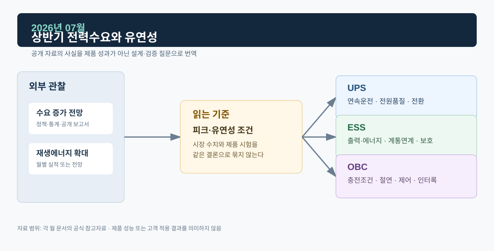
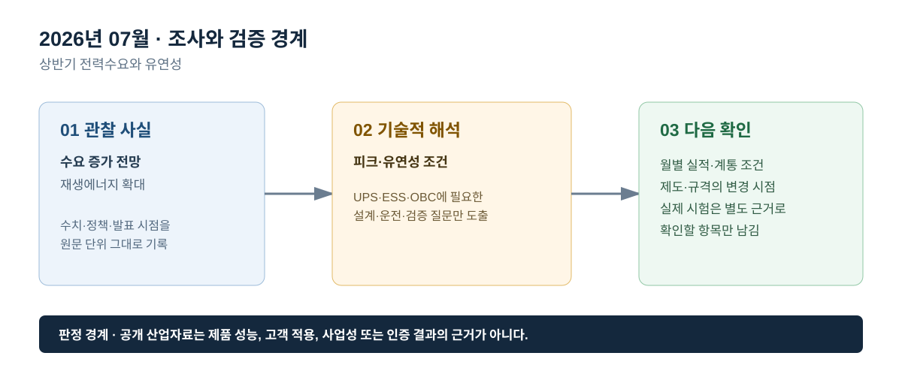

# 2026년 07월 · 상반기 전력수요와 유연성

## 이번 달에 잡은 질문

상반기 자료는 하계 피크의 확정 결과가 아니라, 수요·공급·가격 전망을 다시 보정하는 중간 점검 자료다. 7월에는 전력수요 증가 전망, 재생에너지 확대, 연료가격 변동이 동시에 나타날 때 UPS·ESS·OBC에서 무엇을 확인해야 하는지 정리한다. 전망 수치는 실제 계통 사건 또는 제품 시험 결과와 같은 문장에 두지 않는다.

## 그림으로 보는 이번 달

*그림 1. 공개 산업 신호를 UPS·ESS·OBC의 설계·검증 질문으로 연결한 도식이다. 제품 성능 또는 고객 적용 결과를 의미하지 않는다.*

*그림 2. 관찰 사실, 기술적 해석, 다음 확인 항목을 구분해 기록하는 기준이다.*

## 관찰 사실

IEA의 *Electricity Mid-Year Update 2026*은 세계 전력수요가 2026년에 3.6%, 2027년에 3.8% 증가할 것으로 전망한다. 보고서는 산업 성장, 전기차·냉방·히트펌프 확대, 데이터센터 용량 증가를 구조적 요인으로 들며, 해당 수치는 예측값임을 명시한다.[^midyear]

같은 보고서는 2026년 재생에너지 발전량이 8% 이상 늘어 석탄 발전량을 앞지를 것으로 전망하고, 전력망 확충·유연성·입지별 가격신호·기존 인프라의 효율적 활용이 변동형 재생에너지 통합에 중요하다고 설명한다. 이는 세계 전력계통에 관한 전망이며, 국내 특정 월 또는 특정 ESS의 출력 결과를 제시한 자료는 아니다.[^midyear]

## UPS · ESS · OBC로 나누어 본 해석

**UPS는 상반기 수요 전망을 전원품질 확인으로 번역한다.** 냉방과 대형 부하 증가가 예상되는 환경에서는 중요부하의 입력 상태와 부하 변동 조건을 점검할 이유가 생긴다. 그러나 수요 증가율로 백업시간을 계산할 수는 없다. 실제 설계에서는 부하 전력, 방전 시간, 배터리 노화·온도, 인버터 효율, 전환·바이패스 시퀀스를 확인한다.

**ESS는 피크 대응의 기술 조건을 드러낸다.** 변동형 재생에너지가 커질수록 충·방전 타이밍, SOC 확보, 출력 변화율, 유효·무효전력 제어, 전압·주파수 이상 시 동작이 중요해진다. ‘유연성’은 배터리와 PCS가 있는지로 끝나는 말이 아니라, 접속된 계통·보호·운영 지령이 함께 정의된 경우에만 평가 가능한 운영 특성이다.

**OBC는 충전 부하의 시간성과 차량 안전을 같이 본다.** 전기차 보급이 전력수요의 구조적 요인이라는 전망은 충전 시간·위치 관리의 필요성을 보여준다. 하지만 차량 내부 OBC는 우선 AC 입력과 배터리 상태에서 정류·절연·전류제어·인터록을 안전하게 수행해야 한다. 수요관리 참여는 그 위에 사용자·충전기·통신·계통 조건이 갖춰졌을 때 별도로 논의한다.

## 다음 달 확인 항목

1. 전망치와 사후 실적, 전 세계 자료와 국내 자료의 범위를 문서에서 분리한다.
2. 하계 피크를 볼 때 최대수요·기온·공급예비력·계통 사건·가격의 단위를 섞지 않는다.
3. ESS와 OBC의 유연성 논의에는 제어권한·통신·보호조건을 포함한다.

## 참고자료

[^midyear]: [IEA, *Electricity Mid-Year Update 2026 — Executive summary*, 2026-07](https://www.iea.org/reports/electricity-mid-year-update-2026/executive-summary)

> 기록 원칙: 본문에 적은 수요·발전량 변화는 IEA의 전망이며, 실제 운전 실적 또는 제품 시험 성적이 아니다.
