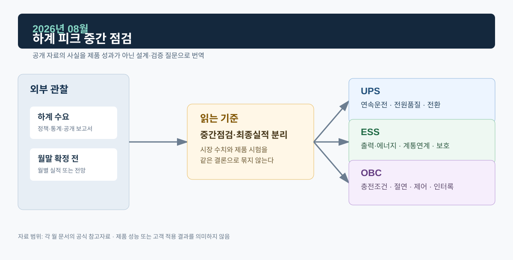
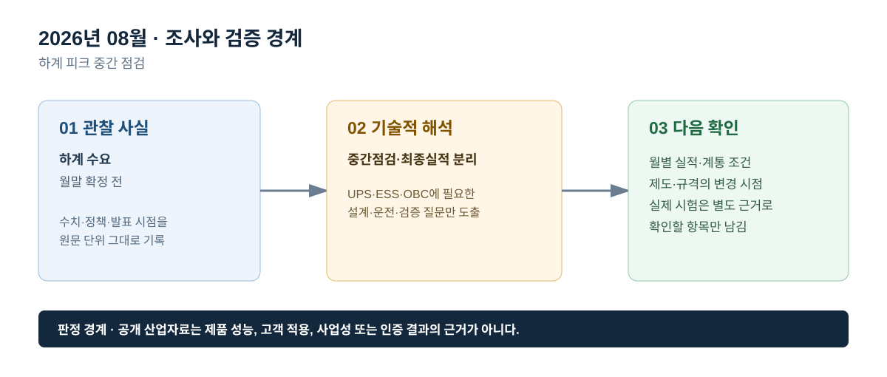

# 2026년 08월 · 하계 피크 중간점검

## 이번 달에 잡은 질문

8월 기록은 월말 이전에 작성한 중간 점검이다. 따라서 이 문서는 8월 전력시장 실적이나 하계 피크의 최종 결과를 선언하지 않는다. 이미 공표된 7월까지의 공개 자료와 상반기 전력 전망을 바탕으로, 하계에 확인해야 할 부하·전원품질·유연성 조건을 정리하고 8월 실적이 공표된 뒤 검증할 항목을 남긴다.

## 그림으로 보는 이번 달

*그림 1. 공개 산업 신호를 UPS·ESS·OBC의 설계·검증 질문으로 연결한 도식이다. 제품 성능 또는 고객 적용 결과를 의미하지 않는다.*

*그림 2. 관찰 사실, 기술적 해석, 다음 확인 항목을 구분해 기록하는 기준이다.*

## 관찰 사실

전력거래소 공개 목록에는 2026년 7월 전력시장 운영실적(속보)이 2026년 8월 25일 게시돼 있다. 이는 7월의 실적을 사후에 공표한 자료이며, 8월 실적의 확정 또는 잠정 결과를 의미하지 않는다. 전력거래소는 운영실적 속보가 최종정산 자료 일부가 반영되지 않은 잠정치임을 계속 명시한다.[^kpx]

IEA의 7월 중간 업데이트는 2026년 세계 전력수요 증가 전망과 재생에너지 확대 전망을 제시하면서, 일부 시장에서 연료가격 변동과 시간대별 가격차가 유연성 자원의 가치를 드러낼 수 있다고 설명한다. 이 역시 국내 8월 피크의 결과가 아니라 전력계통에서 피크·유연성·가격을 어떤 맥락으로 읽을지 보여 주는 국제 자료다.[^midyear]

## UPS · ESS · OBC로 나누어 본 해석

**UPS는 하계 피크를 ‘무정전 시간’이라는 단일 숫자로 줄이지 않는다.** 실제 중요부하의 백업시간은 IT·산업·냉각·통신·제어 부하와 배터리 상태, 온도, 설계 여유가 함께 결정한다. 점검은 계통 이상 또는 부하 과도 때 출력 연속성이 유지되는지, 병렬 모듈과 바이패스 전환에서 부하가 끊기지 않는지 같은 사건 중심의 항목으로 이뤄져야 한다.

**ESS는 피크 대응에서 지속시간과 보호협조를 함께 쓴다.** PCS 출력(MW)이 같아도 배터리 에너지(MWh), 허용 SOC, 배터리 온도, 접속점 제약이 다르면 가능한 방전 시간과 지령 추종 범위가 달라진다. 하계 피크 대응을 말할 때에는 충전 가능 시간, 방전 지령, 전압·주파수 이상 시 상태전이, 계통 분리 검출·복귀, 변압기·배전선로 한계를 함께 확인한다.

**OBC는 충전 시간 이동의 전제조건을 명확히 한다.** 고온·피크 시간대의 충전 부하는 차량의 연결 시간, 목표 SOC, 출발 시각, 충전 인프라의 제어 기능, 사용자 동의, 요금 체계와 배전망 여유에 따라 달라진다. OBC는 차량 내부에서 안전한 전력변환을 수행하는 장치이며, 수요반응이나 V2G 참여는 별도의 통신·계통접속·운영 조건이 갖춰졌을 때만 검토한다.

## 다음 달 확인 항목

1. 8월 실적이 공표된 뒤 7월 속보와 거래량·가격·정산 항목을 같은 기준으로 비교한다.
2. 기온·최대수요·공급예비력·계통 사건·시장가격을 한 지표로 합산하지 않는다.
3. 공개 시장자료로 확인할 수 없는 UPS 백업시간, ESS 운전지령, OBC 차량 시험결과는 추정하지 않는다.

## 참고자료

[^kpx]: [전력거래소 전력시장 운영실적 공개 목록](https://kpx.or.kr/board.es?bid=0086&mid=a10102000000)
[^midyear]: [IEA, *Electricity Mid-Year Update 2026 — Executive summary*](https://www.iea.org/reports/electricity-mid-year-update-2026/executive-summary)

> 기록 기준일: 2026-08-27. 8월 운영실적은 월말 및 사후 공표 전이므로 이 문서에 확정 수치를 넣지 않는다.
