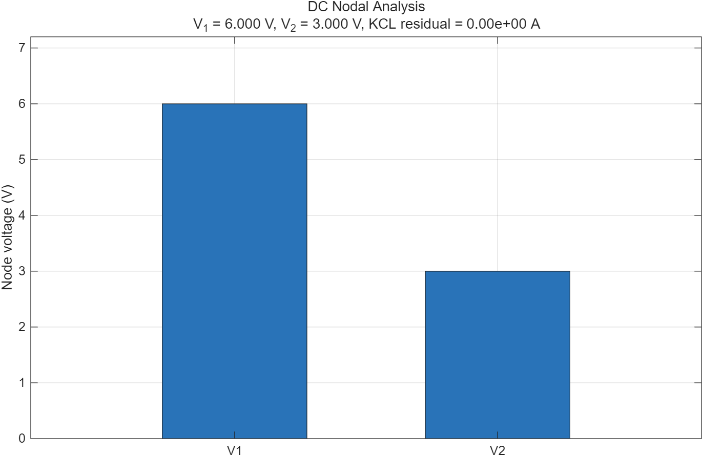
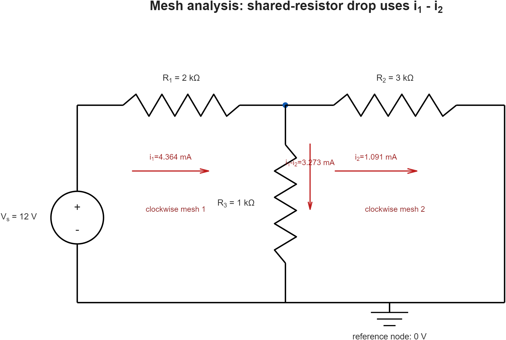
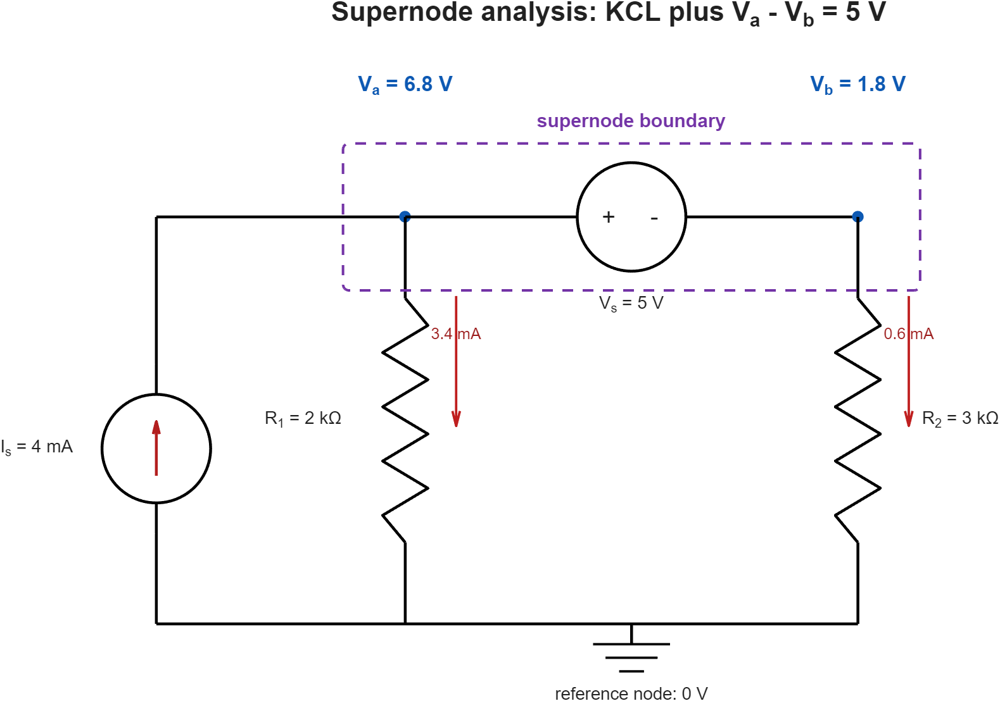

# 직류회로 해석

회로도에 **기준 노드·미지수·전류 방향을 먼저 정한 뒤** KCL 또는 KVL을 식으로
옮긴다. 노달·메시·슈퍼노드 예제 세 개를 각각 회로도 바로 아래에서 풀었다.

## 해석 공통 절차

1. 주어진 회로에서 **노드와 소자 연결**부터 읽는다.
2. 기준 노드 0 V, 전압 극성, 전류 기준방향을 회로도에 표시한다.
3. 미지수를 정하고 각 가지 전류를 미지수로 쓴다.
4. 수치를 넣기 전에 KCL 또는 KVL 원형식을 먼저 쓴다.
5. 단위를 Ω·A 또는 kΩ·mA 중 하나로 맞춰 행렬을 푼다.
6. 잔차, 전력수지 또는 다른 가지식으로 검산한다.

## 1. 노달해석 — 회로에서 KCL 행렬 만들기

아래 회로는 12 V 노드에서 $R_1$을 거쳐 $V_1$으로 들어오고, $V_1$과
$V_2$가 $R_3$으로 연결된 2노드 저항회로다. 파란 점이 미지 노드이고
아래 도선 전체가 기준 노드 0 V다.



### 1.1 가지전류를 노드전압으로 표현

회로도에 표시된 방향을 양(+)으로 잡으면

$$
i_{R1}=\frac{12-V_1}{R_1},\qquad
i_{R2}=\frac{V_1}{R_2},\qquad
i_{R3}=\frac{V_1-V_2}{R_3},\qquad
i_{R4}=\frac{V_2}{R_4}
$$

이다. $V_1$에서는 $i_{R1}$이 들어오고 $i_{R2}$와 $i_{R3}$이 나가므로

$$
\frac{V_1-12}{1}+\frac{V_1}{2}+\frac{V_1-V_2}{1}=0
$$

$V_2$에서는 $i_{R3}$이 들어오고 $i_{R4}$가 나가므로

$$
\frac{V_2-V_1}{1}+\frac{V_2}{1}=0
$$

이다. 저항은 kΩ, 전류는 mA로 썼으므로 전압은 V로 바로 나온다.

### 1.2 행렬과 해

두 KCL 식을 정리하면

$$
\begin{bmatrix}
2.5&-1\\
-1&2
\end{bmatrix}
\begin{bmatrix}V_1\\V_2\end{bmatrix}
=
\begin{bmatrix}12\\0\end{bmatrix}
$$

이고 해는

$$
V_1=6\,\text{V},\qquad V_2=3\,\text{V}
$$

이다. 가지전류는

$$
i_{R1}=6\,\text{mA},\quad
i_{R2}=3\,\text{mA},\quad
i_{R3}=3\,\text{mA},\quad
i_{R4}=3\,\text{mA}
$$

이고, 두 노드 모두 유입전류와 유출전류가 같다.

### 1.3 전력수지로 다시 검산

전원 공급전력은 $12\times6=72$ mW다. 저항 소비전력은

$$
P_{R1}=36,\quad P_{R2}=18,\quad P_{R3}=9,\quad P_{R4}=9\ \text{mW}
$$

이고 합이 72 mW라서 전력수지도 맞는다.

## 2. 메시해석 — 공유저항의 전류부터 정하기

아래 평면회로에서 두 메시전류 $i_1$, $i_2$를 모두 시계방향으로 잡는다.
가운데 공유저항 $R_3$에는 두 메시전류가 반대 방향으로 지나므로, 위에서 아래로
흐르는 실제 가지전류는 $i_1-i_2$다.



### 2.1 메시별 KVL

왼쪽 메시를 시계방향으로 돌면

$$
-12+2i_1+1(i_1-i_2)=0
$$

오른쪽 메시를 시계방향으로 돌면

$$
3i_2+1(i_2-i_1)=0
$$

이다. kΩ·mA 단위로 정리하면

$$
\begin{bmatrix}
3&-1\\
-1&4
\end{bmatrix}
\begin{bmatrix}i_1\\i_2\end{bmatrix}
=
\begin{bmatrix}12\\0\end{bmatrix}
$$

이고

$$
i_1=4.364\,\text{mA},\qquad
i_2=1.091\,\text{mA}
$$

를 얻는다. 공유저항 전류는

$$
i_{R3}=i_1-i_2=3.273\,\text{mA}
$$

이다. 왼쪽 루프의 전압강하
$2(4.364)+1(3.273)=12.001$ V와 오른쪽 루프의
$3(1.091)=1(3.273)=3.273$ V가 반올림 오차 안에서 KVL을 만족한다.

## 3. 슈퍼노드 — 전압원 내부전류 대신 구속식 사용

두 비기준 노드 $V_a$, $V_b$ 사이에 이상 전압원이 있으면 전압원 전류를
옴의 법칙으로 쓸 수 없다. 점선 경계를 슈퍼노드 하나로 묶어 바깥으로
나가는 전류에 KCL을 쓰고, 전압원 극성으로 구속식을 하나 더한다.



4 mA 전류원이 슈퍼노드로 전류를 주입하므로

$$
\frac{V_a}{2}+\frac{V_b}{3}=4
$$

이고, 5 V 전압원의 왼쪽이 `+`이므로

$$
V_a-V_b=5
$$

이다. 두 식을 연립하면

$$
V_a=6.8\,\text{V},\qquad V_b=1.8\,\text{V}
$$

가 된다. 접지로 흐르는 전류는 각각 3.4 mA와 0.6 mA로, 합이 전류원
4 mA와 같다.

## 4. 어떤 해석법을 선택할까

| 회로 특징 | 먼저 선택할 방법 | 이유 |
|---|---|---|
| 비기준 노드가 적고 전류원이 많음 | 노달해석 | KCL 식 수가 적음 |
| 평면회로이고 메시가 적으며 전압원이 많음 | 메시해석 | KVL 식 수가 적음 |
| 두 비기준 노드 사이에 이상 전압원이 있음 | 슈퍼노드 | 전압원 전류 대신 전압 구속식 사용 |
| 두 메시 사이에 이상 전류원이 있음 | 슈퍼메시 | 전류원 전압 대신 전류 구속식 사용 |

어느 방법으로도 풀리지만, 미지수와 방정식이 적은 쪽을 고르면 부호 실수가
줄어든다.

## 5. MATLAB 검증과 재생성

- [노달해석 코드](./examples/dc_nodal_analysis.m)
- [메시해석 코드](./examples/dc_mesh_analysis.m)
- [슈퍼노드 코드](./examples/dc_supernode_analysis.m)
- [직류회로 3예제 실행기](./examples/run_dc_analysis_examples.m)
- [회로도 렌더러](./examples/render_dc_circuit.m)
- [수치·캡처 회귀시험](./examples/test_dc_analysis_examples.m)

세 회로도는 해석 코드가 쓴 저항값·소스값·계산 결과를 받아 MATLAB이 직접
그린다. 회귀시험은 노드전압, 메시전류, 구속식 잔차와 PNG 해상도를 검사한다.

```matlab
cd('studies/전공학습/01_전기전자_핵심기초/01_회로이론/02_직류회로_해석/examples')
run_dc_analysis_examples
results = runtests('test_dc_analysis_examples.m');
assertSuccess(results)
```

## 6. 자주 틀리는 지점

- 직렬·병렬 관계를 회로도의 노드 연결로 확인하지 않고 짐작한다.
- 기준 노드나 전류 화살표 방향을 계산 도중에 바꾼다.
- 노달해석에서 한 가지 전류를 양쪽 노드 KCL에 같은 부호로 넣는다. 반대 부호여야 한다.
- 메시해석에서 공유저항 전류를 메시전류 하나로 쓴다. 두 메시전류의 차다.
- 슈퍼노드 안 전압원 전류를 0으로 두고 전압 구속식을 빠뜨린다.
- `inv(A)*b`로 풀고 잔차를 계산하지 않는다. `A\b`로 풀고 잔차를 본다.

## 메모

노달 예제는 $V_1=6$ V, $V_2=3$ V로 두 노드의 KCL과 전력수지(72 mW)가 맞았다. 메시 예제는
$i_1=4.364$ mA, $i_2=1.091$ mA, 공유저항 3.273 mA로 두 루프 KVL이 반올림 오차 안에서 맞았다.
지금은 노달과 메시 예제가 서로 다른 회로라서, 같은 평면회로 하나를 두 방법으로 풀어 공통 가지전류와 잔차를 비교해 볼 것.

## 참고자료

- [MIT OCW 6.002 — Video Lectures](https://ocw.mit.edu/courses/6-002-circuits-and-electronics-spring-2007/video_galleries/video-lectures/) — Basic Circuit Analysis Method
- [OpenStax — Kirchhoff's Rules](https://openstax.org/books/university-physics-volume-2/pages/10-3-kirchhoffs-rules) — 다중 루프와 노드 해석
- [MathWorks — Systems of Linear Equations](https://www.mathworks.com/help/matlab/math/systems-of-linear-equations.html) — `A\b` 선형계 풀이
