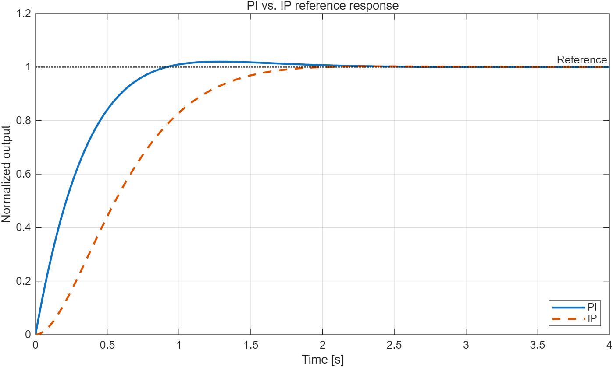

# PI·IP 지령 응답 비교

같은 1차 플랜트와 같은 gain에 PI와 IP를 적용해 지령 step 응답만 비교한 MATLAB
예제다. 실제 적용에서 IP를 검토한 이유는 지령이 바뀔 때 비례항이 한 번에 튀는
현상이었다. 여기서는 그 차이만 가장 단순한 조건에서 본다. 폴더 이름에는 PID가
들어가 있지만 PID는 아직 비교하지 않았다.

## 조건

- 플랜트: $P(s)=\dfrac{1}{0.5s+1}$
- gain: $K_p=1.5$, $K_i=4.0$ (두 구조 동일)
- 폐루프:

$$
T_{PI}(s)=\frac{3s+8}{s^2+5s+8}, \qquad
T_{IP}(s)=\frac{8}{s^2+5s+8}
$$

분모가 같으므로 극점($\omega_n\approx2.83$ rad/s, $\zeta\approx0.88$)도 같다. 차이는
PI 분자의 영점 $s=-8/3$ 하나다.

## 결과

- 코드: [`../../examples/pi_ip_first_order_demo.m`](../../examples/pi_ip_first_order_demo.m)
  (Control System Toolbox 필요, 실행하면 아래 PNG를 다시 만든다)

| 구조 | 상승시간(10–90 %) | 오버슈트 |
|---|---:|---:|
| PI | 약 0.56 s | 약 2.03 % |
| IP | 약 0.99 s | 약 0.26 % |

IP 쪽 오버슈트는 표준 2차계 식 $100\,e^{-\pi\zeta/\sqrt{1-\zeta^2}}$에
$\zeta\approx0.88$을 넣은 값과 같다. PI는 영점 때문에 더 빨리 올라가고 조금 넘친다.

## 다음에 볼 것

- 출력 제한과 anti-windup을 넣었을 때 두 구조의 회복 시간 차이
- 샘플링 지연과 PWM 지연을 넣은 이산 모델에서 같은 비교
- 같은 조건에 D항(필터 포함)을 추가한 PID 비교

## 참고

- https://blog.naver.com/lagrange0115/221157947738
- https://embeddedchallenge.tistory.com/491
- https://setoo0922.tistory.com/259
