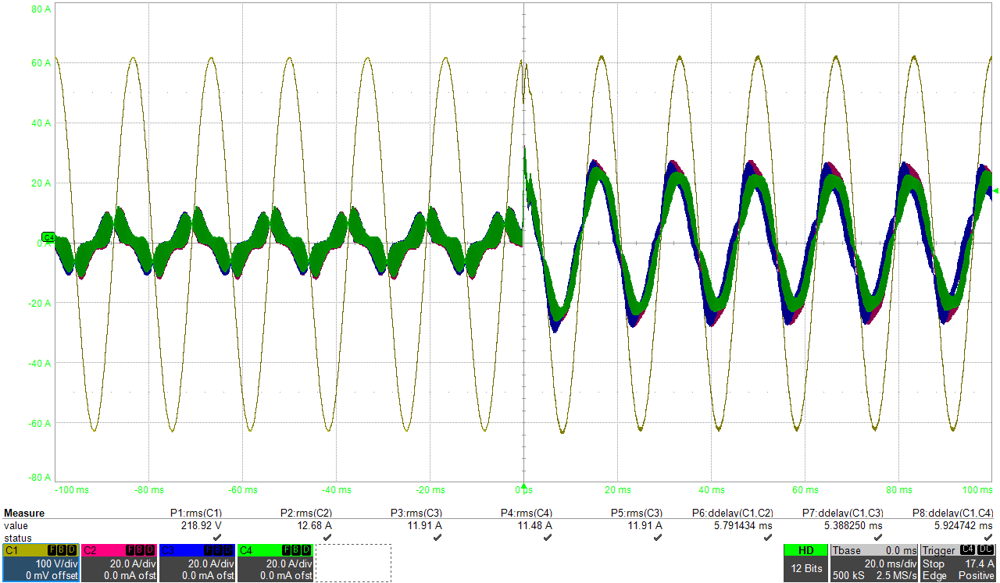

# 3레벨 UPS 출력전압 제어와 부하전류 보상

> 공개용 기록입니다. 회로 정수, 제품별 gain, 원본 시험 파일은 제외했습니다.

## 시작점

3레벨 UPS 인버터의 출력전압 제어를 볼 때, 저항 부하에서 전압이 잘 나오는 것만으로
제어기를 판단하기 어려웠다. 정류기 부하나 한 상에만 부하가 걸리는 조건에서는 같은
PI gain이라도 전압 처짐과 회복이 달라졌다. 처음에는 전압루프 gain을 조정하는 쪽으로
접근했지만, 피드백에 쓰는 전류와 출력 임피던스를 먼저 봐야 한다는 결론에 도달했다.

## 비교한 구조

기본은 전압 외부루프와 전류 내부루프다. 전압루프가 전류 지령을 만들고, 전류루프가
PWM 지령을 계산한다. 차이는 내부루프에 어떤 전류를 넣느냐였다.

| 방식 | 피드백 신호 | 확인한 점 |
|---|---|---|
| 인덕터 전류 피드백 | 필터 인덕터 전류 | 구조가 단순하지만 부하 변화가 전압루프에 직접 부담으로 들어옴 |
| 커패시터 전류 피드백 | 출력 필터 커패시터 전류 | 출력 임피던스 관점에서 과도·비선형 부하에 더 유리한 특성을 보임 |

선형 부하의 정상상태에서는 차이가 크지 않았지만, 부하가 갑자기 변하거나 한 상에만
부하가 걸리면 차이가 분명해졌다. 부하전류를 전향 보상으로 넣어 전압루프가 변화를
뒤늦게 쫓아가는 부분을 줄였다.

```text
전압 지령 - 출력전압 → 전압 제어기 → 인덕터 전류 지령
부하전류 측정 ───────────────────────→ 전향 보상
인덕터 전류 지령 - 피드백 전류 → 전류 제어기 → PWM
```

## 시험에서 확인한 순서

1. 선형 부하에서 전압·전류 루프가 기본적으로 안정한지 확인했다.
2. 단상 불평형 부하와 비선형 부하에서 각 상의 전압 변형을 비교했다.
3. 부하를 단계적으로 바꾸면서 전압 피크와 회복 시간을 봤다.
4. 인덕터 전류 피드백 단독 구조와 부하전류 전향 보상 구조를 같은 조건에서 비교했다.



*공개 처리한 부하 투입 파형. 0 ms 부근의 부하 변화 뒤에 출력전압과 분담 전류가
새 정상상태로 수렴하는지를 확인했다.*

전압 제어기의 대역폭을 올리는 것만으로는 충분하지 않았다. 피드백 전류의 위치,
전압·전류 루프의 대역폭 분리, PWM과 센서 지연을 같이 검토해야 했다. 부하전류 보상은
효과가 있었지만, 측정 노이즈를 그대로 넣으면 PWM 지령이 거칠어질 수 있어 보상 신호의
부호·스케일과 필터 지연도 따로 확인했다.

## 남긴 판단 기준

전압 제어가 흔들릴 때는 gain부터 바꾸지 않고 출력 임피던스와 피드백 경로를 먼저
확인한다. 같은 PI 구조라도 어떤 전류를 되먹임하는지에 따라 부하 외란에 대한 결과가
달라진다는 점을 이 시험에서 확인했다.
