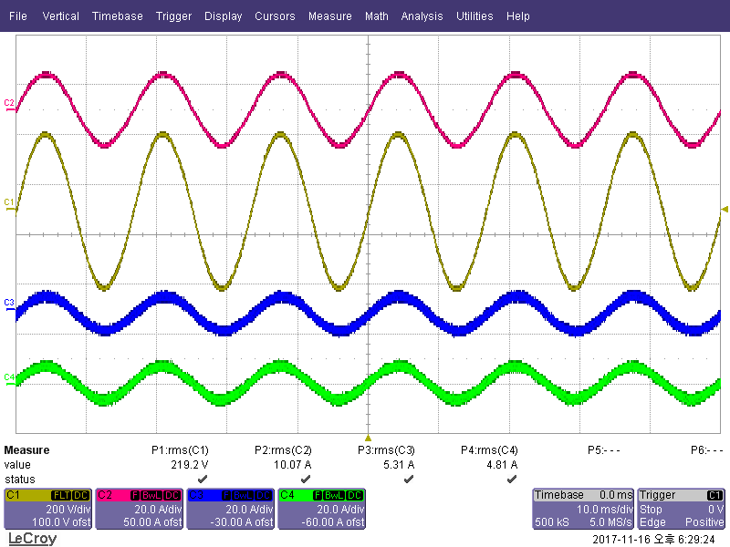
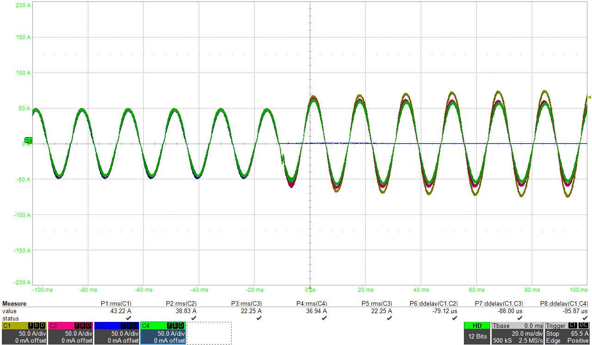

# UPS 병렬운전과 순환전류 억제

> 공개용 기록입니다. 통신 프레임, 제어 파라미터, 원본 시험 파일은 제외했습니다.

## 왜 병렬운전 제어가 따로 필요했나

UPS를 여러 대 묶으면 용량을 늘리고 운전 중 한 대를 분리·투입할 수 있다. 대신 각
인버터의 전압 지령, PWM carrier, 계측 오차가 조금만 달라도 순환전류가 생긴다. 이
문제는 출력전압만 보면 잘 보이지 않아, 모듈별 인덕터 전류와 전류 분담 오차를 먼저
봤다.

## 적용한 제어 방식

각 모듈에는 같은 전압-전류 이중루프를 두고, 모듈 사이 전류 분담을 위한 보상 경로를
추가했다. 검토한 방식은 평균전류분담(ALS)과 Circular Chain Control(3C)이었다.

| 항목 | ALS | 3C |
|---|---|---|
| 전류 분담 기준 | 각 모듈 전류의 평균값 | 인접 모듈 전류를 연결한 환형 구조 |
| 장점 | 전류 분담 기준이 직관적 | 별도 master/slave 의존성을 낮출 수 있음 |
| 설계 시 확인점 | 모듈 수, 평균값 전달 지연 | 연결 순서, 통신 지연, 한 모듈 이탈 시 동작 |

전류 분담 보상만으로 문제를 끝낼 수는 없었다. PWM carrier 시간 오차는 고주파
순환전류로, 전압 지령의 위상 오차는 저주파 순환전류로 이어졌다. 제어기 gain과
별도로 PWM과 위상 동기 상태를 관리한 이유다.

## 파형으로 확인한 것

*공개 처리한 정상상태 캡처. 출력전압, 전체 전류, 두 분담 전류의 RMS 값을 함께
확인해 전류가 한 모듈로 쏠리지 않는지 봤다.*

*공개 처리한 hot-swap 캡처. 한 전류 채널이 사라지거나 추가될 때 나머지 채널이
부하를 이어받고 새로운 정상상태로 수렴하는지를 확인했다.*

시험은 평형·비선형·불평형 부하, 부하 급변, 정전 전환, hot-swap/hot-plug 순서로
진행했다. 4대 병렬 조건에서는 정상상태 RMS 분담 오차와 과도 중 최대 편차를
나누어 기록했다. 통신이 끊기는 경우의 fallback과 모듈 이탈 시 전류 지령 재분배도
같은 시나리오에서 확인했다.

## 정리

병렬운전은 제어기 한 대를 튜닝하는 일보다 여러 제어기가 같은 시간축과 전압 기준을
공유하도록 만드는 일에 가까웠다. 이후에는 전류 분담 알고리즘만 보지 않고 PWM 동기,
통신 지연, 모듈 투입·이탈 순서를 먼저 확인한다.
