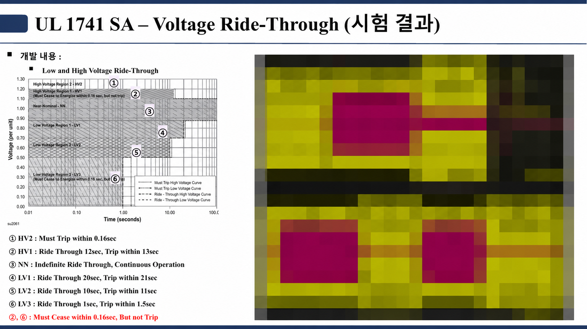

# ESS HILS 기반 계통연계 기능 검증

## HILS에서 먼저 본 이유

UL 1741 SA 항목(Ride-Through, Ramp Rate, Anti-Islanding 등)은 전압 급변, 주파수 변화,
정전·재연계, 보호 동작이 겹치는 조건을 요구한다. 이걸 실제 전력 장비에서 처음
돌리면 문제가 생겼을 때 원인 분리가 어렵다. 그래서 제어 보드를 HILS에 물려 계통·
배터리·부하 조건을 바꿔 가며 시퀀스와 제어 알고리즘을 먼저 확인했다.

## 구성과 확인 범위

HILS 모델에는 전력변환기와 계통 조건을 넣고, 제어 보드는 실제 I/O와 PWM 신호로
연결했다. 기능 검증 단계에서는 모델 정밀도보다 센서 스케일, I/O 지연, 보호 입력
우선순위, 모드 전환 순서가 실제 제어기와 맞는지를 먼저 봤다.

| 검증 항목 | 주로 확인한 내용 |
|---|---|
| Volt-Var / Volt-Watt | 전압 구간별 무효·유효전력 지령과 deadband, slope 동작 |
| Frequency-Watt / ramp-rate | 주파수 변화 시 출력 제한과 지령 변화율 |
| LVRT / HVRT | 이상 전압 구간에서 운전 지속, 전류 제한, 복귀 조건 |
| Anti-islanding | 단독운전 판단과 보호 동작 순서 |
| 정전·재연계 | 모드 전환, 동기 확인, 출력 투입 조건 |

## 경계 조건을 확인한 방법

각 기능은 경계값 한 점만 넣지 않았다. 시작점·종료점·중간값과 상승·하강 방향을
나누어 시험했다. Volt-Watt처럼 곡선으로 정의되는 기능은 지령이 맞는지뿐 아니라
전류 제한에 먼저 걸릴 때 결과도 별도로 확인했다. 저전압에서 정격 유효전력을
요구하면 전류 제한 때문에 기대값과 실제 출력이 달라질 수 있기 때문이다.

*전압 Ride-Through 결과 슬라이드. 왼쪽은 시험 영역(HV2 0.16 s 이내 trip, HV1 12 s
유지, LV1 20 s, LV2 10 s, LV3 1 s 유지 등), 오른쪽은 계측 파형(모자이크 처리).*

기능별 시험을 통과한 뒤에는 보호 동작과 운전 모드가 겹치는 조합을 확인했다. 예를
들어 계통 이상 중 충·방전 지령이 바뀌거나, 재연계 대기 중 지령이 들어오는 경우처럼
단일 기능 시험에서 놓치기 쉬운 순서를 HILS에서 반복했다.

## 시험 기록 원칙

- 초기 모드, 계통 조건, 지령값, 보호 설정 상태를 한 세트로 남겼다.
- 기대 지령과 실제 유효·무효전력 응답을 나누어 기록했다.
- 전류 제한 또는 보호 때문에 결과가 달라진 경우 원인을 별도 표기했다.
- 로직을 수정하면 같은 시나리오를 다시 실행해 변경 전후를 비교했다.

곡선 하나하나보다 모드 전환·전류 제한·보호가 겹치는 경계 조건 쪽을 더 꼼꼼히
봤다.

> 인증 setting 세부값, 고객 요구사항, 원본 시험 데이터는 싣지 않았다.
